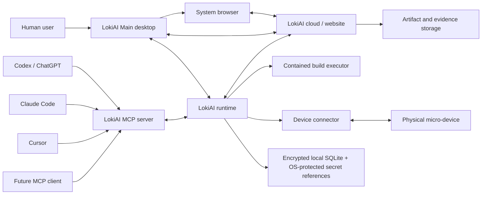
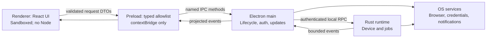
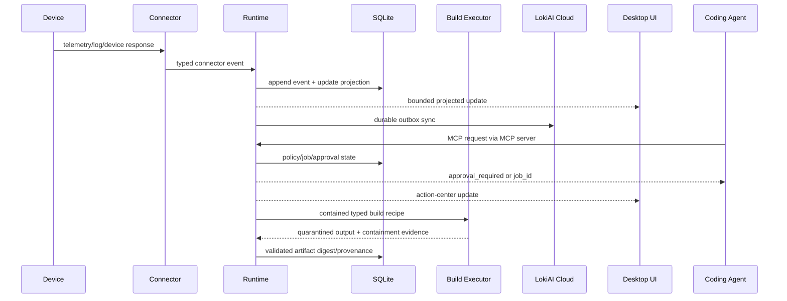

# Architecture — LokiAI Main v1.2

Status: **Proposed baseline; locked after human acceptance**  
Updated: **2026-08-15**

## 1. Architectural outcome

LokiAI uses a split-process architecture. Electron provides the desktop
experience, a Rust runtime owns hardware and durable execution, a local MCP server
adapts coding clients to LokiAI contracts, and the existing LokiAI cloud remains
the account/workspace control plane. This preserves the accepted React UI while
keeping device authority outside the renderer and outside coding agents.

## 2. System context



The website is not embedded in the privileged renderer. Authentication uses the
system browser and returns a one-time code to Electron main. Repository and
toolchain execution is isolated from both the renderer and privileged runtime.

## 3. Deployment units

### 3.1 LokiAI Main desktop

Technology: Electron + React + TypeScript.

Responsibilities:

- installed desktop lifecycle, single-instance behavior, tray and notifications;
- external browser auth and callback ownership;
- secure preload API and renderer event projection;
- local runtime discovery/handshake;
- update checks and user-facing diagnostics;
- displaying the eight accepted product areas and onboarding.

The desktop is not the durable job engine and does not speak directly to hardware.

### 3.2 LokiAI Runtime

Technology: Rust with an async runtime and explicit domain modules.

Responsibilities:

- connector registration and compatibility;
- device discovery, identity, health, telemetry, logs, and operation leases;
- durable job state machines;
- policy enforcement inputs and approval validation;
- artifact validation and execution staging;
- monitoring-rule evaluation and incident evidence capture;
- local SQLite persistence, outbox/inbox, audit emission, and reconciliation;
- desktop/MCP/cloud protocol endpoints;
- diagnostic and health endpoints.

Host modes:

- `desktop-user`: separate per-user background process suitable for developer
  workstations and USB/debug tooling. It may survive window closure and start at
  login.
- `gateway-service`: service-managed process for an always-on LokiAI Gateway. It
  uses installation identity and service-specific permissions.

The same core runtime/domain packages serve both modes; only lifecycle and OS
integration differ.

### 3.2.1 LokiAI Build Executor

Technology: separate Rust executable launched in an ephemeral Windows
AppContainer/Job Object containment profile.

Responsibilities:

- execute only a versioned connector/toolchain recipe against an immutable source
  snapshot;
- enforce filesystem, network, process, CPU, memory, disk, output, and time limits;
- receive no device handles, runtime/cloud credentials, signing material, SQLite
  access, or authenticated LokiAI IPC capability;
- emit bounded logs and quarantined outputs;
- terminate the complete process tree and return containment evidence.

The runtime validates the output and registers the artifact outside the sandbox.
There is no unrestricted local fallback. See
[`BUILD_EXECUTION.md`](BUILD_EXECUTION.md).

### 3.3 LokiAI MCP server

Technology: standalone TypeScript/Node 24 LTS distribution using the current
official Tier-1 MCP SDK. It ships its own supported runtime/launcher and never
depends on Electron's embedded Node or a user-installed global Node.

Responsibilities:

- stdio transport for local coding clients;
- optional authenticated Streamable HTTP transport only when a concrete remote
  use case is accepted;
- per-request MCP protocol/client-capability validation, optional discovery, and
  workspace credential resolution;
- input/output schema validation;
- mapping provider-neutral MCP tools/resources to runtime/control-plane calls;
- structured error, correlation, approval, and job results.

It does not duplicate domain logic or execute raw hardware commands.

### 3.4 Connector packages

Technology: Rust traits/interfaces plus versioned schemas.

Each connector contains transport and family knowledge. The first certified
package is ESP32-S3 after exact board confirmation. Other connectors implement the
same contract without altering device, incident, deployment, or UI domain models.

### 3.5 LokiAI cloud boundary

The existing LokiAI web/control-plane implementation is externally owned by this
repository until its API contract is supplied. LokiAI Main requires these cloud
capabilities:

- account/OAuth authorization;
- organizations, workspaces, membership, and roles;
- runtime and agent-connection registration;
- policy/config distribution;
- device/fleet metadata sync;
- audit/event ingestion and query;
- artifact/evidence storage references and signatures;
- notifications and remote gateway coordination where enabled.

Desktop/runtime code depends on versioned clients and schemas, not on the cloud's
internal framework or database. The required external behavior, sync, enrollment,
notifications, and incident delivery are defined in
[`CLOUD_CONTRACT.md`](CLOUD_CONTRACT.md).

## 4. Electron process model



Renderer requirements:

- `nodeIntegration: false`;
- `contextIsolation: true`;
- renderer sandbox enabled;
- restrictive content security policy;
- packaged local content only;
- denied arbitrary navigation, popups, downloads, permissions, and external URL
  opening; explicit allowlists live in main;
- no generic IPC channel exposure.

The preload bridge exposes one method per approved domain operation. Main validates
the sender, route, request schema, session, workspace, and permission before
calling services.

## 5. Local IPC

Desktop main and MCP server communicate with the runtime through a versioned local
RPC protocol over an OS-local transport:

- Windows: named pipe with an installation/user-specific name and ACL;
- later macOS/Linux: Unix domain socket with owner-only permissions.

The handshake includes protocol versions, client type/version, process identity
evidence where available, session/runtime identity, nonce, and negotiated
capabilities. A per-installation secret stored in OS-protected storage
authenticates local clients. The protocol uses framed messages, bounded payloads,
deadlines, cancellation, and subscription backpressure.

Contract definitions live in `packages/contracts` and generate or validate both
TypeScript and Rust representations. Contract tests must prove compatibility; a
TypeScript interface by itself is not a wire contract.

## 6. Browser authentication

Preferred desktop flow:

1. Main creates PKCE verifier/challenge, cryptographic state/nonce, and an expiry.
2. Main binds an ephemeral loopback listener to `127.0.0.1` only.
3. Main opens the LokiAI HTTPS authorization URL in the default browser.
4. Cloud redirects the authorization code to the exact loopback URI.
5. Main validates state, listener ownership, attempt, and expiry; then exchanges
   the code over HTTPS.
6. Refresh credential is stored using the OS credential store. Renderer receives
   only session-safe account/workspace projection.
7. The listener closes and the attempt is consumed.

A registered `lokiai://` deep link may support install/open workflows, but it is
not a substitute for state/PKCE validation and is not the preferred token-bearing
callback when loopback is available.

## 7. Domain architecture

```text
presentation -> application/use cases -> domain -> ports
                                         ^        |
                                         |        v
                           adapters: cloud, SQLite, connector, OS, MCP
```

- Domain packages contain state-transition and safety rules without Electron,
  React, SQL, serial-port, HTTP, or provider dependencies.
- Application services coordinate domain actions and ports.
- Adapters implement persistence, cloud, OS, connector, and transport details.
- Events are append-only facts; query models are projections optimized for UI and
  MCP reads.

Core bounded contexts:

1. Identity and Workspace
2. Runtime and Connectivity
3. Device Registry and Connectors
4. Telemetry and Monitoring
5. Incidents and Evidence
6. Jobs, Approvals, and Policy
7. Artifacts and Deployments
8. Agent Connections and Runs
9. Activity and Audit
10. Diagnostics and Updates

## 8. Persistence

Runtime-owned, full-database-encrypted SQLite owns:

- runtime/device registration projections;
- connector metadata and capabilities;
- durable jobs, stages, leases, and reconciliation state;
- telemetry/log buffers subject to retention;
- incidents/evidence references needed for local operation;
- activity outbox and cloud inbox checkpoints;
- runtime enrollment, heartbeat, notification, and provider-delivery projections;
- non-secret settings and migration metadata.

Rules:

- write-ahead logging and bounded busy timeout;
- single migration owner in runtime;
- transactional schema migrations with tested downgrade/recovery strategy where
  feasible;
- full database, WAL, backup, and temporary-database encryption using the
  accepted SQLCipher build; the database key is held by OS-protected secret
  storage and never persisted beside the database;
- sensitive credentials stored only by reference to OS-protected secret storage;
- retention and compaction are explicit jobs with audit;
- backup before irreversible migration;
- integrity check and recovery tooling included in diagnostics.
- the database key is retrieved from the OS protection boundary before open and
  is never stored beside the database; a wrong/missing key is a distinct recovery
  state and cannot create a replacement empty database.

The UI does not access the database directly.

## 9. Event and sync flow



Cloud sync is at-least-once. IDs and versions make it idempotent. Safety-critical
state is not merged using timestamp-only last-write-wins.

## 10. Durable operation pipeline

```text
request
  -> authenticate and authorize
  -> resolve target snapshot and capability
  -> acquire operation lease
  -> canonicalize request and idempotency key
  -> evaluate policy
  -> persist job
  -> approval if required
  -> preflight
  -> isolated build and external artifact validation when an artifact is needed
  -> execute bounded connector stage(s)
  -> reconcile restart/connectivity
  -> test and observe
  -> verify
  -> release lease
  -> emit result and audit
  -> rollback/recovery branch when policy requires
```

The pipeline owns success semantics. Connectors return evidence; they do not mark
an incident or deployment completed.

## 11. Repository target

The final repository should become one Git monorepo with explicit ownership:

```text
/
  AGENTS.md
  CLAUDE.md
  Docs/
  apps/
    desktop/
      electron/main/
      electron/preload/
      src/                    # existing React renderer, migrated deliberately
      tests/
  services/
    mcp-server/
  packages/
    contracts/                # schemas, generated types, compatibility fixtures
    ui/                       # LokiAI design tokens and shared UI components
    config/                   # shared TS build/lint configuration
  crates/
    loki-domain/
    loki-runtime/
    loki-build-executor/
    loki-storage/
    loki-ipc/
    loki-policy/
    loki-connectors-sdk/
    connectors/
      esp32-s3/
  tests/
    contract/
    integration/
    desktop-e2e/
    hardware/
  tools/
    scripts/
  .claude/agents/
```

Migration is a planned task. Workers must not move the UI and rewrite behavior in
the same node. First establish a reproducible baseline, then move mechanically,
then add Electron boundaries.

## 12. Build and dependency graph

The reviewed stack, current-version baseline, dependency policy, and packaging
selection are normative in [`TECH_STACK.md`](TECH_STACK.md).

- TypeScript packages use one workspace package manager and lockfile.
- Rust packages use one Cargo workspace and lockfile.
- Root verification commands compose the TypeScript and Rust graphs without
  hiding failures.
- Generated contracts are deterministic and checked for uncommitted drift.
- CI computes affected packages for fast feedback but release gates run the full
  required graph.
- Exact Node, package-manager, Rust, and external toolchain versions are pinned.

Do not add a workflow/orchestration framework merely to represent the engineering
task graph. Markdown/task metadata and CI are sufficient until automation has a
measured need. Runtime durable jobs are a product concern and use the runtime's
explicit state machine, not the coding-agent task graph.

## 13. Compatibility

Every desktop/runtime/connector handshake declares semantic protocol version and
capability set. MCP `2026-07-28` requests carry protocol version, client identity,
and capabilities independently, with optional discovery rather than a session
handshake. One bounded previous-protocol edge adapter is retained only where the
certified Codex/Claude Code/Cursor versions require it. During update, the new
component must support the previous
released counterpart for the documented rolling window, or the installer must
update them atomically. Incompatible clients receive a precise upgrade-required
state, not generic disconnection.

## 14. Architecture decision policy

An ADR is required before changing:

- Electron or the process trust model;
- Rust runtime or host modes;
- IPC transport/authentication;
- credential storage;
- cloud identity/auth flow;
- database/event consistency strategy;
- MCP transport exposed beyond localhost/stdio;
- connector isolation model;
- build-executor containment model or any unrestricted execution fallback;
- artifact signing/provenance;
- installer/update channel;
- a public compatibility window.

Use `Docs/graph/templates/ADR.md`. Accepted ADRs supersede this baseline only where they
say so explicitly.
