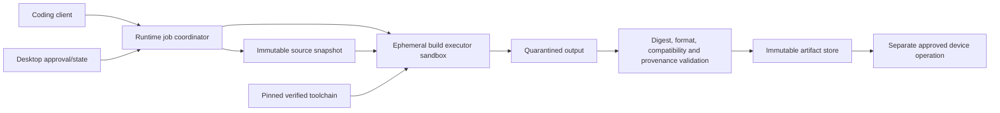

# Isolated Build Execution — LokiAI Main v1.2

Status: **Normative safety boundary**  
Updated: **2026-08-15**

## 1. Why this is a separate boundary

Firmware repositories, build scripts, compiler plugins, generated code, and
third-party toolchains are untrusted executable inputs. Running them inside the
privileged LokiAI Runtime would turn an agent-authored code change into access to
credentials, device handles, local IPC, source outside the workspace, and the
user's machine.

Therefore the runtime coordinates builds but never executes repository commands
in its own process. Builds run in a dedicated least-privilege executor. This
boundary is required even when the request originated from a human.

## 2. Process model



The executor is a separate Rust executable launched through the Windows sandbox
process API with AppContainer isolation and Job Object limits. If a required
vendor tool cannot run under the accepted containment profile, that build
capability is unavailable until an ADR approves a different equally reviewed
executor, such as a signed remote ephemeral build service. LokiAI must not fall
back to an ordinary unrestricted child process.

## 3. Build recipe contract

A connector/toolchain package declares a versioned recipe containing:

- recipe and connector ID/version;
- supported target/board identities and artifact types;
- exact executable/toolchain identity and expected digest/provenance;
- fixed argument template with typed, allowlisted substitutions;
- source input roots and read/write mode;
- allowlisted environment variables with secret classification;
- expected output paths, formats, size bounds, and compatibility metadata;
- CPU, memory, process-count, disk, output, and wall-clock limits;
- network policy, defaulting to denied;
- deterministic/reproducibility settings and known exceptions;
- redaction rules and diagnostics limits.

No MCP/UI parameter can supply an arbitrary executable, command string, script,
URL, environment variable, output path, or shell fragment. Repository-defined
scripts are accepted only when a reviewed recipe explicitly names them and the
executor still contains them.

## 4. Containment profile

Default Windows local build containment:

- AppContainer/least-privileged identity with low integrity;
- no network capability;
- no access to credential stores, LokiAI database, runtime named pipe, signing
  material, USB/serial devices, clipboard, UI, registry, home directories, or
  unrelated repositories;
- read-only access to an immutable source snapshot and verified toolchain;
- write access only to a new per-job scratch/output directory;
- no inherited handles other than explicit standard streams;
- Job Object limits and kill-on-close for the complete process tree;
- bounded stdout/stderr, files, process count, CPU, memory, disk, and duration;
- headless execution with Win32k/UI access disabled where compatible;
- scratch directory destroyed through a controlled retention job after required
  evidence is extracted.

Containment startup is fail-closed. The runtime verifies the sandbox profile and
tool identity before marking the build stage running.

## 5. Build stages

```text
requested
  -> source revision resolved
  -> recipe and target resolved
  -> policy decision
  -> source snapshot created
  -> toolchain digest verified
  -> sandbox created and attested
  -> build executed with limits
  -> outputs quarantined
  -> artifact format/size/target validated
  -> digest and provenance recorded
  -> artifact registered
  -> sandbox teardown and audit
```

A successful build creates an artifact; it does not authorize flash or deployment.
Signing, approval, and device execution are separate stages with separate
identities. Failed, timed-out, or policy-denied builds cannot register a deployable
artifact.

## 6. Provenance

The build record includes source revision and dirty-state policy, recipe,
connector, toolchain and executor digests, normalized parameters, dependency
lockfile digests, start/end time, resource result, output digest, reproducibility
result when run, requester, agent run, job/correlation IDs, and redacted log
references.

Build output is untrusted until LokiAI validates type, size, target compatibility,
and digest outside the sandbox. Artifact labels supplied by a build cannot alter
policy or select a physical target.

## 7. Verification

`BLD-001` must prove:

- a build can read only its granted snapshot/toolchain and write only its output;
- attempts to access LokiAI secrets, database, named pipe, arbitrary files,
  network, UI, USB/serial, or another build fail;
- child processes remain in the resource/termination boundary;
- timeout, output flood, process bomb, disk exhaustion, malformed output, and
  executor crash produce bounded failure and durable job reconciliation;
- tool/recipe/source changes invalidate cached provenance and any bound approval;
- the same declared input is reproducible where the vendor toolchain supports it;
- no artifact reaches deployment storage before external validation succeeds.

