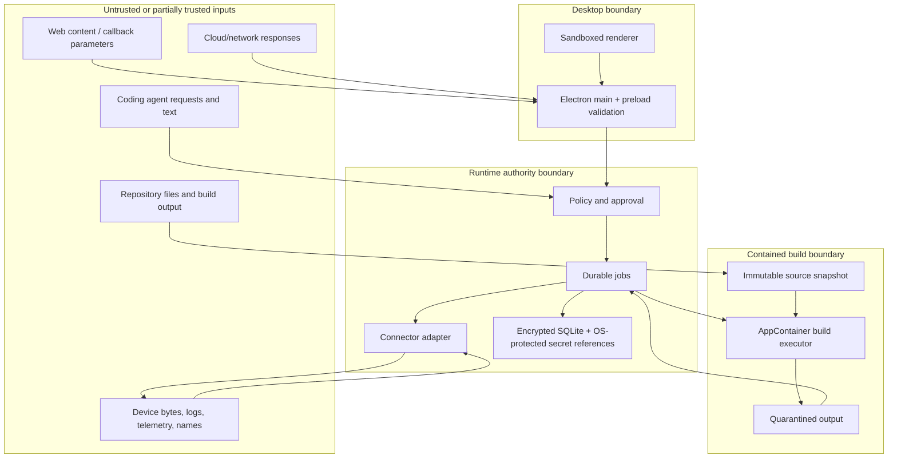

# Security and Safety Architecture — LokiAI Main v1.2

Status: **Normative draft; human security acceptance required**  
Updated: **2026-08-15**

## 1. Security objectives

LokiAI crosses unusually sensitive boundaries: web identity, local credentials,
coding agents, source repositories, firmware artifacts, operating-system
privileges, and physical devices. Security therefore means both information
security and protection from unsafe physical operations.

Objectives:

- preserve account, workspace, runtime, agent, and human identity;
- prevent renderer or agent compromise from becoming arbitrary local execution;
- prevent cross-workspace and cross-device access;
- bind approvals to immutable requests;
- preserve artifact integrity and target compatibility;
- make interrupted device operations recoverable or explicitly unknown;
- provide attributable, redacted, tamper-evident activity evidence;
- treat all external text and device data as untrusted.

## 2. Assets

- OAuth and agent credentials;
- workspace membership, roles, policy, and device inventory;
- source repositories, build inputs, artifacts, signatures, and provenance;
- device identity, firmware/config/model state, and operational capability;
- telemetry, logs, incident evidence, and customer payloads;
- approval decisions, deployment targets, and rollback images;
- runtime installation identity, local IPC credential, update key material;
- activity/audit records and diagnostics.

## 3. Trust boundaries



Crossing a boundary requires runtime schema validation, authorization, bounded
size/time, redaction, and structured error handling.

## 4. Principal threats and controls

| Threat | Example | Required controls |
|---|---|---|
| Renderer compromise | XSS attempts to access filesystem or flash tool | sandbox, no Node integration, context isolation, restrictive CSP, narrow preload, sender validation |
| IPC confused deputy | Compromised renderer calls a privileged generic handler | named domain methods, request schemas, session/workspace checks, no arbitrary channels/paths/commands |
| OAuth interception/replay | Forged callback or reused code | system browser, PKCE, cryptographic state/nonce, loopback-bound attempt, one-time consumption, short expiry |
| Local client impersonation | Unrelated process connects to runtime pipe | OS ACL, per-installation secret, client handshake, protocol negotiation, rate/size limits |
| Agent overreach | Agent calls undeclared hardware operation | scoped connection identity, MCP allowlist, policy, connector capability, lease, approval |
| Prompt injection | Device log or repository file instructs agent to bypass rules | label untrusted content, bounded evidence, tool authorization independent of model text, never treat data as policy |
| Artifact substitution | Approved digest differs from flashed bytes | content-addressed artifact, digest recheck at every stage, signature/provenance, approval bound to digest |
| Wrong-target operation | Mutable COM port now points to another board | stable hardware identity, target snapshot, re-identification immediately before action |
| Interrupted flash | runtime or power loss | durable stage journal, connector recovery contract, reconciliation/quarantine, rollback evidence |
| Cross-tenant access | stale workspace context leaks data | workspace ID from authenticated context, server-side authorization, per-query scoping, cache partitioning |
| Secret leakage | token stored in renderer or support bundle | OS secret store, secret references, redaction, data-class filters, secret scanning |
| Supply-chain compromise | malicious dependency/toolchain/update | lockfiles, allowlist, license/security review, SBOM, signing, provenance, verified updater |
| Audit tampering | actor deletes failed operation evidence | append-only records, restricted retention jobs, cloud anchoring/integrity where available |
| Resource exhaustion | unbounded telemetry or MCP calls | bounded queues, backpressure, retention, quotas, cancellation/deadlines, rate limits |
| Build escape | repository script reads tokens, user files, runtime IPC, or device handles | separate AppContainer executor, no inherited handles/network/secrets/devices, allowlisted paths, Job Object resource limits, fail-closed profile attestation |
| Malicious toolchain | compiler binary changes or emits hostile/mislabeled output | pinned digest/provenance, immutable recipe, quarantined output, external format/target/digest validation, signing separated from build |
| Enrollment hijack | a discovered port/device is attached to the wrong tenant/runtime | one-time cloud challenge, human confirmation, connector evidence digest, expiry, replay protection, pre-operation re-identification |
| Stale cloud authority | revoked role/policy is used offline | expiring versioned projections, bounded offline policy, heartbeat/freshness, deny cloud-required actions, reconciliation on reconnect |
| Local database theft | copied database/WAL/backup reveals device, repo, incident, or audit data | SQLCipher full-database encryption, DPAPI/OS-protected key, ACLs, protected backups, key lifecycle and recovery tests |
| Notification/dispatch spoofing | push message appears to authorize remediation | authenticated fetch of current state, push as hint only, work intent separate from approval/capability, deduplication and audit |

## 5. Electron security baseline

These controls are release-blocking:

- package local renderer assets; never load the LokiAI website as the privileged
  application UI;
- `nodeIntegration: false` for every renderer;
- `contextIsolation: true` for every renderer;
- renderer sandbox enabled globally;
- restrictive CSP beginning with `default-src 'self'`, with the minimum explicit
  additions required by packaged assets and approved APIs;
- no `eval`, remote code, remote preload, or runtime-downloaded JavaScript;
- no `<webview>` unless an accepted ADR proves the need and isolation;
- deny unexpected permissions, navigation, downloads, and window creation;
- allow `shell.openExternal` only for parsed HTTPS URLs on exact approved origins;
- validate the IPC sender and top-level frame for every handler;
- never expose raw Electron `ipcRenderer` or event objects through context bridge;
- expose one narrow method per domain use case and validate input/output;
- enable Electron fuses appropriate to packaged production behavior;
- stay on a supported Electron line and patch Chromium/Node/Electron promptly;
- sign executables and installers; protect signing keys outside source control.

Authentication browser pages open in the system browser, not a privileged
BrowserWindow.

## 6. Identity, session, and secrets

- Authorization Code with PKCE is mandatory for desktop sign-in.
- Access tokens are short-lived. Refresh credentials live in OS-protected storage.
- Renderer receives a non-secret session projection and capability set.
- Runtime installation identity is distinct from user identity.
- MCP agent connections use separate, revocable, workspace-scoped credentials;
  they never reuse the human refresh token.
- Credentials have audience, scope, expiry, and rotation metadata.
- Logout immediately removes renderer access and local usable session state even
  if cloud revocation must retry through an audited job.
- Logs record credential references/fingerprints only, never credential values.
- Development credentials must be structurally separated from production.

## 7. Authorization model

Every request is evaluated on:

```text
actor + actor type + workspace membership + role + environment
+ operation + connector capability + target snapshot + artifact digest
+ current device/runtime state + policy version + requested scope
```

Suggested roles for v1.2:

- Viewer: inspect authorized state and bounded evidence.
- Developer: viewer plus diagnostics, builds, and lab operation requests.
- Operator: approved device operations and incident/deployment operation.
- Workspace Admin: membership, agent connection, policy/configuration management.
- Security/Release Approver: elevated approvals and release gate where assigned.

Role names are insufficient by themselves; policy can further constrain target,
environment, time, connector, operation, and rollout size.

## 8. Approval contract

Canonical approval input includes:

- operation name and schema version;
- workspace/environment;
- exact stable target snapshot;
- exact artifact/config/model digest where applicable;
- normalized parameters;
- requester and agent run;
- policy version and risk;
- preflight result digest;
- expected effect and downtime;
- verification and rollback plan;
- creation and expiry.

The canonical representation is hashed. Execution recomputes and compares the
hash. Approval is single-use and atomically consumed when execution begins.

Rules:

- agents cannot approve their own request;
- UI confirmation without a persisted approval record is insufficient;
- an expired, denied, used, changed, or differently scoped approval fails closed;
- batch/fleet approvals show the entire target snapshot or an immutable selector
  resolution and count;
- critical operations may require two distinct human identities in later policy;
- emergency recovery is a separate explicit policy, never an undocumented bypass.

## 9. Device-operation safety

Before every consequential operation:

1. Re-identify the physical target.
2. Confirm connector/version/capability and exclusive lease.
3. Validate power/transport/boot/recovery preconditions declared by connector.
4. Verify artifact type, digest, compatibility, signature/provenance, and size.
5. Re-evaluate policy and approval binding.
6. Persist a recoverable job checkpoint.
7. Execute with timeouts, progress bounds, and safe cancellation points.
8. Reconcile device identity after restart/reconnect.
9. Run operation-specific tests and observation.
10. Release the lease only after terminal state or quarantine.

Unknown outcome is safer than false success. A quarantined device cannot accept
another destructive job until a reconciliation flow resolves identity and state.

## 10. MCP security

- Prefer stdio for local coding clients in v1.2.
- Remote MCP transport is disabled until a separate threat model, authentication,
  origin validation, and deployment requirement are accepted.
- Every tool has a fixed schema, risk class, maximum payload, timeout, and audit
  policy.
- No tool accepts arbitrary commands, scripts, URLs, ports, device paths, or
  unconstrained filesystem paths.
- Repository paths are resolved against an approved workspace root with canonical
  path checks and symlink policy.
- Tool descriptions state side effects and approval behavior clearly.
- Tool output is bounded and redacted. Large evidence uses authorized resources or
  paginated references.
- MCP client text cannot alter policy or approval state.
- The server authenticates every runtime connection and propagates actor/run IDs.
- Rate limiting and concurrency limits apply per connection, workspace, device,
  and high-cost tool.

## 11. Logs, evidence, and prompt-injection resistance

Device logs, agent messages, source files, build output, artifact metadata, and
cloud labels may contain malicious instructions. LokiAI shall:

- mark provenance and trust class for evidence;
- delimit untrusted content in agent-facing resources;
- never concatenate evidence into system/policy instructions;
- filter control characters and enforce encoding/size limits;
- render text safely without HTML execution;
- keep authorization in deterministic code, not model judgment;
- redact configured secrets and sensitive identifiers before persistence/export;
- retain raw evidence only according to explicit policy.

## 12. Artifact and build supply chain

- Build isolation follows [`BUILD_EXECUTION.md`](BUILD_EXECUTION.md).
- Builds run from an exact source revision and declared target/toolchain inside a
  dedicated contained executor, never the renderer, Electron main, MCP process,
  or privileged runtime process.
- Build recipes use fixed executable/argument/environment/path schemas; arbitrary
  command strings, scripts, URLs, and paths are not product inputs.
- Toolchains are pinned and checksummed or otherwise provenance-verified.
- Artifacts are content-addressed by SHA-256 or stronger accepted digest.
- Build metadata records inputs, versions, command identity, and output digest.
- Signing is separated from build execution and protected by role/policy.
- Runtime revalidates digest and target compatibility before transfer and apply.
- Release packages produce an SBOM and dependency/license record.
- Installer/update metadata and binaries are signed; update verification fails
  closed.

## 13. Data protection and retention

Data classes:

| Class | Examples | Default handling |
|---|---|---|
| Secret | refresh token, agent credential, signing key | OS/HSM-protected; never renderer/log/export |
| Sensitive | device identity, repo path, bounded logs, evidence | encrypted transport; scoped access; redaction/retention |
| Internal | versions, health summaries, job metadata | workspace scoped; auditable |
| Public | product version documentation | normal integrity controls |

The runtime database uses full-database encryption so sensitive table content,
indices, WAL, and backup copies are not plaintext at rest. In `desktop-user` mode
the database key is protected for the current Windows user. In
`gateway-service` mode it is protected for the dedicated service identity and
ACL, not made decryptable to every local interactive user. Secrets such as OAuth,
agent, signing, or runtime private credentials remain separate OS-protected
secret records and are never inserted into the database.

Key creation, rotation, backup, recovery, logout, service-account change,
uninstall, and unrecoverable-key behavior require explicit tested states. Losing
the key must never trigger creation of an apparently healthy empty database over
the encrypted original.

Retention changes and destructive cleanup require policy, dry-run counts, audit,
and human confirmation where user data is deleted. Telemetry sampling and evidence
capture must be purpose-limited.

## 14. Security verification gates

Required evidence before release:

- Electron configuration and navigation/permission/IPC tests;
- runtime IPC authentication, ACL, malformed message, size, timeout, and replay
  tests;
- OAuth state/PKCE/replay/callback binding and logout tests;
- authorization matrix and cross-workspace isolation tests;
- approval binding/expiry/single-use/race tests;
- connector wrong-target/interruption/reconciliation tests on physical hardware;
- artifact digest, signature, compatibility, and substitution tests;
- MCP schema, scope, prompt-injection, path, rate, and side-effect tests;
- database migration, corruption detection, backup/recovery, and retention tests;
- database/WAL/backup encryption, wrong-key, key-loss, rotation, and service/user
  boundary tests;
- build containment/escape, malicious toolchain, output quarantine, resource
  exhaustion, and process-tree termination tests;
- device enrollment replay/wrong-runtime and cloud heartbeat/sync/dispatch tests;
- dependency, secret, license, SBOM, binary-signing, and updater checks;
- independent security review with all release-blocking findings closed or
  explicitly accepted by the human security owner.
