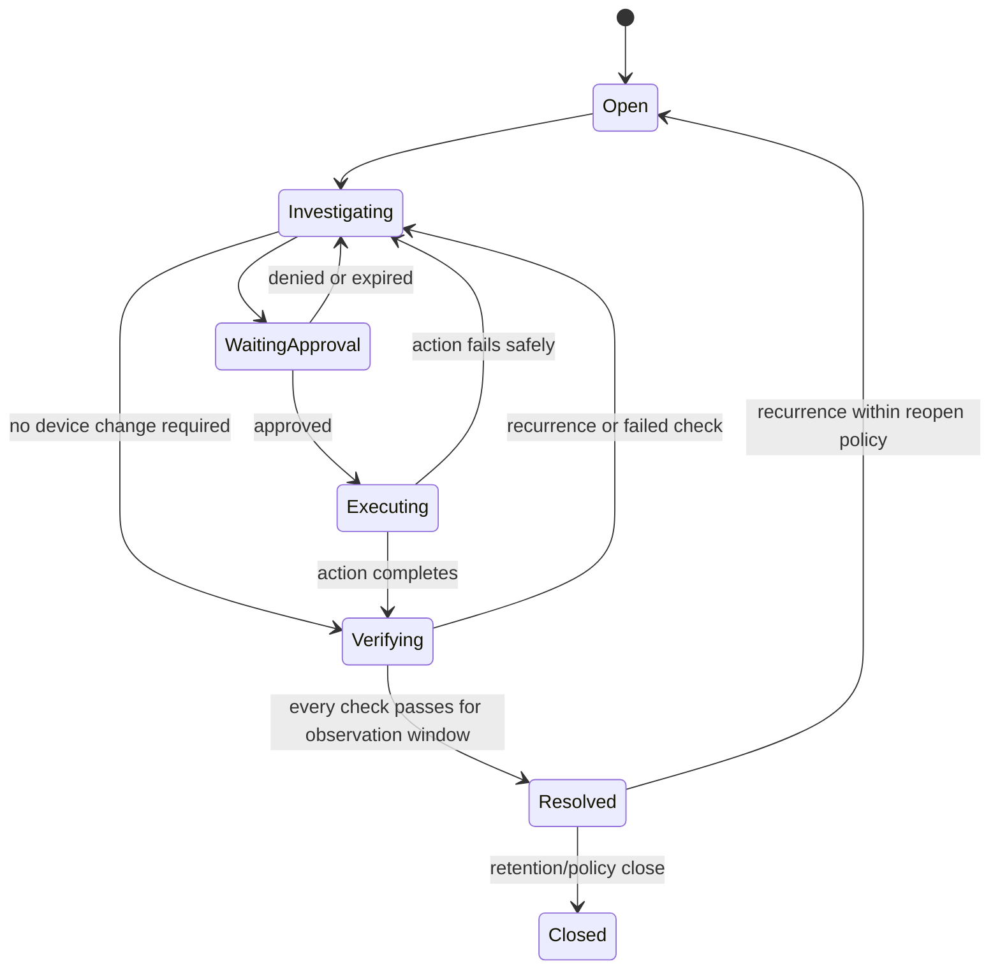
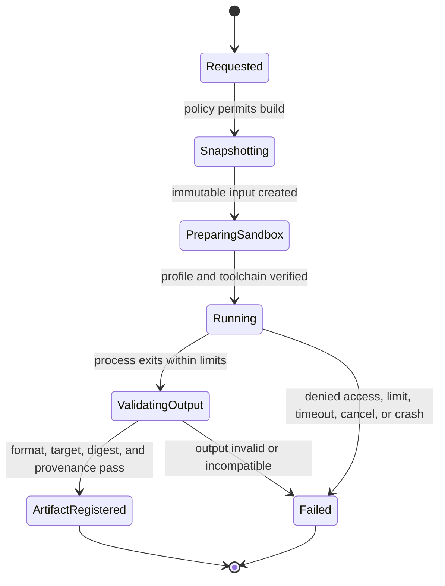
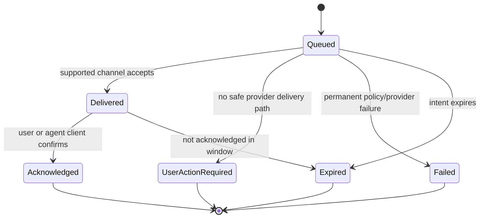

# System Specification — LokiAI Main v1.2

Status: **Draft for human acceptance**  
Implements: [`PRD.md`](PRD.md)  
Updated: **2026-08-15**

## 1. Specification conventions

The words **shall**, **must**, and **must not** are normative. All timestamps are
UTC ISO 8601. Every externally visible identifier is opaque and stable. Every
cross-process error uses a structured error object; errors are never encoded as a
successful result string.

Common envelope:

```text
Envelope<T> {
  protocol_version
  message_id
  correlation_id
  causation_id?
  workspace_id
  occurred_at
  actor
  payload: T
}
```

Common operation result:

```text
OperationResult<T> =
  | accepted { job_id, state, accepted_at }
  | approval_required { approval_id, bound_request_digest, expires_at }
  | rejected { error }
  | completed { job_id, evidence_refs[], result: T }

Error {
  code
  category
  message
  retryable
  retry_after_ms?
  details?          // redacted, schema-bound
  correlation_id
}
```

## 2. Actors and authority

| Actor | Identity | Allowed authority |
|---|---|---|
| Human user | LokiAI account and workspace membership | Actions permitted by workspace role; approval when role and policy permit |
| Coding agent | Connected client credential and run identity | Read and request capabilities within scope; never self-approve |
| Desktop main | Signed app instance and local session | Window/auth/lifecycle, renderer brokering, runtime connection |
| Runtime | Installation identity plus user/gateway session | Device communication, monitoring, jobs, local persistence |
| Connector | Runtime-loaded signed/allowlisted implementation | Only declared device capabilities through runtime contract |
| Policy engine | Versioned workspace policy | Decide allow, approval-required, or deny; no physical execution |
| Cloud control plane | Service identity and workspace authorization | Account/workspace, policy/config sync, fleet metadata, audit ingestion |
| Reviewer/release owner | Human identity | Architecture, security, hardware, and release gates |

An actor's display name is not an authorization identity. Authorization uses
stable IDs, signed/scoped credentials, and current policy.

## 3. Core entities

### 3.1 Workspace

Required fields: `workspace_id`, name, environment, membership/role projection,
policy version, region/control-plane reference, created/updated timestamps.

### 3.2 Runtime installation

Required fields: `runtime_id`, installation identity, host mode (`desktop-user` or
`gateway-service`), version, protocol versions, host fingerprint reference,
health, connected-device count, last heartbeat, update channel, and capabilities.

### 3.3 Device

Required fields: `device_id`, connector-qualified hardware identity, family,
board/module identity where verified, connector ID/version, transport reference,
runtime ID, capability set, support tier, firmware/config/model artifact
references when observable, health projection, last seen, and lifecycle state.

Device IDs must be derived or assigned without exposing raw hardware identifiers
to unauthorized actors. A transport path such as a COM port is mutable metadata,
not device identity.

### 3.4 Agent connection and run

Connection fields: `agent_connection_id`, provider/client type, workspace scope,
credential reference, allowed capabilities, created by, last handshake, status.

Run fields: `agent_run_id`, provider session reference, parent run ID, task title,
phase, workspace/repository/branch references, associated domain IDs, requested
operations, evidence/change summaries, started/ended timestamps, and outcome.

### 3.5 Telemetry sample and log record

Samples include source device/runtime, metric name, typed value/unit, source time,
receive time, quality (`good`, `late`, `gap`, `invalid`), sequence where available,
and retention class.

Logs include source, level, timestamp, bounded message, schema version,
correlation, redaction markers, and retention class. Logs are untrusted input.

### 3.6 Monitoring rule

Fields: `rule_id`, version, workspace, scope selector, required signals, condition,
window, debounce/cooldown, severity, enabled state, missing-data behavior, creator,
and timestamps.

### 3.7 Incident

Fields: `incident_id`, title, severity, state, affected scope, trigger/rule version,
occurrence count, evidence snapshot references, assigned user/agent, diagnosis and
proposal summaries, verification plan/state, timeline, and timestamps.

### 3.8 Artifact and deployment

Artifact fields: `artifact_id`, type, immutable digest, size, source revision,
build provenance, target compatibility claims, signature/provenance status,
storage reference, created by, and timestamp.

Artifact type is explicit: firmware image, edge-model package, declared
configuration, or a manifest-bound bundle. A bundle lists every member digest,
apply order, compatibility/resource constraints, atomicity expectation,
verification, and rollback behavior. A model is never silently embedded into
firmware unless the connector recipe declares and records that composition.

Deployment fields: `deployment_id`, artifact ID/digest, target snapshot, strategy,
policy decision, approval reference, state, stage attempts, per-target results,
observation and rollback plans, and correlations.

### 3.9 Approval

Fields: `approval_id`, requester identity, approver identity when decided, operation
name, canonical bound-input digest, target snapshot, risk, reason, expected
effect/downtime, preflight evidence, verification plan, rollback plan, expiry,
single-use status, and decision metadata.

### 3.10 Activity event

Append-only fields: `activity_id`, envelope metadata, event type, actor, resource,
action summary, result, risk, correlations, redacted detail reference, and integrity
metadata where supported.

### 3.11 Device enrollment

Fields: `enrollment_id`, workspace/runtime/candidate identity, connector evidence
digest, one-time cloud challenge reference, requesting and confirming human,
issued/expires/consumed timestamps, result, assigned device ID, and audit
correlation. A mutable transport path is never sufficient enrollment proof.

### 3.12 Build execution and provenance

Build fields: `build_id`, job ID, immutable source revision/snapshot digest,
recipe and target, executor/profile version, toolchain digests, normalized inputs,
resource policy, state, start/end, quarantined outputs, validated artifact digest,
provenance reference, and bounded log references. The build executor never holds
device, signing, cloud-refresh, or LokiAI database credentials.

### 3.13 Notification and work intent

Notification fields: `notification_id`, category, severity, workspace/resource,
deduplication key, channels, state per channel, created/read/expiry timestamps,
correlation, and redacted display projection.

Work-intent fields: `work_intent_id`, incident, requested capability, bounded
evidence references, provider-neutral delivery requirements, expiry, delivery
attempts, acknowledged agent run when present, and terminal outcome. A work intent
is neither an approval nor an operation credential.

## 4. State machines

### 4.1 Desktop authentication

```mermaid
stateDiagram-v2
  [*] --> SignedOut
  SignedOut --> StartingAuth: user selects Connect account
  StartingAuth --> WaitingForBrowser: PKCE/state created; browser opened
  WaitingForBrowser --> ExchangingCode: valid loopback/deep-link callback
  WaitingForBrowser --> SignedOut: cancel or timeout
  ExchangingCode --> Authenticated: token exchange and session validation pass
  ExchangingCode --> SignedOut: invalid callback or exchange failure
  Authenticated --> Refreshing: access token nearing expiry
  Refreshing --> Authenticated: refresh succeeds
  Refreshing --> ReauthenticationRequired: refresh rejected
  Authenticated --> SigningOut: user confirms logout
  SigningOut --> SignedOut: revocation/cleanup completes or is recorded pending
```



Rules:

- Only Electron main handles PKCE verifier, browser launch, callback listener,
  token exchange, refresh, and credential storage.
- The callback must match one active attempt, state, redirect origin/scheme, and
  expiry. It is consumed once.
- Closing the auth UI does not silently authenticate or skip a failed exchange.
- Logout is idempotent. Cloud revocation failure must be surfaced while local
  protected access is still removed.

### 4.2 Onboarding

```text
account -> workspace -> agent -> device-choice
  -> existing-device -> discovery -> health -> review
  -> new-project -> project-target -> review
review -> ready
```

Rules:

- The authoritative onboarding checkpoint is persisted outside renderer storage.
- Back navigation is allowed unless it would invalidate an already executing job.
- A user may defer agent connection or device connection only if product policy
  permits; the dashboard must show the resulting incomplete capability state.
- Discovery and health results contain timestamps and connector evidence.
- “Ready” is a review of actual completed steps, not a generated success screen.

### 4.3 Runtime connection

States: `unknown`, `starting`, `connected`, `degraded`, `disconnected`, `version-
incompatible`, `unauthorized`, `updating`, `stopping`.

- Desktop and the local MCP server, as runtime IPC clients, must perform a
  runtime version/capability handshake. The external MCP protocol itself uses
  request-carried version/client metadata and optional discovery, not a session
  handshake.
- A lost runtime heartbeat changes the runtime state before changing device state.
- Device status becomes `unknown` after its freshness window; it must not remain
  healthy solely because the last sample was healthy.

### 4.4 Device lifecycle

```text
discovered -> identifying -> identified -> checking -> enrollment-required
                                 |             |                |
                                 v             v                v
                             unsupported    degraded         enrolled -> ready
                                 |             |                |         |
                                 +-----------> offline <---------+------ busy
```

- `discovered` means a connector observed a candidate transport.
- `identified` requires stable device evidence.
- `ready` requires authorized workspace enrollment and the minimum connector
  health contract. Read-only pre-enrollment health is allowed only by local policy
  and remains candidate evidence, not a workspace-owned device projection.
- One device-changing job holds an exclusive operation lease per device.
- A device with unknown operation outcome is quarantined from additional
  destructive operations until reconciliation.

### 4.5 Agent run

States: `registered`, `investigating`, `editing`, `building`, `requesting-action`,
`waiting-approval`, `executing`, `verifying`, `completed`, `failed`, `cancelled`.

Agent-reported phases are recorded as claims. LokiAI-owned operation and
verification states remain authoritative.

### 4.6 Incident



### 4.7 Durable job

States: `queued`, `policy-check`, `waiting-approval`, `preflight`, `executing`,
`restarting`, `testing`, `observing`, `succeeded`, `failed`, `cancelled`,
`rollback-pending`, `rolling-back`, `rolled-back`, `outcome-unknown`.

- A job persists before execution.
- Every stage has attempt, start/end time, bounded logs, and result.
- Restart after crash resumes from a safe checkpoint or enters `outcome-unknown`.
- A device-changing stage cannot run twice under the same idempotency key.
- `succeeded` requires its verification contract, not only command completion.

### 4.8 Deployment

States: `draft`, `validating`, `approval-required`, `scheduled`, `preflight`,
`transferring`, `applying`, `restarting`, `testing`, `observing`, `verified`,
`completed`, `failed`, `rollback-required`, `rolling-back`, `rolled-back`,
`cancelled`.

The target set is snapshotted before approval. Changing artifact digest, target
set, rollout strategy, or device-changing parameters invalidates approval.

### 4.9 Isolated build



There is no unrestricted-execution fallback. A registered artifact is inert until
a separate operation request passes policy, approval where required, preflight,
and physical-target verification.

### 4.10 Notification and agent delivery



## 5. Connector contract

Every connector declares:

- connector ID, semantic version, supported runtime protocol range;
- match evidence and confidence;
- supported family/board identifiers and support tier;
- transports and exclusive-access rules;
- declared capabilities;
- required external toolchains with exact version/provenance expectations;
- health-check definitions;
- operation input schemas, risks, preconditions, timeouts, cancellation points,
  verification, and recovery behavior;
- telemetry/log schemas and redaction hints.

Minimum methods conceptually include:

```text
probe() -> Candidate[]
identify(candidate) -> DeviceIdentity
capabilities(device) -> CapabilitySet
health(device, requested_checks) -> HealthReport
subscribe(device, signals) -> EventStream
preflight(device, operation) -> PreflightReport
execute(device, authorized_operation, job_context) -> StageResult
verify(device, verification_plan) -> VerificationResult
reconcile(device, interrupted_job) -> ReconciliationResult
```

Connectors do not issue approvals, store cloud tokens, write activity records
directly, or expose raw arbitrary command execution.

## 6. MCP surface

MCP is an agent-facing adapter, not the domain authority. The MCP server validates
input, resolves the caller/workspace, calls runtime/control-plane services, and
returns structured results.

Initial resource families:

- workspace summary;
- device inventory and capability descriptors;
- incident and bounded evidence;
- deployment and job status;
- agent-run/task context;
- approved diagnostic schemas and operation documentation.

Initial tool families:

| Family | Examples | Policy |
|---|---|---|
| Inspect | list devices, get device health, read bounded logs/telemetry, get incident | Workspace authorization and audit |
| Diagnose | run declared health/preflight/test suite, collect bounded incident evidence | Capability and environment policy |
| Build | request a reproducible build and artifact registration | Repository/toolchain scope; no device mutation |
| Operate | restart, flash, deploy config/model, rollback | Exclusive lease, policy, preflight, approval, verification |
| Workflow | create/assign incident investigation, inspect job, cancel at safe point | State-transition authorization |

Tool names are stable and versioned through schemas. Provider-specific aliases do
not enter the core MCP contract.

## 7. Desktop renderer contract

The preload bridge exposes cohesive, typed domains rather than Electron primitives:

```text
window.loki.auth.*
window.loki.workspace.*
window.loki.runtime.*
window.loki.devices.*
window.loki.agents.*
window.loki.monitoring.*
window.loki.incidents.*
window.loki.deployments.*
window.loki.activity.*
window.loki.settings.*
window.loki.events.subscribe(...)
```

Requirements:

- Each method has a fixed request/response schema and validates in main.
- No bridge method accepts an executable, raw shell fragment, arbitrary URL,
  arbitrary filesystem path, or arbitrary IPC channel.
- Subscription APIs return an explicit unsubscribe handle and use bounded queues.
- Renderer state is a projection/cache; authoritative state remains in services.
- UI views render loading, empty, disconnected, permission-denied, incompatible,
  and error states.

## 8. UI behavior by route

### Dashboard

Shows active workspace/runtime truth, device/agent/incident/deployment summaries,
approval queue, actionable incidents, bounded live metrics, active agent work, and
clear freshness/source labels.

### Devices

Shows inventory, connector/support/capability truth, runtime association, health,
firmware/config/model versions, relationships, and only permitted operations.

### Agents

Shows connections and runs, parent/child task relationships, phase, tool requests,
changed-file summaries, correlations, failure reason, and revoke/configure actions.

### Monitoring

Shows runtime/gateway health, signal freshness/quality, rule definitions and
versions, telemetry, bounded logs, gaps, and alert evaluation history.

### Incidents

Shows severity/state, affected scope, trigger, evidence snapshot, investigation,
proposal, approval, job/deployment links, timeline, and verification progress.

### Deployments

Shows immutable artifact identity, provenance/signature, target snapshot, strategy,
preflight, policy/approval, stage progress, per-target result, observation, and
rollback.

### Activity

Shows filterable append-only events with actor, target, action, result, risk,
correlation, and safe detail inspection/export.

### Settings

Shows authorized workspace, agent, runtime, permission, monitoring, notification,
security, data, diagnostic, and update configuration.

## 9. Event semantics

- Events are append-only facts; projections may be rebuilt.
- At-least-once delivery is assumed across process/cloud boundaries. Consumers
  deduplicate by event/message ID.
- Ordering is guaranteed only within a declared stream key such as one job or one
  device lease. UI must not rely on global arrival order.
- Event schemas include version and compatibility policy.
- Gaps and dropped samples are first-class events or quality states.
- Device logs, repository content, agent text, and cloud-provided labels are
  untrusted display and agent context.

## 10. Offline and reconnection behavior

- Desktop may open using a last-known non-secret projection with an explicit
  freshness banner.
- Read operations report the source and timestamp.
- Cloud-required writes enter a durable outbox only when defined as safely
  retryable. They never display as completed until acknowledged.
- Device operations require an available owning runtime and current policy. A
  disconnected cloud may be allowed only under an explicit lab/offline policy
  with locally cached authorization and full later audit sync.
- Conflicts are resolved by version/ETag and domain policy, never last-write-wins
  for approvals, deployments, incidents, or permissions.

## 11. Diagnostics and support bundle

A user-authorized support bundle may include version information, redacted
structured logs, crash metadata, protocol handshakes, configuration schema (not
secrets), recent job stage summaries, and database integrity status. The user must
preview the classes of data before export. Raw tokens, private keys, firmware
source, unrestricted device logs, and customer payloads are excluded by default.

### 11.1 Cloud, enrollment, build, and delivery contracts

- Cloud behavior follows [`CLOUD_CONTRACT.md`](CLOUD_CONTRACT.md). Until OQ-002
  is accepted, concrete auth and sync implementation nodes are blocked rather
  than filled with assumed responses.
- Device discovery creates a candidate only. Workspace ownership and
  consequential capabilities require a valid one-time enrollment challenge and
  authorized confirmation.
- Firmware builds follow [`BUILD_EXECUTION.md`](BUILD_EXECUTION.md). The runtime
  coordinates the job while an isolated executor runs the recipe and returns
  quarantined output.
- Incident dispatch records actual provider/channel state. If no supported client
  can be resumed, the user receives an action-center/OS notification and the
  intent remains `user_action_required`.
- Every projection derived through a runtime includes observer identity,
  heartbeat/freshness, and last-known versus current status.

## 12. Acceptance scenarios

Every scenario maps to `Docs/graph/TRACEABILITY.md` and executable tests.

- **AS-001 First-run account:** clean install → external browser → valid callback
  → authenticated desktop → no token in renderer storage.
- **AS-002 Logout:** authenticated session → confirm logout → local access removed
  → relaunch remains signed out → revocation result audited.
- **AS-003 Existing device:** onboarding → discover confirmed ESP32-S3 → identify
  → health checks with evidence → authorized enrollment → device appears in
  workspace.
- **AS-004 Unsupported target:** discover candidate → identify unsupported → no
  flash/restart action offered → actionable connector message shown.
- **AS-005 Agent read:** connected MCP client lists authorized devices and reads
  bounded health evidence with correlation and freshness.
- **AS-006 Agent flash request:** agent requests flash → immutable artifact and
  target are bound → policy returns approval → user approves → preflight → flash
  → restart → verify → activity and deployment update.
- **AS-007 Changed request:** any bound flash input changes after approval → old
  approval rejected → new approval required.
- **AS-008 Incident recovery:** real rule match → incident/evidence → agent
  investigation → approved correction → verification window → resolved.
- **AS-009 Interrupted operation:** runtime stops during a device-changing stage →
  restart reconciliation → known recovered/failed state or quarantine with
  `outcome-unknown`; never false success.
- **AS-010 Window closure:** close visible desktop → runtime continues according to
  configured host mode → reopening reconstructs job/device state.
- **AS-011 Device enrollment:** discover candidate → obtain one-time challenge →
  authorized user confirms connector evidence → workspace device is created →
  replay or wrong-runtime enrollment is rejected.
- **AS-012 Isolated build:** agent requests declared build → immutable snapshot →
  contained recipe executes without LokiAI/device/network authority → output is
  quarantined and validated → artifact/provenance registered by digest.
- **AS-013 Build escape attempt:** repository/toolchain attempts an ungranted file,
  secret, IPC, network, UI, process, or device access → containment denies it →
  bounded failure/audit → no deployable artifact.
- **AS-014 Runtime offline:** gateway heartbeat expires → runtime and observed
  devices become stale/offline with last-known timestamps → notification emitted →
  reconnect resumes sync without duplicate audit events.
- **AS-015 Incident delivery:** rule creates incident → work intent is queued → a
  supported agent acknowledges and links a run, or LokiAI records
  `user_action_required` and notifies the human → no authority is added.
- **AS-016 Protected local state:** encrypted database/WAL/backup cannot be opened
  without the OS-protected key → supported key use succeeds → logout, diagnostic
  export, uninstall choice, migration, backup, and recovery obey data policy.
