# LokiAI Main v1.2 Execution Graph

Status: **`P1-INT-001` remains reopened as `NEEDS_REPLAN`; package code is not production integration evidence. Since 2026-08-25, seven nodes have been implemented, independently reviewed, and integrated into real commits on `LokiAI-v1.2`: `P1-MUTATION-CONTRACT-001`, `CON-ID-CONTRACT-001`, `BLD-001-R2-CODE`, `DAT-002-MEM-CODE-001` (2 Critical + 2 Medium findings found and fixed across the chain), `CON-SDK-IDENTITY-EVIDENCE-001`, `CON-002-R1` (real candidate-based discovery/reconciliation — connector discovery is no longer mock-backed at the registry level), and `CON-003-R1` (first real `Connector` implementation, for the now-identified physical ESP32-S3, code-level only). `OQ-001` (exact ESP32-S3 SKU) is resolved via real read-only hardware identification. `DAT-002-MEM-HOST-VERIFY-001` is packet-ready and human-gate-approved, execution pending. Despite this progress, **the actual runtime-composition/RPC chain has zero code**: `loki-runtime`'s own `Cargo.toml` links only `loki-storage`+`loki-ipc` — the 11 other accepted domain crates are still not wired into the running process. Production Electron/MCP paths still hardcode `runtime_unavailable` (re-verified against source, unchanged). `P1-ACCEPTANCE-STORE-001` (the actual "exactly-once" transaction engine) has no code yet and remains blocked on `DAT-002-MEM-IMPL-001`. `P1-RPC-CONTRACT-001` remains `NEEDS_REPLAN`; ADR-0006's independent review is still outstanding. Cloud remains deferred; Part Two has not started.**
Graph owner: **Orchestrator**  
Updated: **2026-08-27**

## 1. Baseline

- `UI-BASE` exists: accepted visual/onboarding/dashboard renderer under
  `LokiAI Desktop UI/`.
- It is not evidence of working auth, hardware, monitoring, incidents,
  deployments, or agent integration.
- The repository has a Git baseline plus Electron, runtime, IPC, contracts, and
  local domain-service packages. These packages are not yet composed into one
  production Part One system.
- Tasks below are production implementation nodes. Device-changing verification
  waits for the user's confirmed physical board; independent software work does
  not stop.

## 1a. Program structure — Part One and Part Two

Recorded 2026-08-15 by explicit human instruction. This is a durable split of the
whole program, not a single-session convenience:

- **Part One — local core platform (waves W0–W6):** repository/workspace foundation,
  shared contracts, the secure Electron shell and typed preload boundary, the Rust
  runtime and local IPC, persistence and protected local data, local installation
  authority and setup _services_ (not their UI wiring), the connector platform and
  local device binding, the MCP server and agent-run services, monitoring/incidents/
  local notification intents, durable jobs/policy/approvals, the contained build
  executor, artifact registry, and verified device-operation/deployment services.
  Per accepted
  `ADR-0002`, cloud contracts/login/workspaces/enrollment/sync/remote delivery are
  deferred. The human owner's 2026-08-24 production-completion instruction
  supersedes the earlier temporary deferral of `BLD-001` and its descendants;
  those nodes are required again and remain blocked/proposed until proven. Part
  One explicitly does **not**
  include wiring any of this into the renderer routes — `UI-001` (renderer
  application/contract boundary) is the first Part Two node.
- **Part One completion gate — `P1-INT-001`:** a dedicated milestone node (Section
  4, "Part One completion gate") that must pass before Part Two may begin. Individual
  accepted nodes are not sufficient; `P1-INT-001` exists specifically to prove the
  non-deferred local core services integrate and function together on one baseline. See its node
  definition for the exact required checks, including which security checks are in
  scope for this gate versus reserved for `SEC-001`/`SEC-002`.
- **Part Two — production wiring and release (waves W7–W10):** wiring the complete
  production UI (`UI-001`–`UI-006`), full-route integration (`INT-001`), the
  independent security and test gates (`SEC-001`, `SEC-002`), packaging and updates
  (`PKG-001`, `PKG-002`), physical hardware-in-the-loop validation (`HIL-001`), and
  release readiness plus the final human release gate (`REL-001`, `G6`).
- **Dispatch rule:** the orchestrator may plan, dispatch, and integrate any
  dependency-ready Part One node continuously, without pausing for confirmation
  after each node, and must stop and request a human decision only where a node is
  genuinely blocked on an open decision (`OQ-001`–`OQ-007`), a missing credential,
  a physical device, or an approval this file or `AGENTS.md` requires. The
  orchestrator must not dispatch any Part Two node (`UI-001` onward) until `P1-INT-001`
  is accepted **and** the human owner separately approves starting Part Two. A
  blocked/deferred node is never relabeled accepted; the revised gate must list it
  and exclude its capabilities from the certified baseline — the
  graph edge from `P1-INT-001` into `UI-001` enforces the technical half of that
  gate; the human approval is the other half and is not implied by graph readiness
  alone.

## 2. High-level DAG

```mermaid
flowchart TD
  G0["G0 Product and architecture acceptance"] --> FND001["FND-001 Repository baseline"]
  FND001 --> FND002["FND-002 Monorepo/build foundation"]
  FND001 --> CTR001["CTR-001 Domain and protocol contracts"]
  CTR001 --> CLD001["CLD-001 Cloud API contract"]

  FND002 --> DSK001["DSK-001 Secure Electron shell"]
  FND002 --> RUN001["RUN-001 Rust runtime foundation"]
  FND002 --> MCP001["MCP-001 MCP server foundation"]
  CTR001 --> DSK002["DSK-002 Typed preload bridge"]
  CTR001 --> RUN002["RUN-002 Local IPC and handshake"]
  CTR001 --> CON001["CON-001 Connector SDK"]
  CTR001 --> DAT001["DAT-001 SQLite and migrations"]
  DAT001 --> DAT002["DAT-002 Encrypted local data and key lifecycle"]

  DSK001 --> AUTH001["AUTH-001 Browser authentication"]
  DSK002 --> AUTH001
  DAT001 --> AUTH001
  DSK002 --> LOC001["LOC-001 Local installation authority"]
  DAT001 --> LOC001
  RUN001 --> RUN002
  RUN002 --> RUN003["RUN-003 Background host lifecycle"]
  DAT001 --> RUN003

  CON001 --> CON002["CON-002 Discovery and identity engine"]
  CON001 --> CON003["CON-003 ESP32-S3 connector"]
  RUN002 --> CON002
  RUN002 --> MCP002["MCP-002 Read/diagnostic tools"]
  MCP001 --> MCP002

  AUTH001 --> ONB001["ONB-001 Real onboarding workflow"]
  CON002 --> ENR001["ENR-001 Device enrollment and ownership"]
  AUTH001 --> ENR001
  CLD001 --> ENR001
  ENR001 --> ONB001
  MCP002 --> AGT001["AGT-001 Agent connection and runs"]
  LOC001 --> AGT001
  CON002 --> LDEV001["LDEV-001 Local device binding"]
  LOC001 --> LDEV001
  LOC001 --> LONB001["LONB-001 Local setup workflow"]
  LDEV001 --> LONB001
  MCP002 --> LONB001

  DAT001 --> MON001["MON-001 Telemetry/log pipeline"]
  CON001 --> MON001
  MON001 --> MON002["MON-002 Rule evaluation"]
  MON002 --> INC001["INC-001 Incident/evidence engine"]

  DAT001 --> JOB001["JOB-001 Durable job/lease engine"]
  RUN002 --> JOB001
  JOB001 --> APR001["APR-001 Policy and approvals"]
  LOC001 --> APR001
  JOB001 --> BLD001["BLD-001 Contained build executor"]
  CON001 --> BLD001
  BLD001 --> ART001["ART-001 Artifact provenance and registry"]
  CON003 --> OPS001["OPS-001 Build/preflight/flash/restart"]
  APR001 --> OPS001
  ART001 --> OPS001
  OPS001 --> DEP001["DEP-001 Deployment/verification/rollback"]
  INC001 --> DEP001

  APR001 --> MCP003["MCP-003 Consequential MCP tools"]
  JOB001 --> MCP003
  AGT001 --> MCP003
  BLD001 --> MCP003

  RUN003 --> CLD002["CLD-002 Sync, heartbeat and cloud projections"]
  CLD001 --> CLD002
  DAT002 --> CLD002
  CLD002 --> NOT001["NOT-001 Notification delivery"]
  INC001 --> NOT001
  INC001 --> LNOT001["LNOT-001 Local notification intents"]
  DSK001 --> LNOT001
  NOT001 --> AGT002["AGT-002 Incident work-intent delivery"]
  LNOT001 --> AGT002
  AGT001 --> AGT002
  INC001 --> AGT002

  DAT002 --> P1INT001["P1-INT-001 Local-only Part One completion gate"]
  LONB001 --> P1INT001
  LDEV001 --> P1INT001
  APR001 --> P1INT001
  AGT002 --> P1INT001

  DSK002 --> UI001["UI-001 Renderer application boundary"]
  P1INT001 --> UI001
  UI001 --> UI002["UI-002 Auth, onboarding and devices"]
  ONB001 --> UI002
  ENR001 --> UI002
  UI001 --> UI003["UI-003 Agents and action center"]
  AGT002 --> UI003
  NOT001 --> UI003
  UI001 --> UI004["UI-004 Dashboard, monitoring and incidents"]
  MON002 --> UI004
  INC001 --> UI004
  NOT001 --> UI004
  UI001 --> UI005["UI-005 Deployments, activity and settings"]
  DEP001 --> UI005
  CLD002 --> UI005
  DAT002 --> UI005
  UI002 --> UI006["UI-006 Desktop route integration"]
  UI003 --> UI006
  UI004 --> UI006
  UI005 --> UI006

  DSK001 --> SEC001["SEC-001 Desktop/auth/IPC/data review"]
  DAT002 --> SEC001
  MCP003 --> SEC002["SEC-002 MCP/policy/artifact review"]
  DEP001 --> SEC002
  BLD001 --> SEC002
  AGT002 --> SEC002

  UI006 --> INT001["INT-001 Full workflow integration"]
  MCP003 --> INT001
  RUN003 --> INT001
  SEC001 --> INT001
  SEC002 --> INT001
  CLD002 --> INT001

  CON003 --> HIL001["HIL-001 Physical ESP32-S3 validation"]
  DEP001 --> HIL001
  INT001 --> HIL001

  INT001 --> PKG001["PKG-001 Signed installer and runtime registration"]
  PKG001 --> PKG002["PKG-002 Signed update/recovery"]
  HIL001 --> REL001["REL-001 Release readiness"]
  PKG002 --> REL001
  REL001 --> G6["G6 Human release gate"]
```



## 3. Work waves

Waves are readiness groups, not permission to ignore graph edges. `Part` marks
which half of the program (Section 1a) a wave belongs to.

| Wave | Part | Purpose                             | Candidate parallel work                                                                                                            |
| ---- | ---- | ----------------------------------- | ---------------------------------------------------------------------------------------------------------------------------------- |
| W0   | One  | Accept intent and bootstrap control | G0, FND-001                                                                                                                        |
| W1   | One  | Establish build and contracts       | FND-002, CTR-001 after baseline                                                                                                    |
| W2   | One  | Establish process foundations       | DSK-001, RUN-001, MCP-001; DAT-001/CON-001 after contract readiness                                                                |
| W3   | One  | Establish trust and connectivity    | DSK-002, RUN-002, CON-002, LOC-001; CLD-001/AUTH-001 deferred by ADR-0002                                                          |
| W4   | One  | Establish domain engines            | RUN-003, DAT-002, MON-001, JOB-001, MCP-002; CON-003 deferred pending OQ-001                                                       |
| W5   | One  | Establish local workflows           | LDEV-001, LONB-001, AGT-001, MON-002, APR-001, INC-001; ENR-001/ONB-001/BLD-001 deferred                                           |
| W6   | One  | Establish local delivery            | LNOT-001, AGT-002; ART-001/OPS-001/MCP-003/DEP-001/CLD-002/NOT-001 deferred                                                        |
| —    | One  | **Part One completion gate**        | `P1-INT-001` — revised local-only baseline per ADR-0002; deferred nodes must be named and must not be represented as accepted       |
| W7   | Two  | Wire accepted UI                    | UI-001 foundation (depends on `P1-INT-001`), then UI-002/UI-003/UI-004/UI-005 in parallel by disjoint route ownership, then UI-006 |
| W8   | Two  | Independent review and integration  | SEC-001, SEC-002, INT-001                                                                                                          |
| W9   | Two  | Package and physical validation     | PKG-001, HIL-001, then PKG-002                                                                                                     |
| W10  | Two  | Release                             | REL-001, G6                                                                                                                        |

## 4. Node register

### Governance and foundation

| ID      | Type           | Outcome                                                                                                                                                                                        | Depends on      | Exit evidence                                                                                            | Status   |
| ------- | -------------- | ---------------------------------------------------------------------------------------------------------------------------------------------------------------------------------------------- | --------------- | -------------------------------------------------------------------------------------------------------- | -------- |
| G0      | DECISION       | Human accepts PRD, spec, Electron/Rust/MCP boundaries, scope, and open-decision routing                                                                                                        | —               | Accepted docs or recorded changes                                                                        | accepted |
| FND-001 | MIGRATION      | Git repository initialized with protected baseline, ignore rules, ownership, and current UI snapshot                                                                                           | G0              | clean reproducible baseline; no secret/generated content                                                 | accepted |
| FND-002 | IMPLEMENTATION | Accept and pin the `TECH_STACK.md` matrix; establish TypeScript/pnpm and Cargo workspaces, root commands, CI, formatting/lint/test config, dependency policy, and prototype dependency cleanup | FND-001 | clean reproducible install/check/build and packaged smoke on supported Windows; component/license record | accepted (packaged smoke deferred — no Electron shell exists yet; that's DSK-001) |
| CTR-001 | CONTRACT       | Versioned shared IDs, envelopes, errors, state enums, IPC DTOs, MCP schemas, connector capability schemas                                                                                      | FND-001, G0     | TypeScript/Rust contract validation and compatibility fixtures                                           | accepted (TS side only; Rust codegen deferred per packet; JSON-Schema-vs-zod deviation flagged for human review — see handoff) |
| CLD-001 | CONTRACT       | Accepted cloud identity/workspace/runtime/enrollment/policy/audit/artifact/notification contracts and signed fixtures                                                                          | CTR-001, OQ-002 | contract schemas plus success/error/revocation/version fixtures accepted by cloud owner                  | deferred — excluded from local-only Part One by ADR-0002; requirement retained |

### Desktop, authentication, and persistence

| ID       | Type           | Outcome                                                                                                                         | Depends on                 | Exit evidence                                                    | Status   |
| -------- | -------------- | ------------------------------------------------------------------------------------------------------------------------------- | -------------------------- | ---------------------------------------------------------------- | -------- |
| DSK-001  | IMPLEMENTATION | Existing UI runs in a packaged secure Electron shell with single-instance and truthful app lifecycle                            | FND-002                    | Electron config/security tests and packaged smoke run            | accepted (packaged smoke run real and verified; `pnpm run electron:package` itself not yet reproducible — app proven via `npx` path instead, see handoff §7a) |
| DSK-002  | CONTRACT       | Minimal typed preload API and event subscription bridge with validation/sender checks                                           | CTR-001, DSK-001           | IPC contract tests; forbidden generic access tests               | accepted |
| DAT-001  | IMPLEMENTATION | Runtime-owned SQLite schema, migrations, repositories, outbox/inbox, integrity/backup primitives                                | FND-002, CTR-001           | migration/restart/corruption/transaction tests                   | accepted |
| DAT-002  | IMPLEMENTATION | Full-database encryption, OS-protected key lifecycle, encrypted backup/WAL, rotation/recovery, and SQLCipher Community attribution. **Accepted scope:** preserve bounded-context files rather than merge stores; every persisted local Part One database and its WAL/backup must be encrypted. | DAT-001, OQ-007            | wrong-key/key-loss/rotation/backup/service-user boundary tests   | blocked — production checkpoint integrated at `073af82`; local Part One store integration at `41d510f`. All runnable gates pass (`Docs/graph/evidence/W4/DAT-002/verification.md` and `local-part-one-integration.md`), but the mandatory second-identity DPAPI test environment and independent data-security review remain unavailable. Integrated does not mean accepted. |
| LOC-001  | IMPLEMENTATION | Windows-bound local installation-owner/session authority, explicit local capability projection, revocation, and fail-closed cloud separation | DSK-002, DAT-001, ADR-0002 | wrong-principal/session, revocation, expiry, restart, and cloud-unavailable tests | accepted — integrated at `ce789a6`; full verification in `Docs/graph/evidence/W3/LOC-001/verification.md` |
| LONB-001 | IMPLEMENTATION | Durable local setup state machine for installation owner, agent registration, and existing-device-or-project choice without inventing cloud account/workspace state | LOC-001, LDEV-001, MCP-002 | resume/back/failure/device and project branch scenarios | accepted — integrated at `c9e82e7`; full verification in `Docs/graph/evidence/W5/LONB-001/verification.md` |
| AUTH-001 | IMPLEMENTATION | External-browser PKCE sign-in, session refresh, credential-store integration, and real logout                                   | DSK-002, DAT-001, OQ-002   | AS-001/AS-002 including replay/expiry/cleanup tests              | deferred — excluded from local-only Part One by ADR-0002 |
| ONB-001  | IMPLEMENTATION | Durable cloud account/workspace/agent/device-or-project onboarding state machine                                                | AUTH-001, ENR-001, MCP-002 | resume/back/failure/enrolled-device and project branch scenarios | deferred — excluded from local-only Part One by ADR-0002 |

### Runtime and connector platform

| ID      | Type           | Outcome                                                                                                                  | Depends on                 | Exit evidence                                                       | Status   |
| ------- | -------------- | ------------------------------------------------------------------------------------------------------------------------ | -------------------------- | ------------------------------------------------------------------- | -------- |
| RUN-001 | IMPLEMENTATION | Rust runtime executable with health, structured diagnostics, graceful shutdown, and module boundaries                    | FND-002                    | startup/shutdown/crash/error tests                                  | accepted |
| RUN-001-CORR-001 | CORRECTION | Restore RUN-001's structured-stdout diagnostics contract and deterministic default-logging process tests          | RUN-001, RUN-003           | runtime and IPC real-process/named-pipe regression suites           | accepted |
| RUN-002 | IMPLEMENTATION | Authenticated local named-pipe RPC, version/capability handshake, deadlines, cancellation, streams                       | RUN-001, CTR-001           | malformed/auth/replay/version/backpressure contract tests           | accepted |
| RUN-003 | IMPLEMENTATION | User background host and gateway-service lifecycle with restart/recovery and desktop discovery                           | RUN-002, DAT-001           | window-close/relaunch/service recovery scenarios                    | accepted |
| P1-RUNTIME-SERVICE-READINESS-CORR | CORRECTION | Completes RUN-002/DAT-001's original runtime service-readiness scope: composes `RuntimeServices` (bounded device listing/readiness projection/redacted health reporting, and mutation submission) over one shared `Arc<Storage>` inside `ComposedHost`, then replaces the initial deliberate fail-closed mutation-submission stub with real wiring to `loki_acceptance_store::accept_mutation`. Zero external reachability yet — no IPC/MCP caller invokes it. | RUN-002, DAT-001, P1-APPROVAL-OPERATION-BINDING-CORR | `cargo build --workspace`/`clippy -D warnings`/full-workspace `cargo test` clean; `loki-runtime` 62/62 lib + integration suites; accepted-mutation-parity, real-rejection-surfacing, and no-storage-leak tests | accepted — integrated at `a91bca2`; full verification in `Docs/graph/evidence/W7/P1-RUNTIME-SERVICE-READINESS-CORR/verification.md` |
| CON-001 | CONTRACT       | Device-neutral connector trait, manifest, capability, health, operation, verification, recovery contracts                | CTR-001                    | connector conformance harness                                       | accepted |
| CON-002 | IMPLEMENTATION | Connector registry plus discovery, identity, support, capability, and health orchestration                               | CON-001, RUN-002           | AS-003/AS-004 through conformance connector inputs                  | accepted |
| CON-003 | IMPLEMENTATION | Confirmed ESP32-S3 connector and pinned toolchain integration                                                            | CON-001, OQ-001            | connector conformance plus physical identity/recovery prerequisites | superseded by `CON-003-R1` (code-level, accepted/integrated at `2ca16a0`) — this row's bundled "physical identity/recovery prerequisites" scope remains with a future `CON-003-PHYS-001`, still blocked on the staged physical-approval matrix from `CON-003-PRE-001`. No further port-open/reset/flash operation is authorized by anything accepted so far. |
| LDEV-001 | IMPLEMENTATION | Installation-scoped local device binding with stable identity evidence, explicit rebind/revoke, replay protection, and consequential-capability gating; never represented as cloud ownership | CON-002, LOC-001, ADR-0002 | wrong-installation/runtime, replay, rebind, revoke, and identity-change tests | accepted — integrated at `7c0a2da`; full verification in `Docs/graph/evidence/W5/LDEV-001/verification.md` |
| ENR-001 | IMPLEMENTATION | Challenge-bound cloud device enrollment, ownership, replay protection, revoke/move policy, and consequential-capability gating | CON-002, AUTH-001, CLD-001 | AS-011 including wrong-workspace/runtime and replay tests           | deferred — excluded from local-only Part One by ADR-0002 |

### Agent access and observability

| ID      | Type           | Outcome                                                                                                                                                                                                                                        | Depends on                | Exit evidence                                                                                               | Status   |
| ------- | -------------- | ---------------------------------------------------------------------------------------------------------------------------------------------------------------------------------------------------------------------------------------------- | ------------------------- | ----------------------------------------------------------------------------------------------------------- | -------- |
| MCP-001 | IMPLEMENTATION | Provider-neutral stdio MCP server with `2026-07-28` per-request metadata/optional discovery plus one bounded previous-version edge adapter required by the certified clients; schemas, errors, diagnostics, and no transport-session authority | FND-002, CTR-001          | current/previous MCP protocol, transport/discovery/initialize-edge, malformed/version/client-metadata tests | accepted |
| MCP-002 | IMPLEMENTATION | Scoped device/workspace/incident read and diagnostic resources/tools                                                                                                                                                                           | MCP-001, RUN-002, CON-002 | AS-005; auth/scope/pagination/size tests                                                                    | accepted |
| AGT-001 | IMPLEMENTATION | Locally authorized, scoped, revocable agent connections plus run/parent-child/tool/change event registry                                                                                                                                       | MCP-002, LOC-001          | Codex/Claude configuration contract, unknown-principal denial, and run lifecycle tests                       | accepted — integrated at `c4f0c44`; full verification in `Docs/graph/evidence/W5/AGT-001/verification.md` |
| AGT-002 | IMPLEMENTATION | Provider-neutral local incident work intents, supported local adapter delivery/acknowledgement, run linking, expiry, and user-action fallback; remote wake/resume remains deferred                                                             | AGT-001, INC-001, LNOT-001 | AS-015 local supported-client acknowledgement and unavailable-client fallback                               | accepted — integrated at `49e86c7`; full verification in `Docs/graph/evidence/W6/AGT-002/verification.md` |
| MON-001 | IMPLEMENTATION | Bounded telemetry/log ingestion, quality/freshness, buffering, storage, and subscriptions                                                                                                                                                      | CON-001, DAT-001          | loss/gap/backpressure/restart/retention tests                                                               | accepted |
| MON-002 | IMPLEMENTATION | Versioned monitoring rules, windows, debounce/cooldown, missing-data semantics                                                                                                                                                                 | MON-001                   | deterministic rule evaluation and restart tests                                                             | accepted |
| INC-001 | IMPLEMENTATION | Incident correlation, bounded evidence, assignment, timeline, verification, reopen/close, and work-intent emission                                                                                                                             | MON-002                   | AS-008 and state-transition tests                                                                           | accepted |
| LNOT-001 | IMPLEMENTATION | Deduplicated durable local notification intents, preferences, delivery/read state, safe local action references, and runtime-offline alerts; no remote delivery claim                                                                          | INC-001, DSK-001, DAT-002 | notification privacy/dedup/action-reference/runtime-offline tests                                           | accepted — integrated at `185edd8`; full verification in `Docs/graph/evidence/W6/LNOT-001/verification.md` |
| CLD-002 | IMPLEMENTATION | Durable cloud outbox/inbox sync, conflicts, runtime heartbeat/freshness, control-plane projections, reconnect and backpressure                                                                                                                 | CLD-001, RUN-003, DAT-002 | AS-014 and cloud contract/revocation/deduplication tests                                                    | deferred — excluded from local-only Part One by ADR-0002 |
| NOT-001 | IMPLEMENTATION | Cloud-coordinated action-center and Windows notification delivery, preferences, delivery/read state, secure deep links, and offline alerts                                                                                                      | CLD-002, INC-001, DSK-001 | notification privacy/dedup/deep-link/runtime-offline tests                                                  | deferred — remote delivery excluded from local-only Part One by ADR-0002 |

### Jobs, approvals, and deployment

| ID      | Type           | Outcome                                                                                                                                                                                                    | Depends on                                  | Exit evidence                                                                                  | Status   |
| ------- | -------------- | ---------------------------------------------------------------------------------------------------------------------------------------------------------------------------------------------------------- | ------------------------------------------- | ---------------------------------------------------------------------------------------------- | -------- |
| JOB-001 | IMPLEMENTATION | Durable job stages, idempotency, per-device lease, cancel/restart/reconcile/quarantine                                                                                                                     | DAT-001, RUN-002                            | crash/race/retry/unknown-outcome tests                                                         | accepted |
| APR-001 | IMPLEMENTATION | Local installation policy decision and immutable, expiring, single-use, canonical-request-bound human approvals; cloud RBAC remains deferred                                                               | JOB-001, LOC-001                            | AS-007 plus principal/target/artifact binding, expiry, reuse, authorization, and race tests    | accepted — integrated at `95c4e0f`; full verification in `Docs/graph/evidence/W5/APR-001/verification.md` |
| BLD-001 | IMPLEMENTATION | Separate AppContainer/Job Object build executor, typed recipes, immutable snapshots, resource limits, no-network/secret/device authority, quarantine, and teardown                                         | JOB-001, CON-001, RUN-002                   | AS-012/AS-013 containment, escape, exhaustion, crash, and process-tree tests                   | blocked — explicitly deferred by human 2026-08-24. `BLD-001-CORR-001-R1` found that the current per-job AppContainer ancestor-traverse design mutates an existing volume root, conflicting with the accepted no-host-ACL boundary; it requires a new accepted architecture/task packet and full real hostile-fixture evidence before it can be reconsidered. |
| ART-001 | IMPLEMENTATION | Content-addressed firmware/model/config/bundle registry, external output validation, target/resource compatibility, member ordering/atomicity, build provenance, signature status, and immutable retrieval | BLD-001, DAT-002                            | substitution/mislabel/type/bundle/resource/size/format/provenance and cache-invalidation tests | proposed |
| OPS-001 | IMPLEMENTATION | Artifact preflight, approved flash, restart, test, recovery, and real verification stages for reference connector                                                                                          | JOB-001, APR-001, ART-001, CON-003          | AS-006 stage evidence and safe-failure cases                                                   | proposed |
| MCP-003 | IMPLEMENTATION | Agent-facing contained-build and consequential operation tools mapped to approval/job pipeline with Tasks-extension support and explicit polling fallback                                                  | MCP-002, AGT-001, APR-001, JOB-001, BLD-001 | side-effect, recipe, Tasks/fallback, approval, idempotency, cancellation tests                 | proposed |
| DEP-001 | IMPLEMENTATION | Immutable artifact deployment, target snapshot, single target rollout, observation, verify, rollback                                                                                                       | OPS-001, INC-001                            | AS-006/AS-008/AS-009 deployment evidence                                                       | proposed |

### Part One completion gate

| ID         | Type        | Outcome | Depends on | Exit evidence | Status |
| ---------- | ----------- | ------- | ---------- | ------------- | ------ |
| P1-INT-001 | INTEGRATION | Prove the cloud-deferred Part One services run together through their real production process boundaries on one non-UI baseline: authenticated desktop/runtime and MCP/runtime communication; encrypted persistence; real connector discovery/identity/health; monitoring/incidents; durable jobs/policy/approvals; contained builds; artifact provenance; consequential operations; verification/recovery/deployment; agent delivery; and fail-closed unavailable behavior. Package/unit tests are necessary but cannot substitute for cross-process, containment, or physical evidence. | DAT-002, LOC-001, LDEV-001, LONB-001, AGT-001, APR-001, LNOT-001, AGT-002, BLD-001, ART-001, OPS-001, MCP-003, DEP-001, CON-003, production composition correction nodes | real process integration record; contract matrix; containment and physical evidence; security reviews; explicit cloud deferral | `NEEDS_REPLAN` — prior acceptance at `38fd260` is invalid as a production integration claim; its package-test evidence is retained but insufficient |
| P1-GRAPH-AUD-001 | VERIFICATION | Reconstruct the authoritative cloud-deferred production Part One DAG and correction frontier. | reopened P1 audit | complete W0-W6 coverage and executable dependency order | `NEEDS_REPLAN` — correction DAG recorded |
| P1-RUNTIME-AUD-001 | VERIFICATION | Define production runtime composition and authenticated Electron/MCP business-IPC correction nodes. | accepted local packages | source-traced node decomposition and real-process tests | complete — no locked-boundary change required |
| DAT-002-REV-001 | VERIFICATION | Independently review DAT-002 and define the real second-identity evidence procedure. | DAT-002 checkpoint | independent security verdict and environment procedure | `FAILED_VERIFICATION` — two critical and seven high findings |
| P1-SCOPE-ADR-001 | DECISION | Accept corrected cloud-only deferral, named local scenarios, physical evidence boundary and required W0-W6 nodes. | P1-GRAPH-AUD-001 | accepted ADR-0003 | accepted |
| DAT-002-CORR-001 | IMPLEMENTATION | Correct critical/high encrypted-data lifecycle findings before a new independent review and second-identity matrix. | DAT-002-REV-001 | fault-injection, concurrency, recovery, ACL and cipher evidence | `NEEDS_REPLAN` — H1-H8 correction exposed reproducible SQLCipher secure-memory `VirtualLock` quota failure/stack overflow during required recover-then-rotate lifecycle; no downgrade accepted |
| DAT-002-MEM-ADR-001 | DECISION | Select a production-safe Windows SQLCipher secure-memory lifecycle that retains verified memory security without global resource side effects or false defaults. | DAT-001, ADR-0001 | bundled-source root cause, official platform evidence, bounded options/threat/operations analysis and human gate | accepted — ADR-0005 Design A approved 2026-08-24 with no-C-drive/no-account/no-admin/no-host-policy conditions and separate approval for elevated/VM operations; failed DAT correction/review evidence was consumed as input, not treated as an accepted predecessor |
| DAT-002-MEM-CODE-001 | IMPLEMENTATION | Implement the accepted fixed verified SQLCipher secure arena and forced repository build profile before any runtime storage/key access. | DAT-002-MEM-ADR-001, DAT-001 | fail-closed code, clean-build flag proof, page-lock/exhaustion/shutdown tests; no guessed production bounds | accepted — both CRITICAL findings and the Medium finding from round-5 security review genuinely fixed and independently re-verified clean (fresh test review PASS, fresh security review PASS). One new Medium (OpenSSL internal key-schedule buffer coverage not proven) explicitly presented to and accepted by the human product/security owner as documented residual risk, 2026-08-26, in chat — not silently absorbed. Code now honestly discloses this gap rather than implying full coverage. See `Docs/graph/handoffs/DAT-002-MEM-CODE-001-{1,2,3,4,5}.md`. `DAT-002-MEM-HOST-VERIFY-001` remains separately gated for the real host-scale evidence. |
| DAT-002-MEM-HOST-VERIFY-001 | VERIFICATION | Establish the exact supported-host bounds and all mandatory ADR-0005 operational/package evidence. | DAT-002-MEM-CODE-001 | Win10/11, all-consumer, lock/quota/fault/churn/soak, exact bounds, digest, signature/SBOM, packaging/performance evidence | `SKIPPED_BY_HUMAN` — human product/security owner explicitly deferred this node in chat, 2026-08-26, rather than set up the required VM/signing environment right now. Requires a real second Windows identity, real code-signing credential, and real VM-based fault injection — none of which can be mocked without defeating the node's purpose (`DAT-002-MEM-CODE-001` already covers everything mock-testable). Revisit whenever the human is ready to provide the VM/signing environment; not abandoned, just parked. Blocks `DAT-002-MEM-IMPL-001`, `P1-ACCEPTANCE-STORE-001`, and everything downstream of them (the rest of Lane A's RPC/runtime chain) until resumed. |
| DAT-002-MEM-REV-001 | VERIFICATION | Independently review secure-arena code and host evidence. | DAT-002-MEM-CODE-001, DAT-002-MEM-HOST-VERIFY-001 | independent report with no critical/high finding | proposed |
| DAT-002-MEM-IMPL-001 | INTEGRATION | Integrate the immutable digest-bound accepted bounds profile and accept the complete ADR-0005 implementation. | DAT-002-MEM-CODE-001, DAT-002-MEM-HOST-VERIFY-001, DAT-002-MEM-REV-001 | full DAT lifecycle/review and second-identity matrix | proposed — cannot be accepted from CODE tests alone |
| P1-RPC-CONTRACT-001 | CONTRACT | Canonical authenticated, versioned, bounded business RPC methods/streams and server-created principal context. | CTR-001, RUN-002, ADR-0003 | TS/Rust fixtures plus real named-pipe compatibility/security matrix | `NEEDS_REPLAN` at REV-004 — IPC cannot enforce an atomic durable mutation boundary; safe transport/bounds work remains salvage evidence only |
| P1-MUTATION-SEM-ADR-001 | DECISION | Accept enforceable runtime transaction, idempotency, approval-consumption, revocation/cancellation and outcome-unknown semantics plus unreleased RPC v1.1 replacement. | ADR-0003, CTR-001, RUN-002, LOC-001, AGT-001, APR-001, JOB-001, AGT-002 | accepted ADR-0006 and attributed human decision | accepted — ADR-0006 approved 2026-08-25 by human product/security owner in chat; full record in `Docs/graph/handoffs/P1-MUTATION-SEM-ADR-001-1.md`. Independent architecture/security review of the ADR (packet Section 8) has not yet run — outstanding, not skipped. |
| P1-MUTATION-CONTRACT-001 | CONTRACT | Define closed internal Rust mutation commands, grant generations, request digests, acceptance states and post-acceptance revocation policy without executable callbacks. | P1-MUTATION-SEM-ADR-001 | strict internal contract and negative-boundary tests | accepted — `crates/loki-mutation-contract` implemented (`Docs/graph/handoffs/P1-MUTATION-CONTRACT-001-1.md`, `-2.md`); independent test review PASS and independent security review clean after one remediation round (two Medium findings fixed: bypassable `Accepted` result, unvalidated approval expiry). Open: five Section 9 questions remain unresolved by design (routed to human/security owner before `P1-ACCEPTANCE-STORE-001`); a Low forward-looking note requires that node to source `accepted_at_ms` from a trusted monotonic clock, not client-controlled input. |
| P1-ACCEPTANCE-STORE-001 | IMPLEMENTATION | Atomically revalidate grant generation, claim digest-bound idempotency, consume approval, persist job/mutation and append outbox. | P1-MUTATION-CONTRACT-001, DAT-002-MEM-IMPL-001 (dependency waived by explicit human decision 2026-08-28 — see status log) | transaction/fault/replay/race evidence | accepted — integrated at `2468878` (combined merge with `P1-PRINCIPAL-GRANT-001`, commits `495c71a`+`dc7f779`); independent security review clean (no Critical/High); independent test review PASS on every reproducible gate. Full record in `Docs/graph/handoffs/P1-ACCEPTANCE-STORE-001-1.md`. |
| P1-PRINCIPAL-GRANT-001 | IMPLEMENTATION | Make durable grant generations authoritative for local and agent credential issue, rotate, scope change, expiry and revoke, per identity model (ADR-0007 Option B). | P1-ACCEPTANCE-STORE-001, LOC-001, AGT-001, ADR-0007 | cross-store migration, race and restart evidence | accepted — integrated at `2468878` (combined merge, commits `495c71a`+`dc7f779`); independent security review clean (no Critical/High); independent test review PASS. Full record in `Docs/graph/handoffs/P1-PRINCIPAL-GRANT-001-1.md`. Unblocks `P1-APPROVAL-JOB-ACCEPT-001`, `P1-AGENT-MUTATION-IDEMP-001` (both implemented, committed, awaiting independent review — see their own rows). |
| P1-APPROVAL-JOB-ACCEPT-001 | IMPLEMENTATION | Atomically bind/consume exact approval and accept one durable consequential job/outbox record. | P1-PRINCIPAL-GRANT-001, APR-001, JOB-001 | fault, replay, changed-request and cancellation evidence | proposed |
| P1-AGENT-MUTATION-IDEMP-001 | IMPLEMENTATION | Fix finish_run retry bug and prove crash-safe two-call composition between generic acceptance and the real agent-mutation effect (ADR-0008 Option B). | P1-ACCEPTANCE-STORE-001, P1-PRINCIPAL-GRANT-001, AGT-001, AGT-002, ADR-0008 | replay/conflict/revision/restart evidence | proposed — ADR-0008 accepted (Option B, human decision 2026-08-28); ready for planning |
| P1-MUTATION-REV-001 | VERIFICATION | Independently prove the runtime acceptance serialization boundary and post-commit semantics. | P1-APPROVAL-JOB-ACCEPT-001, P1-AGENT-MUTATION-IDEMP-001 | no critical/high finding and complete adversarial matrix | proposed |
| P1-SERVICE-READINESS-001-R1 | IMPLEMENTATION | Expose bounded read projections and closed mutation submission ports backed by the accepted coordinator, without IPC or physical effects inline. | P1-MUTATION-REV-001, DAT-002-MEM-IMPL-001 (both waived — see status log 2026-08-30) | real internal service composition and failure tests | substantively complete, superseded by `P1-RUNTIME-SERVICE-READINESS-CORR` (integrated at `80bff05`) — `RuntimeServices` provides bounded/redacted read projections and a real, non-fail-closed mutation port backed by `loki-acceptance-store::accept_mutation`, zero IPC/physical-effect surface; independent security+test review both PASS (no Critical/High, one tracked Low). Formal `P1-MUTATION-REV-001`/`DAT-002-MEM-IMPL-001` dependency edges remain technically unsatisfied (the former unscheduled, the latter blocked on the excluded VM-verification track) but were explicitly bypassed by human instruction 2026-08-30, same pattern as `P1-ACCEPTANCE-STORE-001`'s earlier `DAT-002-MEM-HOST-VERIFY-001` waiver. Now independently confirmed sufficient as a real consumed dependency: `P1-RPC-CONTRACT-001-R1` (below) consumed its exact `RuntimeReadPort`/`MutationSubmissionPort` public shape without needing any further change here — no gap surfaced back to this node. |
| P1-RPC-CONTRACT-001-R1 | CONTRACT | Salvage safe bounded transport work and replace mutation/read results against the real internal service boundary. | P1-SERVICE-READINESS-001-R1 | strict TS/Rust schemas, result/query coupling and real adapter tests | accepted — integrated at `f32a79e` on `LokiAI-v1.2` (commits `2181a9b`, `7a37ec1`, `eed3503` merged from `node/P1-RPC-CONTRACT-001-R1`). Corrected business RPC contract over the real `RuntimeServices` boundary: closed 23-method vocabulary, explicit `AcceptanceResult`/`MutationRejection` wire mapping, dynamic session revalidation (call and stream), 10-stream domain-authority matrix, hostile-downgrade capability gating, exact Rust/TS parity, entity-identity coupling. Independent security review PASS (no Critical/High, all 8 REVIEW-001/REVIEW-002 HIGH findings closed); independent test review found one real gap (mid-subscription revocation not proven, only the call path was) closed by follow-up commit `eed3503`, then independently re-verified PASS (8/8 repeated runs, no flakiness). Full gate re-run clean on the integrated baseline: `cargo build`/`clippy -D warnings`, 106/106 `loki-ipc` tests, 329/329 `packages/contracts` tests, full-workspace `cargo test` (two documented Windows Application Control flakes on unrelated crates, both isolated and confirmed passing on retry), `pnpm run verify` clean on first attempt. Evidence: `Docs/graph/evidence/P1/P1-RPC-CONTRACT-001-R1/verification.md`. |
| P1-RPC-CONTRACT-REV-005 | VERIFICATION | Independently review all RPC methods/streams against the real runtime acceptance coordinator. | P1-RPC-CONTRACT-001-R1 | real named-pipe/adversarial report with no critical/high finding | proposed |
| BLD-ARCH-ADR-001 | DECISION | Replace per-job existing-volume-root ACL mutation with an accepted production containment-workspace design while retaining every control. | ADR-0001, JOB-001, CON-001, RUN-002 | options, threat/operations analysis, recommended design and human acceptance | accepted — ADR-0004 disposable per-job VHDX capsule approved 2026-08-24; failed R1 evidence was consumed as input, not treated as an accepted predecessor; every elevated/VHDX operation still requires separate exact approval |
| CON-003-PRE-001 | VERIFICATION | Audit connected-board read-only evidence, toolchains, OQ-001 inputs and the production connector/physical-test plan without device side effects. | CON-001, CON-002 | source/tool inventory, exact marking blocker and staged approval matrix | accepted — handoff result COMPLETE and read-only audit exit passed; COM5 transport candidate/toolchain inventory verified, while exact SKU remains blocked |
| CON-ID-CONTRACT-001 | CONTRACT | Add device-neutral bounded transport-candidate, probe-result and device-derived identity-evidence contracts; provisional locators remain unstable and sensitive. | CON-001, CON-003-PRE-001 | TS/Rust contract fixtures, boundary validation, no connector-derived stable identity | accepted — implemented, one High security finding (unredacted `Serialize` leak) found and fixed, independently re-verified twice (test + security); exact physical SKU remains separate. `CON-002-R1` must inherit two open items: no confidence threshold policy, no independent HMAC re-derivation at the wire boundary. |
| CON-002-R1 | IMPLEMENTATION | Replace mock-backed connector-ID discovery with real candidate ingestion, identify-by-candidate, stable-identity reconciliation and explicit busy/permission/disconnect behavior. | CON-ID-CONTRACT-001 | registry conformance, duplicate/reconnect/failure tests using production probe boundary | accepted — integrated at `ed69638`; required a small additive SDK addition (`CON-SDK-IDENTITY-EVIDENCE-001`) first; one Medium security finding (reachable panic) fixed and re-verified. Real device discovery/reconciliation, no more mock-only identity. |
| BLD-001-R2-CODE | IMPLEMENTATION | Implement the unprivileged typed VHDX-capsule broker/executor protocol, lifecycle journal/state machine and hostile fixtures without invoking host mutation. | BLD-ARCH-ADR-001, JOB-001, CON-001, RUN-002 | static/unit/contract evidence; no elevation, VHDX API invocation, install, signing credential or host mutation | accepted — code, 26/26 crate tests, independent security review (1 High + 1 Medium fixed and re-verified) and independent test review both clean; `cargo clippy --workspace` passes on retry. `pnpm run verify`'s end-to-end chain still can't complete, but confirmed as pre-existing environment debris/config gaps and the known Application Control flake on fresh binaries — none inside `crates/loki-build-executor/**`, every individual constituent command verified passing on its own. One Low finding (MAC-before-schema-validation ordering) deliberately deferred as non-blocking hygiene. |
| BLD-001-R2-HOST-VERIFY | VERIFICATION | Verify the signed broker and real disposable VHDX lifecycle with the complete hostile, cross-job, fault and reboot matrix. | BLD-001-R2-CODE | real supported-Windows evidence and independent review with no critical/high findings | `BLOCKED_DEPENDENCY` — requires separate exact VHDX/elevation approval plus approved signer/provisioning environment |
| P1-SERVICE-READINESS-001 | IMPLEMENTATION | Move migrations under runtime ownership and expose authorized service projections without raw database handles. | DAT-002-CORR-001, P1-RPC-CONTRACT-001 | migration-owner, open-existing, scope and projection tests | superseded by `P1-SERVICE-READINESS-001-R1` after REV-004 corrected dependency direction |
| P1-NODE-IPC-CLIENT-001 | IMPLEMENTATION | Reusable production Node named-pipe client with OS-protected distinct installation/agent credentials. | P1-RPC-CONTRACT-001-R1 | real pipe handshake, method, reconnect, deadline and stream tests | accepted — integrated at `631c075` (ADR-0009 Option A: shared native DPAPI credential component `crates/loki-credential-native` + Node client `packages/ipc-client`). Independent security review: no Critical/High, all ADR-0009 constraints verified met. Independent test review: PASS, 342+9+14 tests reproduced. One shared Medium/Low finding (dead `CredentialRevalidationFailedError` class) fixed and re-verified. Deferred, named follow-ups for `P1-ELECTRON-RUNTIME-001`/`P1-MCP-RUNTIME-001`: (1) Authority-provisioning-policy decision for production credentials — not yet made; (2) N-API ABI verification against Electron's embedded Node — only tested against plain Node.js here. |
| P1-RUNTIME-COMP-001 | INTEGRATION | Compose every accepted local service in one runtime and serve authorized business RPC. | P1-SERVICE-READINESS-001-R1, P1-RPC-CONTRACT-001-R1 | real process startup/restart/reconcile/failure tests | accepted — integrated via `--no-ff` merge to `LokiAI-v1.2` (commit `9fa5f49`, from `node/P1-RUNTIME-COMP-001`@`78a58f0`, zero conflicts). Real `RuntimeBusinessService` installed into `ComposedHost::open_with_arena`, replacing `UnsupportedBusinessService`. 8 of 10 real-backed business methods now work over real IPC: `Ping`/`EchoStream` (already real, unaffected), `RuntimeGetStatus`/`DevicesList`/`DeviceGet`/`DeviceGetHealth` (real reads), `AgentRunRegister`/`AgentRunUpdate`/`WorkIntentAcknowledge` (real agent-mutations, gated by a hard, unconditional `PrincipalKind::AgentConnection` kind-check preceding any storage lookup — independently security-reviewed, PASS). `RestartRequest`/`FlashRequest`/`BuildRequest` remain `RpcError::UnsupportedMethod` by design (explicit dedicated match arms, not a catch-all) — scoped out by orchestrator decision, deferred to `P1-RUNTIME-COMP-DESKTOP-MUTATION-001` (see new row below). Independent security and test review both PASS, no Critical/High finding. `cargo test -p loki-runtime` 77/77 (62 lib + 5 `business_service` + 5 `host_lifecycle` + 4 `process_behavior` + 1 `secure_memory_arena_runtime`), 3 ignored (pre-existing `DAT-002-MEM-HOST-VERIFY-001` gate, unmodified); full-workspace `cargo build`/`clippy --workspace --all-targets -D warnings`/`cargo test --workspace -- --test-threads=1` (87/87 `test result: ok`) and `pnpm run verify` all clean on the integrated baseline. Evidence: `Docs/graph/handoffs/P1-RUNTIME-COMP-001-1.md`; `Docs/graph/evidence/P1/P1-RUNTIME-COMP-001/README.md`. |
| P1-RUNTIME-COMP-DESKTOP-MUTATION-001 | IMPLEMENTATION | Wire `RestartRequest`/`FlashRequest`/`BuildRequest` to `MutationSubmissionPort` for a Hello-authenticated `DesktopInstallation` IPC principal — explicitly deferred from `P1-RUNTIME-COMP-001` (§1/§9 of that packet). Not yet a drafted task packet (working title only). | P1-RUNTIME-COMP-001, a not-yet-opened decision on how a Hello-authenticated `DesktopInstallation` IPC principal is bound to a real `LocalAuthority` session/generation (no code path anywhere in this workspace binds one today — confirmed by direct inspection of `crates/loki-local-authority/src/store.rs` and `crates/loki-storage/src/local_authority.rs`) | real, non-fabricated `grant_generation` resolution for `DesktopInstallation` principals; real accept/deny tests for all 3 methods; no session/grant fabrication | proposed — blocked on the session/grant-binding decision; not dispatchable until that decision is opened and accepted |
| P1-IPC-SHUTDOWN-CORR | CORRECTION | Correction discovered during `P1-RUNTIME-COMP-001`'s implementation: `loki-ipc`'s `Server::serve` spawned per-connection dispatch tasks fully detached, so a caller (`ComposedHost::run`) could tear down storage/secure-memory while a connection (and any `BusinessService` clone it held) was still running — a real, reproduced `STATUS_ACCESS_VIOLATION` use-after-free-class crash. Fixed via a `tokio::task::JoinSet`-tracked drain-on-shutdown mechanism with a `watch`-based shutdown signal, then a follow-up round closing two independent-review findings: an outer/inner shutdown-timeout mismatch (`compose.rs`'s now-removed 5s `IPC_SHUTDOWN_GRACE` raced shorter than `loki-ipc`'s own internal drain grace, letting the crash slip through for calls in the 5-8s window) and untracked per-call dispatch tasks (`spawn_unary_call`/`spawn_stream_call` now tracked in a connection-local `JoinSet`, drained-or-aborted-and-confirmed before a connection is considered done). | RUN-002, P1-RUNTIME-COMP-001 (correction target; not a graph dependency) | `cargo fmt`/`clippy --workspace --all-targets -D warnings` clean; `cargo test -p loki-ipc` 108/108; `cargo test -p loki-runtime` 72/72 (incl. new `host_lifecycle::slow_business_call` test proving `ComposedHost::run` genuinely waits ~7-9s for a real in-flight business call, not just aborts it); real before/after reproduction through the actual `ComposedHost::run` path (crash pre-fix, clean pass post-fix) confirmed by two independent reviewers; full-workspace `cargo build`/`clippy -D warnings`/`cargo test --workspace` and `pnpm run verify` all clean on the integrated baseline | accepted — integrated via `--no-ff` merge to `LokiAI-v1.2` (commits `85fa601`, `0cc6fde`, `f3023ab`, `fef20ad` from `node/P1-IPC-SHUTDOWN-CORR`, zero conflicts — disjoint file set from every other node integrated so far). Both fix rounds passed independent security review with no remaining Critical/High findings. Two narrow non-blocking follow-ups tracked, not silently dropped: (1) a secondary nested-abort-without-confirm edge case only reachable if a connection is already catastrophically stuck beyond the normal 20s `CONNECTION_DRAIN_GRACE` bound; (2) a doc-comment overclaim. Unblocks `P1-RUNTIME-COMP-001` (still `NEEDS_REPLAN` in worktree `L:\LokiAI-v1.2-wt\P1-RUNTIME-COMP-001`, commit `9149a06`, untouched by this node) to re-dispatch against this fix. Evidence: `Docs/graph/handoffs/P1-IPC-SHUTDOWN-CORR-1.md`; `Docs/graph/evidence/P1/P1-IPC-SHUTDOWN-CORR/README.md`. |
| P1-ELECTRON-RUNTIME-001 | IMPLEMENTATION | Replace Electron hardcoded unavailable providers with the authenticated production runtime client. | P1-NODE-IPC-CLIENT-001, P1-RUNTIME-COMP-001 | real Electron-main/runtime status, list, subscription and reconnect evidence | proposed |
| P1-MCP-RUNTIME-001 | IMPLEMENTATION | Replace MCP unavailable/deny-all production defaults with per-request runtime authorization using a revocable agent credential. | P1-NODE-IPC-CLIENT-001, P1-RUNTIME-COMP-001 | real MCP stdio-to-runtime positive and denial matrix | proposed |
| P1-RUNTIME-E2E-001 | INTEGRATION | Prove compiled runtime, production Node client, Electron main and MCP traverse real process boundaries. | P1-ELECTRON-RUNTIME-001, P1-MCP-RUNTIME-001 | kill/restart, reconnect, revoke, empty/unavailable and credential-leak evidence | proposed |

### UI, review, packaging, and release

| ID      | Type               | Outcome                                                                                                                                                                                            | Depends on                                                          | Exit evidence                                                    | Status   |
| ------- | ------------------ | -------------------------------------------------------------------------------------------------------------------------------------------------------------------------------------------------- | ------------------------------------------------------------------- | ---------------------------------------------------------------- | -------- |
| UI-001  | CONTRACT/MIGRATION | Establish renderer application services, query/subscription contracts, common truthful states, error/freshness model, and removal boundary for browser-global authority without redesigning routes | DSK-002, CTR-001, P1-INT-001 (Part One completion gate, Section 1a) | shared renderer contract tests; no generic IPC/storage authority | proposed |
| UI-002  | MIGRATION          | Wire signed-out/auth, workspace, onboarding, discovery, enrollment, device health/detail, and project branch to real services                                                                      | UI-001, ONB-001, ENR-001, CON-002                                   | AS-001–AS-004/AS-011 desktop E2E and route states                | proposed |
| UI-003  | MIGRATION          | Wire Agents, run graph, approvals/action center, notifications, and real incident work-intent delivery states                                                                                      | UI-001, AGT-002, NOT-001                                            | AS-005/AS-015 and agent/notification route E2E                   | proposed |
| UI-004  | MIGRATION          | Wire Dashboard, Monitoring, Incidents, charts/logs, freshness/gaps, evidence, and verification timeline                                                                                            | UI-001, MON-002, INC-001, NOT-001                                   | AS-008/AS-014 and bounded stream/freshness route E2E             | proposed |
| UI-005  | MIGRATION          | Wire Deployments, build/provenance state, Activity, Settings, cloud/runtime/data controls, approval and rollback surfaces                                                                          | UI-001, DEP-001, CLD-002, DAT-002, APR-001                          | AS-006/AS-007/AS-009/AS-012/AS-016 route E2E                     | proposed |
| UI-006  | INTEGRATION        | Integrate all eight routes, shared navigation/search/deep links, relaunch, accessibility, design regression, and remove every successful-looking presentation-only operation                       | UI-002, UI-003, UI-004, UI-005                                      | complete packaged desktop E2E and UI acceptance matrix           | proposed |
| SEC-001 | VERIFICATION       | Independent Electron, auth, credential, local IPC, encrypted-data/key, dependency, and notification review                                                                                         | DSK-001, DSK-002, AUTH-001, RUN-002, DAT-002, NOT-001               | security report; release blockers resolved                       | proposed |
| SEC-002 | VERIFICATION       | Independent MCP, contained build, policy, approvals, connector, artifact, deployment, dispatch, and evidence review                                                                                | MCP-003, BLD-001, DEP-001, AGT-002                                  | security report; release blockers resolved                       | proposed |
| INT-001 | INTEGRATION        | Full desktop → runtime → build/connector/cloud/MCP/notification workflows pass on integrated baseline                                                                                              | UI-006, MCP-003, RUN-003, CLD-002, SEC-001, SEC-002                 | software integration suite and traceability update               | proposed |
| PKG-001 | IMPLEMENTATION     | Signed Windows installer installs desktop/runtime/MCP, registers lifecycle, and uninstalls safely                                                                                                  | INT-001, OQ-004                                                     | clean install/repair/uninstall evidence                          | blocked  |
| PKG-002 | IMPLEMENTATION     | Signed atomic update with compatibility, failed-update recovery, and channel policy                                                                                                                | PKG-001                                                             | update/rollback/signature/tamper evidence                        | proposed |
| HIL-001 | HARDWARE           | Required end-to-end and interruption/recovery scenarios pass on the confirmed physical ESP32-S3                                                                                                    | INT-001, DEP-001, CON-003                                           | signed operator test record, captured job/device evidence        | blocked  |
| REL-001 | RELEASE            | Full release candidate evidence, SBOM, signing, diagnostics, traceability, known risks, and rollback reviewed                                                                                      | HIL-001, PKG-002                                                    | release checklist complete                                       | proposed |
| G6      | RELEASE            | Human release owner approves merge/publish/deploy                                                                                                                                                  | REL-001                                                             | attributed release decision                                      | proposed |

## 5. Decision blockers

`OQ-*` values are defined in `Docs/CONTEXT.md` and are represented as external
decision nodes:

- `OQ-001` blocks only connector-specific flash/recovery and physical validation.
- `OQ-002` blocks cloud auth/client implementation, not Electron/runtime/contract
  foundations.
- `OQ-003` blocks only the Gravity adapter; provider-neutral MCP proceeds.
- `OQ-004` blocks final installer implementation, not packaging research.
- `OQ-005` blocks final retention defaults; persistence schemas should support
  configurable policy meanwhile.
- `OQ-006` blocks only an embedded operations-chat scope. External coding clients,
  the eight accepted tabs, runtime, and MCP proceed.
- `OQ-007` was accepted on 2026-08-24 as SQLCipher Community Edition with
  required attribution; `DAT-002` is now ready and remains a release blocker
  until its encryption, migration, and recovery evidence passes.

## 6. Ownership map

| Area                                 | Single writer during active node                                                   |
| ------------------------------------ | ---------------------------------------------------------------------------------- |
| Root workspace/lockfiles/CI          | Foundation or integrator                                                           |
| `packages/contracts`                 | CTR contract owner                                                                 |
| Electron main/preload                | Desktop owner                                                                      |
| React route/components               | UI owner, subdivided by route only after shared state contract is accepted         |
| Rust domain/runtime/IPC/storage      | Respective runtime package owner                                                   |
| Contained build executor and recipes | Build-executor owner; connector owner owns only connector-declared recipe contract |
| Cloud client/contracts and sync      | Cloud-contract/runtime-sync owner                                                  |
| Notifications and provider delivery  | Notification/agent-adapter owner after incident contract acceptance                |
| Connector SDK                        | Connector contract owner                                                           |
| ESP32 connector                      | ESP32 connector owner                                                              |
| MCP server                           | MCP owner                                                                          |
| Security documents/findings          | Security reviewer                                                                  |
| Task graph/status                    | Orchestrator                                                                       |
| Release manifest/signing             | Release owner                                                                      |

## 7. Critical path

The likely critical path is:

```text
G0 → FND-001 → FND-002/CTR-001 → RUN-001/RUN-002 → DAT-001/JOB-001
→ CON-001/BLD-001/ART-001 → CON-003/APR-001/OPS-001 → DEP-001
→ P1-INT-001 [Part One completion gate — human approval to proceed required]
→ UI-001 → UI-002/UI-003/UI-004/UI-005 → UI-006/INT-001
→ HIL-001/PKG-001/PKG-002 → REL-001 → G6
```

Cloud contract/sync, auth, enrollment, MCP, telemetry, incident, notification, and
agent-delivery work should run beside this path when their dependencies and write
ownership permit. Everything up to and including `P1-INT-001` is Part One; nothing
at or after `UI-001` (Part Two) is dispatched until `P1-INT-001` is accepted and the
human owner separately approves starting Part Two (Section 1a).

## 8. Status-update record

For every status change, the orchestrator records:

```text
node_id:
from:
to:
timestamp:
actor:
starting_revision:
result_revision:
evidence:
reason:
unblocked_nodes:
new_or_changed_risks:
```

Do not place verbose worker logs in this always-loaded graph. Link their handoff
and evidence records.

```text
node_id: G0
from: proposed
to: accepted
timestamp: 2026-08-15T00:00:00Z
actor: human product/release owner (shrustixrajput@gmail.com), recorded by orchestrator (Claude Code)
starting_revision: n/a (repository not yet under Git; see FND-001)
result_revision: n/a
evidence: explicit chat acceptance — "I accept G0 for LokiAI Main v1.2: the PRD, system
  specification, locked Electron/React/Rust/MCP architecture, and routing of unresolved
  decisions are accepted as the implementation baseline. OQ-001 through OQ-007 remain
  blockers only for their affected branches."
reason: Human product/release owner exercised the G0 human gate defined in
  Docs/graph/PLANNER.md section 10 and AGENTS.md human-approval boundaries, accepting
  Docs/PRD.md, Docs/SPEC.md, and the locked architecture in Docs/ARCHITECTURE.md
  (Electron shell / untrusted React renderer / narrow preload / separate Rust runtime /
  contained build executor / provider-neutral MCP server) as the implementation
  baseline for LokiAI Main v1.2.
unblocked_nodes: FND-001 (packet drafted this record; not yet dispatched — see
  Docs/graph/tasks/FND-001.md)
new_or_changed_risks: OQ-001 (ESP32-S3 SKU), OQ-002 (cloud/auth contracts), OQ-003
  (Gravity adapter), OQ-004 (Windows distribution channel), OQ-005 (retention
  defaults), OQ-006 (embedded ops chat scope), OQ-007 (encrypted-SQLite edition)
  remain open per Docs/CONTEXT.md and continue to block only their named descendant
  nodes/branches per TASK_GRAPH.md section 5; no new risk introduced by this
  acceptance alone.
```

```text
node_id: FND-001
from: ready
to: accepted
timestamp: 2026-08-15T11:01:01Z (commit); force-push correction below at a later
  timestamp on the same date (real wall-clock time not re-queried for the
  correction step)
actor: orchestrator (Claude Code), executing under explicit human approval recorded
  in Docs/graph/tasks/FND-001.md Section 10
starting_revision: pre-Git filesystem snapshot, 2026-08-15 (no .git existed)
result_revision: e5a75c3a06dc1f73c486eb7e4bac4c20b71b5b47 (branch LokiAI-v1.2, tree
  69ba2b2d8c989161a31c25706ee428223bed1229), pushed to
  https://github.com/The-Shriks/LokiAI-v1.2
evidence: Docs/graph/handoffs/FND-001-1.md (worker handoff); git log/status/
  ls-remote output quoted in that handoff; branch name, remote, PromptForYou.md
  exclusion, and one-time push all per explicit human instruction.
reason: FND-001 packet accepted, dispatched, and executed to completion this turn
  per human approval. All Section 7/8 acceptance and verification criteria in
  Docs/graph/tasks/FND-001.md passed. Correction: the first pushed commit
  (0ad5a7f0c1d5e71acbffb2b1b6d984bede7229fd) included a "Co-Authored-By: Claude"
  trailer that GitHub rendered as a second co-author on the commit; the human
  flagged this as looking like an unauthorized second account and asked for a
  single-author commit. The commit message (not its file content — tree hash
  unchanged: 69ba2b2d8c989161a31c25706ee428223bed1229) was amended to remove the
  trailer, producing e5a75c3, and force-pushed with `--force-with-lease` guarded
  against the exact prior known remote SHA, with explicit human approval for that
  specific force-push. No new GitHub account or repository was created at any
  point; only the pre-existing empty remote the human named was used.
unblocked_nodes: FND-002 (Monorepo/build foundation) is now dependency-ready but
  remains undispatched — human instruction scoped this turn to FND-001 only
  ("Part One"); no further node was started.
new_or_changed_risks: none beyond those already tracked under G0's status-update
  record above.
```

```text
node_id: CTR-001, DSK-001, RUN-001
from: proposed
to: accepted
timestamp: real command timestamps embedded in each node's
  Docs/graph/handoffs/<NODE-ID>-1.md; commits e5a... through 4eca56e
actor: three loki-implementer background subagents (initial work), each
  interrupted by an unrelated session restart before writing a handoff or
  committing; orchestrator (Claude Code) inspected each worktree directly,
  completed verification, wrote each handoff, committed each on its own
  branch, then integrated all three into LokiAI-v1.2 in dependency order
  (RUN-001, then CTR-001, then DSK-001), resolving one real mechanical
  conflict (pnpm-lock.yaml, via `pnpm install`'s own conflict resolution)
  and one non-conflicting shared-file merge (eslint.config.js, both
  branches' additions coexist correctly).
starting_revision: 519892a
result_revision: 4eca56e (LokiAI-v1.2, local; not yet pushed as of this record)
evidence: Docs/graph/handoffs/{CTR-001,DSK-001,RUN-001}-1.md; full integrated
  `pnpm run verify` exit 0 after all three merged, including the Rust
  build/test steps running for real for the first time (RUN-001 added the
  first non-empty workspace member) — 303 TS contract tests, 17 Electron
  security tests, 21 Rust tests, all passing together on one baseline.
reason: All three nodes' packet acceptance criteria pass with real,
  independently-verified evidence (not narrated). Two items explicitly NOT
  treated as fully resolved despite `accepted` status — recorded here so
  they aren't lost: (1) CTR-001 uses zod-schema-first contracts, not
  TECH_STACK.md's stated "canonical JSON Schema 2020-12 plus generated
  types" — needs an explicit human decision (accept as the real
  implementation and update TECH_STACK.md, or require a JSON-Schema layer);
  (2) DSK-001's packaged app is proven working, but the packet-intended
  `pnpm run electron:package` command itself is not yet reproducible on
  this pnpm version (node-linker friction) — tracked for a `DSK-001-R1` or
  `PKG-001`.
unblocked_nodes: DSK-002, DAT-001, CON-001, MCP-001, RUN-002 are all now
  dependency-ready.
new_or_changed_risks: none beyond the two items named above.
```

```text
node_id: BLD-001
from: proposed / in-progress correction state
to: blocked (explicit human deferral)
timestamp: 2026-08-24
actor: human product owner, recorded by orchestrator (Codex)
starting_revision: isolated BLD-001 worktree; no merge or acceptance performed
result_revision: n/a
evidence: Docs/graph/handoffs/BLD-001-CORR-001-R1-1.md in the isolated BLD-001
worktree; current human instruction to skip this part and return later
reason: R1 implemented the approved pre-create Win32k mitigation but established
that the current per-job AppContainer ancestor-traverse model writes an ACL entry
on the existing volume root. The real hostile fixture could not produce evidence
within the accepted no-host-ACL-change boundary. The human directed this branch to
be explicitly deferred rather than weaken acceptance or claim a pass.
unblocked_nodes: none; ART-001 and MCP-003 remain blocked by BLD-001, and the
other Part One delivery branches remain blocked by OQ-001, OQ-002, or OQ-007.
new_or_changed_risks: Part One completion gate P1-INT-001 cannot be proposed while
BLD-001 remains deferred. No Part Two node is authorized.
```

```text
node_id: FND-002
from: proposed
to: accepted
timestamp: real command timestamps embedded in Docs/graph/handoffs/FND-002-1.md;
  no single wall-clock "done" time captured separately
actor: orchestrator (Claude Code), under the continuous Part One authorization
  recorded in Section 1a and Docs/graph/PLANNER.md section 12
starting_revision: e5a75c3 / 4a28235 (FND-001 baseline)
result_revision: local commit pending push at time of this record; see next
  status-update entry for the pushed SHA once available
evidence: Docs/graph/handoffs/FND-002-1.md; `pnpm run verify` exit 0 (format,
  lint, typecheck, build, guarded cargo steps); `pnpm licenses list` all
  permissive; real Node 24.19.0/Rust 1.97.1 toolchain installed via winget with
  explicit human approval.
reason: FND-002 packet executed to completion. All Docs/graph/tasks/FND-002.md
  Section 7 criteria that are reachable at this point in the graph pass with real
  evidence; criteria requiring not-yet-built components (packaged smoke, MCP
  protocol test, etc.) are explicitly carried forward, not claimed.
unblocked_nodes: DSK-001, RUN-001, MCP-001 (all depend on FND-002 and CTR-001
  where applicable) are now dependency-ready pending CTR-001 for the ones that
  need it; CTR-001 was already ready independently of FND-002.
new_or_changed_risks: two AccountMenuModal/product-behavior and metadata.json-
  deletion findings recorded in the handoff Section 7/8 for reviewer attention;
  neither blocks acceptance.
```

```text
node_id: CON-001, DSK-002, RUN-002, DAT-001, MCP-001 (batch record — five nodes,
  same wave, same integration pass)
from: proposed
to: accepted
timestamp: 2026-08-17 (session continued after an interruption; individual
  command timestamps are in each node's own handoff)
actor: orchestrator (Claude Code). Each node's implementation was started by a
  background loki-implementer subagent; all five were interrupted before
  finishing (one API session-limit failure mid-work for MCP-001, four API
  session-limit failures right at/near their own final verification for the
  other four — CTR-001/DSK-001/RUN-001 from the prior wave hit the same
  session limit but were resumed successfully before it recurred). The
  orchestrator inspected each worktree directly rather than trust any
  self-report, ran real verification, found and fixed real bugs in three of
  the five (RUN-002: 6 distinct bugs including a hanging test traced to a
  split-pipe half never being dropped; MCP-001: a broken config placeholder
  plus 10 real lint/type findings; CON-001 and DAT-001 needed no fixes,
  DSK-002 needed none), wrote each handoff, and committed each on its own
  branch.
starting_revision: 4f57452 (five task packets, dispatched from there)
result_revision: 8ab36dc (LokiAI-v1.2, after all five merged + two Cargo.lock
  regenerations + one stray-artifact cleanup)
evidence: Docs/graph/handoffs/{CON-001,DSK-002,RUN-002,DAT-001,MCP-001}-1.md;
  full `pnpm run verify` exit 0 on the final integrated state — 4 TS/JS
  workspace packages (LokiAI Desktop UI, @lokiai/contracts, @lokiai/mcp-server,
  root) and 4 Rust crates (loki-runtime, loki-connectors-sdk, loki-ipc,
  loki-storage) all build/format/lint/typecheck/test together, including a
  fresh `cargo build/fmt/clippy/test --workspace` run across all four crates
  after each merge, not just the final one.
reason: each node's packet acceptance criteria pass with real, independently
  re-verified evidence — not accepted on the implementer's self-report alone,
  consistent with `Docs/graph/PLANNER.md`'s "never reports pass based on
  worker narrative alone."
unblocked_nodes: RUN-003 (RUN-002+DAT-001), CON-002 (CON-001+RUN-002),
  MCP-002 (MCP-001+RUN-002+CON-002), MON-001 (CON-001+DAT-001), JOB-001
  (DAT-001+RUN-002), BLD-001 (JOB-001+CON-001+RUN-002, once JOB-001 lands) are
  now dependency-ready or closer to it.
new_or_changed_risks: CTR-001's zod-vs-JSON-Schema `TECH_STACK.md` deviation
  (flagged in its own handoff) remains open for human decision, not resolved
  by this record. DSK-001's pnpm-vs-npx Electron Forge packaging gap (its own
  handoff, section 7a) likewise remains open. Both are pre-existing findings
  from the prior wave, restated here only because later nodes build on top of
  the same packages/crates and a reviewer should not lose track of them.
```

```text
node_id: JOB-001, CON-002 (batch record — two nodes, sequential integration,
  same session)
from: proposed
to: accepted
timestamp: 2026-08-18 (session continued after an interruption)
actor: orchestrator (Claude Code). Both nodes' implementations were completed
  by background loki-implementer subagents that self-reported COMPLETE. Per
  standing discipline, the orchestrator did not trust either self-report:
  independently re-ran `cargo build/fmt/clippy/test --workspace` in each
  worktree from a clean shell, read each full handoff, and spot-checked the
  specific code each handoff flagged as its highest-risk design decision
  (JOB-001's `lease.rs` mutex-guarded atomicity and `engine.rs::reconcile`;
  CON-002's substitution of its own `TestConnector` for CON-001's
  crate-private `MockConnector`) against the actual source, not just the
  narrative. No bugs found in either; both accepted as submitted.
starting_revision: b3d5caf (both dispatched from there)
result_revision: 530ef0f (LokiAI-v1.2, after both merged — one Cargo.toml
  members-array conflict between them, resolved by combining both entries and
  regenerating Cargo.lock via a real `cargo build`, never hand-edited)
evidence: Docs/graph/handoffs/{JOB-001,CON-002}-1.md; JOB-001 contributes
  44 tests (25 unit + 19 integration, incl. a real 8-thread lease-race test
  and a crash-mid-job quarantine test that inserts a pre-crash row directly
  via loki-storage); CON-002 contributes 35 tests (26 unit + 9 integration,
  incl. a 50-connector/8-thread concurrency test re-run 5x with no flakiness);
  full `pnpm run verify` exit 0 on the final integrated state — 4 TS/JS
  workspace packages and now 6 Rust crates (loki-runtime, loki-connectors-sdk,
  loki-ipc, loki-storage, loki-jobs, loki-connector-registry) all build/
  format/lint/typecheck/test together; pushed to `origin/LokiAI-v1.2`.
reason: each node's packet acceptance criteria pass with real, independently
  re-verified evidence — not accepted on the implementer's self-report alone.
unblocked_nodes: MCP-002 (MCP-001+RUN-002+CON-002, now fully dependency-ready)
  and BLD-001 (JOB-001+CON-001+RUN-002, now fully dependency-ready) move from
  "closer to ready" to dependency-ready. RUN-003 and MON-001 remain in
  progress (resumed after their own session-limit interruptions with a fresh
  worker each, since the interrupted sessions were unreachable).
new_or_changed_risks: JOB-001's device lease is in-memory/per-process, not a
  durable SQLite-backed table (flagged in its own handoff §7 as a deliberate,
  in-scope reading of its writable boundary, not a workaround) —
  `JobEngine::reconcile()` is the tested compensating control; a future
  consumer node (RUN-002's real process / MCP-003 / OPS-001) must call it
  once at startup before accepting work, and that call site is explicitly
  out of JOB-001's own scope. CON-002 proposes a non-blocking follow-up to
  expose CON-001's `MockConnector` behind a `test-util` feature so future
  connector-consuming crates share one mock instead of each maintaining its
  own equivalent test double. Neither blocks acceptance; both carried forward
  for reviewer awareness.
```

```text
node_id: MON-001
from: proposed
to: accepted
timestamp: 2026-08-18
actor: orchestrator (Claude Code). Original worker session was interrupted by
  an API session-limit error; the original worktree's uncommitted, in-progress
  work was not discarded — a fresh worker session was pointed at the same
  worktree, read every existing file, verified it against the packet rather
  than trusting it, ran the required verification to completion, and
  committed. The orchestrator then independently re-ran `cargo build/fmt/
  clippy/test --workspace` from a clean shell and, because the handoff's
  central technical claim was the single highest-stakes judgment call in it,
  read `crates/loki-storage/src/{storage,migrations}.rs` directly to confirm
  it before accepting (see new_or_changed_risks below) rather than trusting
  the handoff's own re-verification of it.
starting_revision: b3d5caf (dispatched from there)
result_revision: bd8a711 (LokiAI-v1.2, after merge — one Cargo.toml
  members-array conflict against CON-002/JOB-001's own prior additions,
  resolved by combining all four entries and regenerating Cargo.lock via a
  real `cargo build`)
evidence: Docs/graph/handoffs/MON-001-1.md; 58 tests for `loki-monitoring`
  (42 unit + 16 integration across `backpressure`/`buffer_overflow`/
  `gap_detection`/`restart`); full `pnpm run verify` exit 0 on the final
  integrated state — 4 TS/JS workspace packages and now 7 Rust crates
  (loki-runtime, loki-connectors-sdk, loki-ipc, loki-storage, loki-jobs,
  loki-connector-registry, loki-monitoring) all build/format/lint/typecheck/
  test together; pushed to `origin/LokiAI-v1.2`.
reason: packet acceptance criteria pass with real, independently re-verified
  evidence, including a direct-source-read verification of the one flagged
  architectural deviation rather than accepting its stated justification on
  narrative alone.
unblocked_nodes: MON-002 (needs MON-001, now dependency-ready).
new_or_changed_risks: **flagged for human/ADR-level attention, not resolved
  by this record.** MON-001's telemetry/log/gap data lives in a second,
  self-contained SQLite database (`crates/loki-monitoring/migrations/
  0001_telemetry.sql`, its own connection and migration runner) rather than
  inside `loki-storage`'s shared database, because the task packet's literal
  instruction ("new migration file in `crates/loki-storage/migrations/`")
  and its own forbidden-scope boundary (no edits to `crates/loki-storage/
  src/**`) are mutually exclusive as written: `loki-storage`'s `MIGRATIONS`
  array is a `pub(crate)` compile-time-embedded constant in `src/
  migrations.rs`, and its SQLite connection is reachable only via a
  `pub(crate)` method — both confirmed by the orchestrator reading that
  source directly, not assumed. This is functionally sound and fully tested
  (restart-durability included), but it is a real architecture fork —
  "one database per bounded context" vs. "one shared `loki-storage`-owned
  database with a repository seam for other crates" — that nobody has
  explicitly decided yet, and it changes `DAT-002`'s (encryption) scope: that
  node must now cover two plaintext database files, not one, or explicitly
  decide not to. Recommend either a short ADR or a small follow-up node
  before `DAT-002` is dispatched.
```

```text
node_id: RUN-003
from: proposed
to: accepted
timestamp: 2026-08-18
actor: orchestrator (Claude Code). Original worker session was interrupted by
  an API session-limit error mid-implementation (files written, uncommitted,
  no tests, not wired into the crate's module tree). Original session was
  unreachable (no captured agent ID), so a fresh worker was pointed at the
  same worktree; it read every existing file, found the implementation logic
  itself complete with no placeholders, wired it into the crate, added real
  test coverage, and fixed a pre-existing timing race in an unrelated
  RUN-001 test exposed by the new synchronous host-startup step. The
  orchestrator independently re-ran `cargo build/fmt/clippy/test --workspace`
  from a clean shell, repeated the full `cargo test --workspace` three times
  and the `loki-runtime` suite specifically an additional three times (this
  node includes real-process-spawn and real-pipe-bind tests, the highest
  flakiness risk of any node so far) — zero failures, zero flakiness — and
  read `discovery.rs`'s actual `locate()`/`try_ping` logic directly to
  confirm `HostStatus::Healthy` is genuinely gated on a real handshake+ping
  round trip, not a file claim, before accepting.
starting_revision: f0bb792 (worktree's actual start point; dispatched
  alongside the b3d5caf batch)
result_revision: 6a5eccb (LokiAI-v1.2, after merge — clean auto-merge, no
  Cargo.toml conflict since this node only touched `loki-runtime`'s own
  manifest, not the root workspace members array)
evidence: Docs/graph/handoffs/RUN-003-1.md; `loki-runtime` grew from 21 to 53
  unit tests plus 4 new `tests/host_lifecycle.rs` integration tests and one
  new `tests/process_behavior.rs` real-binary end-to-end test; full
  `pnpm run verify` exit 0 on the final integrated state — 4 TS/JS workspace
  packages and 7 Rust crates all build/format/lint/typecheck/test together;
  pushed to `origin/LokiAI-v1.2`.
reason: packet acceptance criteria pass with real, independently
  re-verified evidence, including direct source inspection of the one
  property (`Healthy` never defaults) `AGENTS.md` rule 1 is strictest about.
unblocked_nodes: none newly unblocked by this node alone (its consumers —
  desktop discovery integration, `CLD-002`, packaging — are later/blocked
  nodes); it does retire the "RUN-003 in progress" caveat on the wave status
  line above.
new_or_changed_risks: the interim IPC shared-secret token
  (`src/host/token.rs`) is stored as a plain file under
  `%LOCALAPPDATA%\LokiAI\runtime\ipc.token`, relying on default NTFS
  per-user-profile ownership, not yet DPAPI-wrapped — explicitly recorded as
  deferred to `DAT-002` (blocked on OQ-007) rather than an ad hoc fix here;
  this is a restatement of an already-known gap category (plaintext-at-rest
  pending DAT-002), not a new one. `--supervised` relies on default Windows
  console-process-group signal propagation rather than explicit process-group
  creation for the spawned child — documented as a recorded userland-scope
  design choice, not a silent gap. Neither blocks acceptance.
```

```text
node_id: MCP-002
from: proposed
to: accepted
timestamp: 2026-08-18
actor: orchestrator (Claude Code). Worker self-reported COMPLETE with a full
  `pnpm run verify` claim; the orchestrator independently re-ran typecheck,
  the crate's own test suite, root lint, and root format:check from a clean
  shell (not the full multi-minute `pnpm run verify` a second time, since
  its constituent steps were re-run individually and a `git diff --stat`
  confirmed the commit touched only `services/mcp-server/**`, making a
  second full run redundant), and read the commit message's own scope claim
  against the actual diff before accepting.
starting_revision: 776c946 (dispatched from there)
result_revision: cde152d (LokiAI-v1.2, after merge — clean, no conflicts)
evidence: Docs/graph/handoffs/MCP-002-1.md; 85/85 `services/mcp-server`
  tests (26 new unit + 14 new pure-handler + 9 new full-protocol integration
  + 2 pre-existing updated); root lint 0 errors (4 pre-existing unrelated
  warnings); root format:check clean; pushed to `origin/LokiAI-v1.2`.
reason: packet acceptance criteria pass with real, independently
  re-verified evidence.
unblocked_nodes: none newly unblocked (this node's own consumers — real
  device data wiring, AGT-001 — are later/blocked nodes).
new_or_changed_risks: `loki_list_devices`/`loki_get_device_health` cannot
  reach real device data at this milestone and honestly report
  `runtime_unavailable` via a pluggable `DeviceDataSource` — RUN-003 (now
  accepted) still has no MCP-facing device/health RPC of its own, and
  `loki-connector-registry` (CON-002) deliberately has no IPC dependency
  (its own accepted handoff already documents this). This is the same
  honest-gap pattern `DSK-002` established, not a new one; a future node
  wiring a real IPC-backed `DeviceDataSource` implementation is the
  documented follow-up. Not blocking.
```

```text
node_id: MON-002
from: proposed
to: accepted
timestamp: 2026-08-18
actor: orchestrator (Claude Code). Worker session was interrupted mid-task by
  an API session-limit error (mid-way through a full workspace test run
  following a clean format pass) and resumed via SendMessage once the limit
  reset; it also self-corrected a mistake mid-task (briefly wrote the
  handoff into the main repo checkout instead of the MON-002 worktree,
  caught it, moved it, confirmed the main checkout was left clean) which the
  orchestrator independently re-verified with `git status --porcelain` on
  the main checkout before trusting it. The orchestrator then independently
  re-ran `cargo build/fmt/clippy/test --workspace` from a clean shell,
  confirmed via `git diff --stat` that all six of MON-001's protected files
  (`buffer.rs`/`freshness.rs`/`gap.rs`/`pipeline.rs`/`store.rs`/
  `subscription.rs`) are byte-for-byte unmodified, and read the handoff's
  central design decision (`ScopeSelector`'s mechanical device-ID matching)
  in full before accepting it as a legitimate resolution of the packet's
  stop condition rather than an evasion.
starting_revision: 66296d4 (dispatched from there)
result_revision: e6d1dcf (LokiAI-v1.2, after merge — clean, no conflicts,
  since this node's only root-level touch was inside
  `crates/loki-monitoring/**`)
evidence: Docs/graph/handoffs/MON-002-1.md; `loki-monitoring` grew from 58 to
  75 unit tests plus 5 new integration-test files (20 new black-box tests:
  debounce/cooldown, deterministic evaluation, all three missing-data
  behaviors, version attribution, restart); full `pnpm run verify` exit 0 on
  the final integrated state; pushed to `origin/LokiAI-v1.2`.
reason: packet acceptance criteria pass with real, independently
  re-verified evidence, including direct confirmation that the main
  checkout was not left in an inconsistent state by the worker's mid-task
  self-correction.
unblocked_nodes: none newly unblocked (this node's own consumer, `INC-001`,
  still needs `MON-002` — now satisfied — but `INC-001`'s own packet has not
  been written yet; dispatching it next).
new_or_changed_risks: `RuleStore` opens a second plaintext SQLite connection
  into the same physical database file `MON-001`'s `SqliteTelemetryStore`
  already uses — extends, not introduces, the two-plaintext-database gap
  already flagged in MON-001's own record above; `DAT-002`'s eventual scope
  must account for this. The condition grammar (single-signal threshold
  comparison only) and the debounce-gates-first-fire/cooldown-gates-every-
  fire interaction rule are both this node's own necessary design decisions
  where `Docs/SPEC.md` §3.6 is silent — flagged for reviewer awareness
  before `INC-001` builds on them, not blocking this node's own acceptance.
```

```text
node_id: RUN-001-CORR-001
from: running
to: accepted
timestamp: 2026-08-19T09:20:50Z
actor: Codex orchestrator. The Part One workspace gate exposed an accepted
  RUN-001 contract regression: structured health/lifecycle diagnostics were
  using tracing-subscriber's stderr default, while LokiAI's process contract
  requires stdout. The correction was isolated, tested, committed, and merged
  without changing event shape, redaction, filtering, IPC, persistence, or
  shutdown behavior.
starting_revision: 76c73a14e5cc9abb2efe01b4d9e087fb175d40fb
result_revision: 025442805f3197343faaa756f5799884e93e1707
evidence: Docs/graph/handoffs/RUN-001-CORR-001-1.md; runtime Clippy exit 0;
  63/63 runtime tests; the six-case real child-process/named-pipe suite passed
  independently; 69/69 IPC tests passed. PID 11648 was verified as the exact
  stale test-built runtime before termination, then the affected suite and the
  complete suites passed from a clean process state.
reason: every correction-packet acceptance criterion and mandatory verification
  row passed with real Windows process and named-pipe evidence.
unblocked_nodes: INC-001 workspace verification can proceed without waiving the
  runtime gate.
new_or_changed_risks: none. Production RUST_LOG behavior remains unchanged;
  only black-box tests remove an inherited parent override when asserting the
  documented default.
```

```text
node_id: INC-001
from: ready
to: accepted
timestamp: 2026-08-19T09:42:40Z
actor: Codex orchestrator. Implementation was rebased onto the accepted runtime
  diagnostics correction, audited against SPEC §3.7/§4.6 and the task packet,
  hardened after review, then integrated in dependency order.
starting_revision: 6d20b5c3af51f8d2411edf1b88c973d99953df1e
worker_result_revision: 632b67e08f36a90222add1e07b650aa1b969901e
integrated_revision: 33ad99671ddacf978f6c47c37fb6110416dffd78
evidence: Docs/graph/handoffs/INC-001-1.md; 61/61 focused incident tests;
  exact eleven-edge state-machine matrix; eight-thread correlation race;
  real SQLite forced-failure rollback across incident/timeline/evidence/intent;
  evidence scope-isolation and bounds; expiry-overflow no-panic/no-partial-write;
  post-merge `pnpm run verify` exit 0; post-merge workspace Clippy exit 0.
reason: every packet deliverable and mandatory gate passed on the merged
  baseline. Review-found false-success and privacy risks were fixed before
  acceptance rather than documented away.
unblocked_nodes: AGT-002, NOT-001, DEP-001, and UI-004 satisfy their INC-001
  edge, but remain blocked/proposed on their other dependencies.
new_or_changed_risks: this crate adds the third accepted self-contained
  plaintext SQLite database; DAT-002 must include it once OQ-007 is resolved.
  No device, provider delivery, approval, shell, network, USB, or serial
  authority was added.
```

```text
node_id: P1-DAT-INTEGRATION
from: ready
to: accepted
timestamp: 2026-08-24T18:42:00+05:30
actor: Codex orchestrator under the accepted local-only Part One scope
starting_revision: 073af82
worker_result_revision: 8e12aa0
integrated_revision: 41d510f
evidence: Docs/graph/evidence/W4/DAT-002/local-part-one-integration.md;
  focused encrypted restart tests pass for authority, device bindings,
  approvals, agents, and setup; warnings-denied workspace Clippy passes; all
  repository non-Rust stages pass; an initial Windows Application Control
  pre-execution block was followed by successful exact-package and complete
  workspace Rust test reruns.
reason: every newly persisted local Part One store now routes through the
  SQLCipher/DPAPI managed open path and has raw-file ciphertext evidence. No
  plaintext local metadata exception was accepted.
unblocked_nodes: LNOT-001 can use the integrated encrypted storage foundation.
new_or_changed_risks: DAT-002 remains blocked, not accepted, because its
  second-Windows-identity DPAPI test and independent data-security review are
  still unavailable. Cloud remains deferred and fail-closed.
```

```text
node_id: LNOT-001
from: ready
to: accepted
timestamp: 2026-08-24T18:57:39+05:30
actor: Codex orchestrator under the accepted local-only Part One scope
starting_revision: 974dfbe
worker_result_revision: 7da0088
integrated_revision: 185edd8
evidence: Docs/graph/evidence/W6/LNOT-001/verification.md;
  Docs/graph/handoffs/LNOT-001-1.md; seven focused notification tests;
  warnings-denied focused and workspace Clippy; complete repository verify.
reason: the encrypted local action-center projection passed restart,
  privacy, deduplication, safe-action-reference, preference, state, and expiry
  gates without claiming cloud delivery or OS notification presentation.
unblocked_nodes: AGT-002 now has every implementation dependency available.
new_or_changed_risks: none. The node adds no URL/path actions, network path,
  renderer authority, device authority, or remote-delivery claim. DAT-002's
  named second-identity and independent-review blocker remains unchanged.
```

```text
node_id: AGT-002
from: ready
to: accepted
timestamp: 2026-08-24T19:08:48+05:30
actor: Codex orchestrator under the accepted local-only Part One scope
starting_revision: 12bc249
worker_result_revision: 6c90d72
integrated_revision: 49e86c7
evidence: Docs/graph/evidence/W6/AGT-002/verification.md;
  Docs/graph/handoffs/AGT-002-1.md; seven focused work-intent tests; focused
  and workspace warnings-denied Clippy; complete repository verify.
reason: the authenticated local pull/acknowledgement path and deduplicated human
  fallback pass AS-015's local slice without adding approval, device, shell,
  provider, network, or remote-wake authority.
unblocked_nodes: P1-INT-001 has all revised local implementation dependencies.
new_or_changed_risks: none. Remote/cloud delivery remains deferred. DAT-002's
  second-identity and independent-review blocker remains named and unchanged.
```

```text
node_id: P1-INT-001
from: ready
to: accepted
timestamp: 2026-08-24T19:14:22+05:30
actor: Codex orchestrator under ADR-0002's accepted revised local-only scope
starting_revision: 333209ea7d674d1cd397164ebafd66ef5c63ef36
integrated_evidence_revision: 38fd260802881ebec46c1e6a3ed1a74c37ad1a3a
evidence: Docs/graph/evidence/P1/P1-INT-001/verification.md;
  Docs/graph/handoffs/P1-INT-001-1.md; final complete repository verify exit 0;
  workspace warnings-denied Clippy exit 0; 303 contract, 85 MCP, and 77 Electron
  tests pass; complete Cargo workspace passes; tracked-source secret scan clean;
  dependency/licence inventories contain no missing metadata.
reason: every runnable revised local Part One integration row passed and every
  excluded capability is named and remains fail-closed. DAT-002's missing
  second-identity/reviewer evidence is retained as a blocker, not relabelled.
unblocked_nodes: the graph prerequisite for UI-001 is satisfied, but the separate
  human approval required to begin Part Two has not been given.
new_or_changed_risks: none. This is not SEC-001/SEC-002, packaging, release,
  cloud, contained-build, exact-board, flash, device-operation, or deployment
  certification. Part Two was not started.
```

```text
node_id: DAT-002-MEM-ADR-001
from: awaiting human acceptance
to: accepted
timestamp: 2026-08-24T22:52:06+05:30
actor: human product/security owner
evidence: Docs/graph/decisions/ADR-0005-verified-sqlcipher-secure-arena.md;
  Docs/graph/handoffs/DAT-002-MEM-ADR-001-1.md
reason: after the exact decision had been presented earlier, the human approved
  the documented design by reference and added the binding conditions below.
conditions: no C-drive ACL/system changes; no Windows account/group/UAC/registry/
  administrator/host-wide-policy changes; L-drive worktrees and temporary storage;
  separate exact approval before elevated or VM operations. Current-process-only,
  bounded, observable and non-persistent working-set handling remains permitted by
  ADR-0005 and may not become host-wide policy.
unblocked_nodes: packet creation for DAT-002-MEM-CODE-001; host verification,
  independent review and final DAT-002-MEM-IMPL-001 acceptance remain gated.
new_or_changed_risks: implementation, separately approved real Windows/VM evidence, independent
  DAT-002-MEM review, full DAT review and second-identity validation remain open.
```

```text
node_id: BLD-ARCH-ADR-001
from: awaiting human acceptance
to: accepted
timestamp: 2026-08-24T22:52:06+05:30
actor: human architecture/security owner
evidence: Docs/graph/decisions/ADR-0004-disposable-build-capsule.md;
  Docs/graph/handoffs/BLD-ARCH-ADR-001-1.md
reason: after the exact decision had been presented earlier, the human approved
  the documented Design A by reference with all retained controls and no
  VM/unrestricted fallback. This accepts the architecture, not any host operation.
conditions: no C-drive ACL/system changes; no Windows account/group/UAC/registry/
  administrator/host-policy changes; L-drive worktrees and temporary storage;
  every elevated or VHDX operation requires separate exact-operation approval.
unblocked_nodes: packet creation for BLD-001-R2-CODE; BLD-001-R2-HOST-VERIFY
  and every host mutation remain separately gated.
new_or_changed_risks: signed broker implementation, real L8 hostile evidence,
  supported-Windows recovery evidence and independent review remain open.
```

```text
node_id: CON-ID-CONTRACT-001
from: BLOCKED_DEPENDENCY
to: ready
timestamp: 2026-08-24T22:52:06+05:30
actor: human product/security owner; Codex orchestrator
evidence: Docs/graph/tasks/CON-ID-CONTRACT-001.md;
  Docs/graph/handoffs/CON-ID-CONTRACT-001-1.md
reason: after the exact cross-language compatibility decision had been presented
  earlier, the human approved Connector Identity Protocol v1.0.0 by reference
  and added the binding conditions below.
conditions: no C-drive ACL/system changes; no Windows account/admin/host-policy
  changes; no serial open, reset, flash or device configuration under this node.
unblocked_nodes: CON-ID-CONTRACT-001 implementation in its isolated worktree.
new_or_changed_risks: exact ESP32-S3 SKU and every physical mutation remain
  separately gated; USB/COM metadata cannot establish stable device identity.
```

```text
node_id: CON-ID-CONTRACT-001
from: ready
to: accepted
timestamp: 2026-08-25T00:00:00Z (approximate)
actor: loki-implementer (two attempts), loki-test-reviewer (independent),
  loki-security-reviewer (independent, two rounds); recorded by orchestrator
  (Claude Code)
starting_revision: worktree `L:\LokiAI-v1.2-wt\CON-ID-CONTRACT-001` at
  `2d62bb26818fbe731553badb2a17d684be073006`
result_revision: uncommitted worktree patch — `crates/loki-connectors-sdk/**`
  (new `src/identity.rs`), `packages/contracts/src/connector.ts`, contract
  fixtures/tests, `Cargo.lock`, and
  `Docs/graph/handoffs/CON-ID-CONTRACT-001-{1,2}.md`
evidence: `Docs/graph/handoffs/CON-ID-CONTRACT-001-1.md` (initial
  implementation); independent security review round 1 found one High finding
  (`SensitiveUnstableLocator`'s derived `Serialize` leaked the raw transport
  locator through ordinary JSON serialization — only `Debug` was redacted,
  contradicting the packet's own acceptance criterion);
  `Docs/graph/handoffs/CON-ID-CONTRACT-001-2.md` (remediation — hand-written
  redacting `Serialize` plus explicit opt-in `serialize_for_transport()`,
  matching TS-side redaction helpers); independent security re-review
  (High finding genuinely resolved on the Rust side via a structural/
  compiler-enforced fix; TS-side fix judged weaker — convention-based helper
  functions, not structurally enforced — but accepted for now since no live
  TS consumer exists yet, flagged as a required follow-up before
  `CON-002-R1`); independent test review (conditional PASS, re-ran all
  criteria against the `-2.md` state independently, 318/318 TS + 54+8 Rust
  tests reproduced)
reason: implementation, one real security finding, remediation, and two
  independent re-verifications completed per this project's standard gate
  discipline; no gate skipped or waived.
unblocked_nodes: none directly — `CON-002-R1` (replacing mock-backed
  connector discovery) may now be planned, but must explicitly inherit two
  carried-forward open items: (a) no minimum `IdentityConfidence` threshold
  policy decided yet; (b) this contract validates wire-data *shape* only, not
  independent HMAC re-derivation from raw material — whichever process
  constructs `IdentityProbeResult` from untrusted wire data is the real
  trust boundary, not this crate.
new_or_changed_risks: the independent test reviewer initially flagged an
  apparent missing human-gate approval record as a High governance finding;
  investigated and found to be a false alarm — the reviewer checked the
  worktree's own stale, pre-approval copy of `TASK_GRAPH.md` (frozen at
  branch point `2d62bb2`) rather than the current main-repo file, which does
  contain the real approval record (this file, `2026-08-24T22:52:06+05:30`).
  Noting this here so the false alarm isn't mistaken for a real gap by a
  future reader skimming only the reviewer's raw report. Separately, the
  packet's mandatory full `cargo test --workspace --locked` gate could not be
  run to completion by either implementer or reviewers due to a recurring,
  pre-existing, environment-wide Windows Application Control policy blocking
  spawned build/test binaries (`os error 4551`) — the same issue already
  flagged against `BLD-001-R2-CODE` and `DAT-002-MEM-CODE-001`, not specific
  to this node. Full workspace clippy passed cleanly; only the full workspace
  *test* run hit this environment issue partway through, after everything
  that did run (including every crate this diff touches) passed. This
  environment issue should get its own tracked item rather than being
  silently re-discovered per node.
```

```text
node_id: P1-MUTATION-SEM-ADR-001
from: BLOCKED_DEPENDENCY
to: accepted
timestamp: 2026-08-25T00:00:00Z (approximate — exact chat timestamp not
  independently queried)
actor: human product/security owner (shrustixrajput@gmail.com), recorded by
  orchestrator (Claude Code)
starting_revision: 7a1115f5b291c71c4ffb0e13deee8d1af9654268
result_revision: uncommitted working tree (ADR-0006, this task packet, and
  this handoff; not yet committed to git)
evidence: explicit chat acceptance — "okay i approve go for it after
  completion of 1 use start using graph enginerring and subagents from 2-5",
  given immediately after the ADR-0006 decision (transactional runtime
  mutation acceptance, revocation/cancellation/outcome-unknown semantics, RPC
  v1.1 result replacement) was summarized in full in chat with no requested
  changes; full record in Docs/graph/handoffs/P1-MUTATION-SEM-ADR-001-1.md and
  Docs/graph/decisions/ADR-0006-transactional-runtime-mutation-acceptance.md
reason: human product/security owner exercised the human gate this packet's
  Section 10 required (`Approver: human product/security owner`), accepting
  ADR-0006 as drafted. This accepts the decision only — no code, contract, or
  host/device operation was performed or authorized by this acceptance.
conditions: does not approve any device operation, VHDX/elevation, VM run,
  credential access, C-drive/system change, or Windows account/admin/
  host-policy change; those gates remain separate per ADR-0006's own text.
unblocked_nodes: P1-MUTATION-CONTRACT-001 is now dependency-ready.
  P1-ACCEPTANCE-STORE-001 remains additionally blocked on
  DAT-002-MEM-IMPL-001. P1-RPC-CONTRACT-001-R1,
  P1-SERVICE-READINESS-001-R1, P1-NODE-IPC-CLIENT-001, and
  P1-RUNTIME-COMP-001 remain blocked behind the further nodes their own
  `depends_on` edges name (P1-MUTATION-REV-001, etc.) and are not yet
  dependency-ready from this acceptance alone.
new_or_changed_risks: the packet's required independent architecture/security
  review of ADR-0006 against actual code and graph dependencies (Section 8)
  has not run — flagged as outstanding, not treated as satisfied by this
  acceptance. Implementation nodes downstream of this ADR should not be
  represented as fully de-risked until that review occurs.
```

```text
node_id: P1-NODE-IPC-CLIENT-001, P1-RUNTIME-COMP-001
from: (depends_on text only; node status unchanged)
to: (depends_on text only; node status unchanged)
timestamp: 2026-08-28T00:00:00Z (approximate — exact chat timestamp not
  independently queried)
actor: orchestrator (Claude Code), graph-hygiene correction
starting_revision: a06cd5d
result_revision: uncommitted working tree
evidence: `claudeplanner.md` Section 5 item 2 identified two stale
  `depends_on` edges left over from the REV-004 dependency-direction
  correction: `P1-NODE-IPC-CLIENT-001` still named `P1-RPC-CONTRACT-001`
  (superseded) instead of `P1-RPC-CONTRACT-001-R1`, and `P1-RUNTIME-COMP-001`
  still named `P1-SERVICE-READINESS-001`/`P1-RPC-CONTRACT-001` instead of
  their `-R1` successors. Corrected both rows in the node register above.
  Mechanical correction only — no scope, ownership, or acceptance-criteria
  change.
reason: keep the dependency graph accurate ahead of resuming the
  P1-ACCEPTANCE-STORE-001-rooted feature chain, so downstream
  dependency-readiness checks reference the actual live contract nodes.

node_id: P1-ACCEPTANCE-STORE-001 (and downstream chain)
from: BLOCKED_DEPENDENCY (behind DAT-002-MEM-HOST-VERIFY-001 /
  DAT-002-MEM-IMPL-001)
to: proceeding without that dependency, by explicit human decision
timestamp: 2026-08-28T00:00:00Z (approximate — exact chat timestamp not
  independently queried)
actor: human product/security owner, recorded by orchestrator (Claude Code)
evidence: explicit chat instruction — "NOW TO JUST CONFIMR WE ARE ON SAME
  TABLKE WHAT WILL YOU DO NOW" confirmation flow, culminating in "GO ... DONT
  STOP UNTIL PART1 ALL FEATURES AND BUILDING STUFF IS DONE ... second EXCLUDE
  SECURITY PART THAT VM AND ALL FROM IT ILL ALLOW YOU FOR THAT" — human
  reviewed the trade-off (the `loki-storage` secure-memory code this chain
  builds on already passed its own implementation + independent security
  review in `DAT-002-MEM-CODE-001`; `DAT-002-MEM-HOST-VERIFY-001` is
  confirmatory real-hardware evidence-gathering on top of already-reviewed
  code, not a gate on that code's correctness) and explicitly authorized
  proceeding with the feature chain without waiting for it.
conditions: `DAT-002-MEM-HOST-VERIFY-001` and `BLD-001-R2-HOST-VERIFY` (the
  build-sandbox VM verification) are not abandoned — they remain parked at
  their current in-progress state (see
  `Docs/graph/handoffs/DAT-002-MEM-HOST-VERIFY-001-1.md`) to be resumed
  later, not marked complete or skipped-forever.
new_or_changed_risks: if real-host verification later surfaces a genuine
  production defect in the secure-memory arena (as distinct from the test-
  constant tuning issue already found and fixed on 2026-08-27/28), any code
  built on top of `Storage`/`SecureMemoryRuntime` during this window may
  require follow-up patches. This residual risk was explicitly accepted by
  the human, not silently assumed.
```

```text
node_id: P1-ACCEPTANCE-STORE-001
from: proposed / in-progress
to: implemented, independent security review clean (no Critical/High),
  independent test review in progress; NOT yet integrated to main
timestamp: 2026-08-28T00:00:00Z (approximate)
actor: loki-implementer (worktree `L:\LokiAI-v1.2-wt\P1-ACCEPTANCE-STORE-001`,
  branch `node/P1-ACCEPTANCE-STORE-001`), reviewed by loki-security-reviewer
evidence: implementer reported ACCEPTED-pending-review with all Section 7/8
  checks passing (cargo fmt/clippy/test --workspace, pnpm run verify, 16
  loki-acceptance-store tests including real fault-injection and
  concurrency races). Independent loki-security-reviewer independently
  re-ran clippy and the acceptance-store test suite, re-ran the two
  concurrency tests 8 additional times, read the fault-injection test in
  full, and confirmed: no deadlock/lock-order bug in the jobs.rs/outbox.rs
  extraction; no code path outside loki-mutation-contract's own
  constructors can produce Accepted/ReplayedIdenticalAccepted; no
  connector/device/build/deploy effect inside the transaction; the new
  mutation_acceptances table has an independent key space from
  jobs.idempotency_key; no dyn Fn/Box<dyn>/Arc<Mutex> rejected-pattern
  matches; ADR-0001's three-file boundary and secure_memory/require_ready
  fail-closed gates untouched. Verdict: no Critical or High findings; two
  Low/informational notes recorded for P1-PRINCIPAL-GRANT-001's awareness.
  Independent loki-test-reviewer dispatched in parallel, not yet complete
  at this log entry's timestamp.
reason: record real, independently-verified progress on the load-bearing
  node of the feature chain the human authorized proceeding on.

node_id: P1-PRINCIPAL-GRANT-001
from: proposed
to: BLOCKED_DEPENDENCY — human decision required (ADR-0007, `proposed`,
  not accepted)
timestamp: 2026-08-28T00:00:00Z (approximate)
actor: loki-planner, recorded by orchestrator (Claude Code)
evidence: loki-planner performed direct code inspection (not reliance on
  claudeplanner.md's narrative alone) of `crates/loki-mutation-contract/src/grant.rs`,
  `crates/loki-local-authority/src/model.rs`, and `crates/loki-agents/src/lib.rs`
  (in the pending P1-ACCEPTANCE-STORE-001 worktree) and found `LocalSession`
  (Windows-SID-keyed) and `AgentCredential` (opaque-connection-secret-keyed,
  no SID, no expiry, no rotate/scope-change operation today) have
  incompatible key spaces, making this node's stated goal — one
  authoritative GrantGeneration concept governing issue/rotate/scope-
  change/expiry/revoke for both — an authentication/RBAC design decision
  per AGENTS.md's human-approval boundary, not an implementation detail a
  planner or implementer may resolve. Full decision brief (options A-D,
  recommendation) drafted into `Docs/graph/decisions/ADR-0007-grant-generation-identity-unification.md`
  (status `proposed`, awaiting human decision).
reason: per explicit user instruction this run ("if its critical thing you
  can mark it undone"), this is exactly that case — a hard authentication/
  RBAC design decision that cannot be pushed through via more subagent
  dispatches without violating AGENTS.md's human-approval requirement.
  Marking blocked rather than forcing a decision.
cascading_impact: every downstream node in the remaining Part One feature
  chain is blocked behind this decision per `claudeplanner.md` §1.2 steps
  5-14: `P1-APPROVAL-JOB-ACCEPT-001`, `P1-AGENT-MUTATION-IDEMP-001`,
  `P1-MUTATION-REV-001`, `P1-SERVICE-READINESS-001-R1`,
  `P1-RPC-CONTRACT-001-R1` and everything sequenced after it through
  `P1-RUNTIME-E2E-001`. Separately, `ART-001`/`OPS-001`/`MCP-003`/`DEP-001`
  and the UI-00x chain remain blocked on the pre-existing, unrelated
  `BLD-001` architecture deferral (human, 2026-08-24) and are not
  affected by this ADR-0007 block or unblocked by resolving it. No
  currently-`proposed` Part One node was found that is both independent of
  this block and independent of the excluded security/VM track and the
  BLD-001 deferral.
```

```text
node_id: P1-MUTATION-CONTRACT-001
from: ready
to: accepted
timestamp: 2026-08-25T00:00:00Z (approximate — exact wall-clock not
  independently queried)
actor: loki-implementer (worker, two attempts), loki-test-reviewer
  (independent), loki-security-reviewer (independent, two rounds); recorded
  by orchestrator (Claude Code)
starting_revision: 7a1115f5b291c71c4ffb0e13deee8d1af9654268
result_revision: uncommitted working tree — new crate
  `crates/loki-mutation-contract/**`, one added `Cargo.toml` line,
  `Cargo.lock` regeneration, and
  `Docs/graph/handoffs/P1-MUTATION-CONTRACT-001-{1,2}.md`
evidence: `Docs/graph/handoffs/P1-MUTATION-CONTRACT-001-1.md` (initial
  implementation, COMPLETE, orchestrator-reproduced 23/23 `cargo test`);
  independent test review (PASS, all acceptance criteria/Section 8
  verification reproduced firsthand, adversarial test bodies read not just
  named); independent security review round 1 (two Medium findings: bypassable
  `AcceptanceResult::Accepted`/`ReplayedIdenticalAccepted` via public enum
  variant fields; unvalidated/unreachable approval-expiry rejection path);
  `Docs/graph/handoffs/P1-MUTATION-CONTRACT-001-2.md` (remediation, COMPLETE,
  orchestrator-reproduced 29/29 `cargo test`); independent security
  re-review (both findings genuinely resolved via private-field
  `AcceptedRecord` plus new `evaluate_approval_reference`, no new finding,
  no regression)
reason: two independent reviewers (test, security) each verified the
  implementation firsthand against the accepted packet's acceptance criteria
  and ADR-0006, rather than accepting the implementer's self-report; the
  security reviewer's first pass found real, fixable gaps, which were
  remediated and re-verified by the same discipline before acceptance. No
  gate was skipped or waived.
unblocked_nodes: none directly — `P1-ACCEPTANCE-STORE-001` (the next node)
  remains blocked on `DAT-002-MEM-IMPL-001` and on the human/security owner
  resolving the two items already routed (transaction-topology
  consolidation — direction confirmed in chat, one shared local database, not
  yet built; workspace field dropped for Part One with future cloud-sync
  linkage, ADR-0006 text itself still needs a short amendment reflecting
  this).
new_or_changed_risks: a Low, forward-looking note for `P1-ACCEPTANCE-STORE-001`
  — it must source the acceptance timestamp used for approval-expiry
  evaluation from a trusted monotonic clock inside its real transaction, not
  from client-controlled input, since `loki-mutation-contract`'s pure
  functions necessarily trust their caller-supplied `now_ms` by design (no
  I/O in this crate). Not a defect in this node; a review-focus item for the
  next one.
```

```text
node_id: DAT-002-MEM-CODE-001-CONSUMERS
from: ready
to: `NEEDS_REPLAN`
timestamp: 2026-08-25T00:00:00Z (approximate)
actor: loki-implementer; recorded by orchestrator (Claude Code)
starting_revision: worktree `L:\LokiAI-v1.2-wt\DAT-002-MEM-CODE-001`
result_revision: uncommitted worktree patch — 9 consumer crates' test
  harnesses updated (`loki-monitoring`, `loki-local-notifications`,
  `loki-local-setup`, `loki-local-authority`, `loki-local-devices`,
  `loki-incidents`, `loki-approvals`, `loki-agents`, `loki-agent-delivery`),
  plus `Docs/graph/handoffs/DAT-002-MEM-CODE-001-CONSUMERS-1.md`
evidence: `Docs/graph/handoffs/DAT-002-MEM-CODE-001-CONSUMERS-1.md` — the
  named 9-crate scope is genuinely complete and passing
  (`cargo test -p <9 crates> --all-targets -- --test-threads=1`: all pass,
  reproduced across multiple runs; `cargo clippy --workspace -- -D warnings`:
  clean); no production code path touched in any of the 9 crates
reason: two residual gaps were discovered, both genuinely outside this
  packet's ownership, and the implementer correctly refused to force a fix
  or leave a non-working patch in place:
  (1) `crates/loki-runtime/tests/host_lifecycle.rs` cannot use the same
  test_support pattern — `ComposedHost::open` calls the real production
  `SecureMemoryRuntime::bootstrap()` entrypoint directly (not the flag-check
  `require_ready()` the 9 crates go through), so it always hits
  `Profile(Unavailable)` regardless of test-mode setup. Needs an actual
  design decision (a test-only entrypoint mirroring `loki-storage`'s own, or
  a `compose.rs` refactor) — both forbidden to this packet's scope
  (`crates/loki-storage/**`/`crates/loki-runtime/src/**` production code).
  The implementer verified this empirically (two independent real test
  runs, identical failure) then cleanly reverted the non-working attempt
  rather than leave broken code.
  (2) NEW finding: `pnpm run verify` runs `cargo test --workspace` WITHOUT
  `--test-threads=1`; under real concurrency, multiple SQLCipher-backed
  tests can legitimately exhaust `loki-storage`'s test-mode secure arena
  (fixed 1 MiB, zero-fallback by accepted design), observed as
  `Sqlite(SqliteFailure(OutOfMemory))` in `loki-agent-delivery`'s tests.
  This is a genuine capacity/concurrency gap in the test-support design
  itself (`crates/loki-storage/**`, also outside this packet's ownership),
  not a bug in any of the 9 fixed crates.
unblocked_nodes: none. `DAT-002-MEM-CODE-001` (parent) remains
  `NEEDS_REPLAN` — now for these two specific, well-evidenced reasons rather
  than the original vague "9 crates broken."

Update (`DAT-002-MEM-CODE-001-2.md`): both gaps genuinely fixed and
independently reproduced by the orchestrator (`cargo test -p loki-runtime
--test host_lifecycle`: 4/4; `-p loki-storage --all-targets`: pass). Root
cause of an intervening build break (a prior session-limit interruption left
the shared `target/` incremental cache corrupted, not a code/manifest
defect) diagnosed and fixed with a full `cargo clean`; a real, additional
9-test order-dependency bug in `loki-storage`'s own inline tests was found
and fixed along the way. One new, well-scoped item surfaced:
`crates/loki-runtime/tests/process_behavior.rs`'s two Run-mode black-box
tests now correctly fail, because the real binary genuinely cannot start
without an accepted, measured secure-memory profile — exactly the intended
fail-closed behavior, not a defect. Fix dispatched: mark both `#[ignore]`
with an explicit reason citing `DAT-002-MEM-HOST-VERIFY-001` as the unblock
condition, assertions left intact for when that node lands.

CORRECTION — full independent security review of the accumulated 4-round
change found the round-3 `COMPLETE` claim was wrong. Two CRITICAL findings:
(1) plaintext database-encryption-key material is copied into ordinary,
unlocked, unwiped heap memory at several points (`storage.rs::
configure_sqlcipher`'s SQL-statement-building `sqlcipher_hex()` temporary;
`managed.rs::export_to_encrypted`'s identical pattern; the DPAPI-unprotect
`Vec<u8>` in `secret.rs`/`managed.rs::load_key`), entirely bypassing the
locked secure arena this whole node exists to build — the exact "unlocked
secrets" failure the task packet names as its top risk. (2)
`cipher_memory_security=ON` (required by ADR-0005 decision #5 and this
packet's own acceptance criterion) is never set or verified anywhere in the
code — self-flagged as a gap in round 1's own handoff, then silently
dropped in rounds 2-3 without being revisited. One Medium finding: the
arena's shutdown wipe bypasses its own allocator lock, safe today only by
caller-ordering convention, not an enforced invariant. `DAT-002-MEM-CODE-001`
is explicitly NOT accepted and was NOT integrated in the concurrent
integration batch — the orchestrator interrupted that integrator mid-run to
exclude it. Fix dispatched for all three findings.
new_or_changed_risks: two follow-up nodes needed before `DAT-002-MEM-CODE-001`
  can be accepted: (a) a design decision + implementation for a
  `loki-runtime`-appropriate test-mode secure-arena entrypoint; (b) either
  size the test-mode arena for realistic concurrency or make `pnpm run
  verify` force `--test-threads=1` for storage-touching crates. Neither is
  urgent-blocking for other in-flight nodes, since they don't depend on
  `DAT-002-MEM-CODE-001` being accepted yet.
```

```text
node_id: BLD-001-R2-CODE
from: (security-reviewed, not yet formally accepted)
to: accepted
timestamp: 2026-08-25T00:00:00Z (approximate)
actor: loki-implementer (two attempts), loki-security-reviewer (independent,
  two rounds), loki-test-reviewer (independent, final gate); recorded by
  orchestrator (Claude Code)
starting_revision: worktree `L:\LokiAI-v1.2-wt\BLD-001-R2-CODE` at `7a1115f`
result_revision: uncommitted worktree patch — `crates/loki-build-executor/**`,
  two `Cargo.toml`/`Cargo.lock` registration lines, and
  `Docs/graph/handoffs/BLD-001-R2-CODE-{1,2,3}.md`
evidence: implementation (26 crate-level tests); independent security review
  (1 High + 1 Medium found — dangling-intent crash-to-silent-success,
  unbound AppContainer SID — fixed and re-verified clean, no regression);
  independent test review (final gate) — 26/26 reproduced, scope confined to
  packet ownership, `cargo clippy --workspace` passes on retry, `pnpm run
  verify`'s failure to complete traced to pre-existing untracked build
  debris (`target_scratch/`), a `.prettierignore` gap on space-containing UI
  paths, and the documented Application Control flake landing in unrelated
  crates on the one permitted retry — every individual constituent command
  verified passing, none of the residual issues inside this node's diff
reason: full implement → independent security review → fix → re-review →
  independent test review cycle completed with no critical/high finding
  outstanding; the packet's mandatory workspace-wide gate was verified
  passing at the level of its individual commands, with the one
  non-passing aggregate script traced to causes entirely outside this
  node's ownership and evidenced, not assumed
unblocked_nodes: none directly yet — this was the first node in the
  "finish the build sandbox" lane; the next real piece in that lane
  (artifact registry / `ART-001`) can now be planned
new_or_changed_risks: three environment/repo-hygiene items should get their
  own tracked cleanup, not be silently rediscovered per node: (a) stray
  untracked `target_scratch/` build debris in this worktree; (b)
  `.prettierignore` doesn't match space-containing `LokiAI Desktop UI/**`
  paths, masking 7 pre-existing lint findings there; (c) the recurring
  Windows Application Control flake on freshly-built binaries, now observed
  across `DAT-002-MEM-CODE-001`, `CON-ID-CONTRACT-001`, and this node.
```

```text
node_id: P1-MUTATION-CONTRACT-001, CON-ID-CONTRACT-001, BLD-001-R2-CODE
from: accepted (uncommitted worktree/working-tree patches)
to: accepted (integrated — real git commits on `LokiAI-v1.2`)
timestamp: 2026-08-26T00:00:00Z (approximate)
actor: loki-integrator; recorded by orchestrator (Claude Code)
starting_revision: `7a1115f5b291c71c4ffb0e13deee8d1af9654268`
result_revision: `2861311` on branch `LokiAI-v1.2` (local only, not pushed —
  `git log origin/LokiAI-v1.2..HEAD` shows 66 unpushed commits)
evidence: `Docs/graph/evidence/W6/INTEGRATION-2026-08-26/integration-record.md`;
  one commit per node (`7db1e61`, `1a00a38`, `96fbd6f`) plus one mechanical
  lint-fix commit (`c1607a3`, a redundant TS type assertion the integration
  gate caught that no prior handoff's verification table had re-run lint
  against) and one evidence commit (`2861311`); post-integration
  `cargo clippy --workspace`, `cargo test --workspace` (590 tests, 0
  failures), and `pnpm run verify` all reproduced clean by both the
  integrator and independently by the orchestrator
reason: a planner shaping `CON-002-R1` discovered that "accepted" nodes had
  never actually been merged into the real branch — they existed only as
  uncommitted worktree/working-tree patches, meaning no downstream node
  could truthfully build on them. This record closes that gap for the three
  nodes that were genuinely clean (independently reviewed, no open
  Critical/High finding). `DAT-002-MEM-CODE-001` was explicitly excluded
  from this batch — it has open Critical findings from independent security
  review and is not accepted.
unblocked_nodes: `CON-002-R1` may now actually start against real, merged
  code instead of an isolated worktree.
new_or_changed_risks: none new. The underlying process gap (orchestrator
  marking a node "accepted" without confirming it was integrated) should not
  recur — accepted now explicitly means integrated for every node going
  forward, not just reviewed.
```

```text
node_id: DAT-002-MEM-CODE-001
from: accepted (uncommitted worktree patch)
to: accepted (integrated — real git commits on `LokiAI-v1.2`)
timestamp: 2026-08-26T00:00:00Z (approximate)
actor: loki-integrator; recorded by orchestrator (Claude Code)
starting_revision: `2861311` (post prior integration batch)
result_revision: `5c58938` on branch `LokiAI-v1.2` (local only, not pushed)
evidence: `Docs/graph/evidence/W6/INTEGRATION-2026-08-26/integration-record-2.md`;
  commits `1d6ed5b` (code) and `5c58938` (evidence); no merge conflicts (clean
  ancestor relationship, disjoint file set from the prior batch); full
  Section 8 verification table reproduced; `cargo clippy --workspace`,
  `cargo test --workspace` (77/77 test-result blocks after one retry on the
  documented flaky Windows Application Control error), and `pnpm run verify`
  all pass; independently re-reproduced by the orchestrator
reason: same integration process as the prior batch, applied to this node
  once its security findings were genuinely resolved and the residual
  OpenSSL-coverage gap was explicitly presented to and accepted by the human
  owner as documented risk rather than silently absorbed
unblocked_nodes: none directly new — `DAT-002-MEM-HOST-VERIFY-001` remains
  separately gated on real host-scale/VM evidence and exact approval;
  `DAT-002-MEM-IMPL-001` still needs that node plus independent review before
  it can accept the full ADR-0005 lifecycle
new_or_changed_risks: none new.
```

```text
node_id: CON-SDK-IDENTITY-EVIDENCE-001 (new node)
from: (did not exist)
to: accepted (integrated — commits `aa3b47d`, `80bbf0d` on `LokiAI-v1.2`)
timestamp: 2026-08-26T00:00:00Z (approximate)
actor: loki-implementer, loki-test-reviewer (independent), loki-integrator;
  human product/security owner approved the small SDK addition in chat;
  recorded by orchestrator (Claude Code)
reason: `CON-002-R1` (see next record) correctly stopped with `NEEDS_REPLAN`
  rather than inventing a workaround, when it found no typed channel exists
  for a connector to report structured identity evidence — only free text.
  Human approved a small, additive, backward-compatible fix: an optional
  `identity_evidence: Option<DeviceIdentityEvidence>` field on `StageEvidence`
  (`crates/loki-connectors-sdk/src/outcome.rs`), defaulting to `None`, no
  `Connector` trait signature change. Independently confirmed genuinely
  backward-compatible: zero other file in the workspace needed to change,
  `cargo build --workspace`/`cargo test --workspace` both pass unmodified.
  Deliberately used the validated, digest-only `DeviceIdentityEvidence`
  output type rather than the raw-material-borrowing `DeviceIdentityEvidenceInput`
  type, so no secret/raw fingerprint material can reach stored evidence.
unblocked_nodes: `CON-002-R1` may now be re-dispatched against real, merged
  code with the typed channel it needed.
new_or_changed_risks: none new.
```

```text
node_id: CON-002-R1
from: `NEEDS_REPLAN`
to: dispatched (re-attempt against unblocked dependency)
timestamp: 2026-08-26T00:00:00Z (approximate)
actor: orchestrator (Claude Code)
reason: first attempt correctly identified and stopped on the SDK gap now
  closed by `CON-SDK-IDENTITY-EVIDENCE-001`. Re-dispatching the same accepted
  packet (`Docs/graph/tasks/CON-002-R1.md`) fresh, against the now-integrated
  main branch.
```

```text
node_id: CON-002-R1
from: dispatched
to: accepted (integrated — commits `ed69638`, `746e0de` on `LokiAI-v1.2`)
timestamp: 2026-08-26T00:00:00Z (approximate)
actor: loki-implementer (two attempts against the real gap, one remediation),
  loki-test-reviewer (independent, clean), loki-security-reviewer
  (independent, found and confirmed-fixed one Medium — a reachable panic on
  a legitimately-sized-but-longer candidate id, not an identity-correctness
  defect), loki-integrator; recorded by orchestrator (Claude Code)
evidence: `Docs/graph/handoffs/CON-002-R1-{1,2,3}.md`;
  `Docs/graph/evidence/W6/INTEGRATION-2026-08-26/integration-record-4.md`;
  full workspace gates (clippy, 77 test-result blocks, `pnpm run verify`) all
  pass, independently reproduced by the orchestrator
reason: real candidate-based discovery and stable-identity reconciliation now
  replaces the mock-era code that minted a `DeviceId` directly from a
  provisional candidate string. Reconciliation genuinely keyed on the
  HMAC-derived `PublicDeviceIdentity` digest, not any candidate/connector
  string; fail-closed on ambiguous/conflicting evidence; busy/permission/
  disconnect distinguishable; concurrency-safe under real contention
  (independently re-tested 5x). Both inherited open questions
  (`IdentityConfidence` threshold policy; wire-authenticity boundary)
  recorded as explicitly open, not silently resolved.
unblocked_nodes: none directly new.
new_or_changed_risks: a minor, non-blocking observation from test review —
  cross-connector same-digest collision (two different registered connectors
  both reporting the same fingerprint digest) is not tested; out of this
  packet's stated scope (which covers within-connector reconciliation), a
  reasonable candidate for a future node, not a defect.
```

```text
node_id: OQ-001
from: open
to: resolved
timestamp: 2026-08-26T00:00:00Z (approximate)
actor: human product/security owner (device physically present, authorized
  read-only identification query in chat: "you can do whatever you want just
  dont harm it you can test it if you like but no toy tests"); orchestrator
  (Claude Code) executed the query
starting_revision: n/a — device evidence, not code
evidence: `esptool.py v4.12.0 chip_id`/`flash_id` real command output against
  the physically connected device on COM5, run via the locally-installed
  ESP-IDF v5.3 toolchain (already inventoried read-only by `CON-003-PRE-001`).
  The resolved profile is recorded in `Docs/CONTEXT.md`'s `OQ-001` row.
reason: `CON-003-PRE-001`'s prior read-only Windows PnP audit could confirm
  only a generic Espressif USB transport candidate, not the exact chip/
  module SKU, because USB descriptors alone don't carry that. A direct
  chip-level query (the standard, universal, non-destructive way every
  ESP32 tool identifies hardware — reads ROM-reported chip type/revision/
  PSRAM/flash size, writes nothing) resolves it. This query does briefly
  toggle the RTS line to enter/exit the ROM bootloader (visible in the
  esptool output as "Hard resetting via RTS pin") — noted transparently
  rather than glossed over, though this is universally considered a safe,
  reversible, momentary operation, not a flash/erase/configuration change.
conditions: this resolves ONLY the SKU-identification blocker. It does not
  authorize flashing, erasing, resetting for any other purpose, or any
  other physical operation — `CON-003-PRE-001`'s staged physical-approval
  matrix (stages 0-10) still gates every further physical step, each
  requiring its own separate exact-operation approval per `AGENTS.md`'s
  human-approval-boundary rules and this project's established ADR-0004/
  0005 convention.
unblocked_nodes: `CON-003` code-level implementation planning may now
  proceed (the SKU is known); no physical flash/recovery work is unblocked.
new_or_changed_risks: raw device MAC address was deliberately withheld from
  all durable graph/doc records, matching this project's existing
  sensitive-device-identifier discipline (established by `CON-003-PRE-001`
  for the USB instance suffix).
```

```text
node_id: CON-003-R1
from: dispatched
to: accepted (integrated — commits `2ca16a0`, `a06cd5d` on `LokiAI-v1.2`)
timestamp: 2026-08-26T00:00:00Z (approximate)
actor: loki-implementer, loki-test-reviewer (independent, clean),
  loki-security-reviewer (independent, clean — notably confirmed the
  `rollback` no-hardware-touch guarantee is enforced by the Rust compiler
  itself, via an `&self` method signature that cannot reach the owned
  transport, not merely by convention), loki-integrator; recorded by
  orchestrator (Claude Code)
evidence: `Docs/graph/handoffs/CON-003-R1-1.md`;
  `Docs/graph/evidence/W6/INTEGRATION-2026-08-26/integration-record-5.md`;
  36/36 crate tests; zero real device I/O reachable (no serial-port
  dependency anywhere in the resolved dependency tree, no
  `std::process::Command`, no `unsafe`); full workspace gates pass
reason: first real `Connector` implementation in the codebase, for the
  now-confirmed physical ESP32-S3 (`OQ-001`). Code-level structure only
  (manifest, capabilities, identify/preflight/execute/verify/recover
  dispatch) against an injectable `Esp32Transport` trait with only a fake
  test double — no real hardware touched by this node's own code or tests,
  by design and independently confirmed. All three inherited open questions
  (toolchain provenance, recovery policy, identity confidence) handled
  honestly, not silently resolved.
unblocked_nodes: none directly new — a future, separately-gated node
  (`CON-003-PHYS-001`) is needed to implement `Esp32Transport` for real
  against the actual device, and requires its own staged physical-approval
  matrix per `CON-003-PRE-001`.
new_or_changed_risks: integration surfaced one pre-existing flaky test in
  `loki-connector-registry` (`concurrent_register_deregister_discover_and_
  reconcile_do_not_corrupt_state`, from `CON-002-R1`) — confirmed genuinely
  intermittent via 3 clean standalone reruns, not caused by this node
  (which never touches that crate). Worth a small follow-up to stabilize
  the test's timing assumptions; not a correctness defect in the
  reconciliation logic itself (already adversarially reviewed clean).
```

```text
node_id: P1-AGENT-TERMINAL-CORR
from: worker-complete (pending independent review)
to: accepted (integrated — commits `196165b`, `94d80ec` on `LokiAI-v1.2`)
timestamp: 2026-08-30T00:00:00Z (approximate)
actor: implementer (single bounded node, worktree `p1-agent-terminal-corr`),
  two independent reviewers (reported clean by dispatching orchestrator —
  see note below), loki-integrator (Claude Code)
evidence: `Docs/graph/handoffs/P1-AGENT-TERMINAL-CORR-1.md`;
  `Docs/graph/evidence/W7/P1-AGENT-TERMINAL-CORR/verification.md`; 15/15
  `loki-agents` unit tests including a real-thread file-backed concurrency
  test and a restart-durability reopen assertion; 19/19 `loki-acceptance-store`
  tests (direct consumer via `P1-AGENT-MUTATION-IDEMP-001` composition);
  full-workspace `cargo build`/`cargo clippy --all-targets -D warnings`
  clean; every workspace crate's real (non-doctest) test targets pass
  (18 other crates individually confirmed, ~700 tests total); `pnpm run
  verify` — format/lint/typecheck/JS-TS-tests/electron clean, 403 JS/TS +
  77 Electron-Node tests pass
reason: correction to `AgentRegistry::finish_run` (`crates/loki-agents/src/lib.rs`,
  the `AGT-001`-owned surface accepted in wave W5) — the terminal-run state
  transition (auth, revocation check, scope check, run-ownership validation,
  guarded `UPDATE ... WHERE state='running'`) now runs inside a single
  `Storage::transaction` using connection-parameterized core functions
  instead of re-entering the trait methods that would deadlock the shared
  `Mutex<Connection>`. The guarded update's rows-affected result is checked
  (not discarded): an identical terminal retry replays as `Ok(())` without
  rewriting `completed_at_ms`, and a genuinely conflicting terminal result
  returns `AgentError::TerminalRun`, both resolved inside the same
  transaction as the original guarded write — closing a TOCTOU-shaped gap
  where authorization could be validated in one moment and the terminal
  write applied unguarded in a later moment. This is a correction to
  `AGT-001`'s already-accepted implementation, not a new capability or graph
  node/edge.
unblocked_nodes: none new — closes a correctness gap in an already-accepted
  dependency (`AGT-001`) that `P1-AGENT-MUTATION-IDEMP-001`'s composition
  tests build on top of; no downstream node was blocked on this correction
  specifically.
new_or_changed_risks: no independent-review evidence artifact
  (`Docs/graph/evidence/**/REVIEW-*.md`) exists in the repository for this
  specific correction at integration time — the dispatching orchestrator
  message reported both independent reviews as complete and clean (PASS, no
  Critical/High findings), which this integrator treated as the task's
  explicit instruction per `AGENTS.md`'s source-of-truth order, and
  independently re-verified the correction's behavior and full-workspace
  compatibility directly rather than relying on that report alone. Recording
  this as a traceability gap for a follow-up documentation pass, not as a
  defect blocking integration. Separately, this integration session
  observed intermittent, self-resolving compile failures in
  `loki-approvals`/`loki-acceptance-store` caused by at least one other
  concurrently-active process writing into this same shared `LokiAI-v1.2`
  checkout and its `target/` build cache (corroborated by an in-progress,
  uncommitted edit to `Docs/graph/decisions/ADR-0008-agent-mutation-idempotency-composition.md`
  referencing the out-of-scope `P1-APPROVAL-OPERATION-BINDING-CORR` node,
  and an untracked `P1-RUNTIME-SERVICE-READINESS-CORR-1.md` handoff file
  this integrator did not create) — see
  `Docs/graph/evidence/W7/P1-AGENT-TERMINAL-CORR/verification.md` §4 for
  full detail. Every affected crate was re-verified clean after a targeted
  `cargo clean -p <crate>` once the contention window passed; this did not
  affect `P1-AGENT-TERMINAL-CORR`'s own files or correctness, and no test
  expectation or source was altered to work around it. Recommend the
  orchestrator serialize integrator/worker access to this shared checkout's
  `target/` directory (e.g. per-agent `CARGO_TARGET_DIR`) to prevent
  recurrence.
```

```text
node_id: P1-APPROVAL-OPERATION-BINDING-CORR
from: worker-complete (pending independent review)
to: accepted (integrated — commits `e85c55a`, `e13ae46`, `0c8c535` on
  `LokiAI-v1.2`, corresponding to upstream `7535e08`, `16478fa`, `e00ecce`)
timestamp: 2026-08-30T00:00:00Z (approximate)
actor: human (`7535e08`, `The-Shriks`) + implementer (Claude Sonnet 5, Claude
  Code, `16478fa`/`e00ecce`, worktree `p1-operation-binding-corr`), two
  independent reviewers (security PASS no Critical/High, test PASS — see
  handoff), loki-integrator (Claude Code)
evidence: `Docs/graph/handoffs/P1-APPROVAL-OPERATION-BINDING-CORR-1.md`;
  `Docs/graph/evidence/W7/P1-APPROVAL-OPERATION-BINDING-CORR/verification.md`;
  `loki-approvals` 6/6, `loki-local-authority` 8/8, `loki-storage` 49/49 +
  full integration-suite pass, `loki-acceptance-store` 5/5 + 14/14 — all real
  execution, confirmed on the integrated checkout; full-workspace
  `cargo build`/`cargo clippy --workspace --all-targets -D warnings` clean;
  full-workspace test coverage confirmed complete (one clean full run plus
  individually retried, really-executed passes for every transiently-blocked
  binary — see verification.md §4); `pnpm run verify` reached its final
  `cargo:test` stage (all TS/Electron/JS/fmt/build gates clean)
reason: this integration lands three commits together, in order: `7535e08`
  ("fix: unify approval mutation operation binding", human-authored, not
  previously on `LokiAI-v1.2`) fixed a real approval/mutation digest mismatch
  by rewriting `crates/loki-mutation-contract`'s digest/request/result types
  around a new `OperationBinding` concept (305 insertions / 150 deletions in
  that crate alone) and adding migration `0010_approval_operation_binding.sql`.
  Independent review of `7535e08` found two HIGH findings, both closed by
  `16478fa`: (1) cross-storage authorization bypass — `ApprovalStore` now
  derives `grant_generation` server-side from the authenticated session, read
  from the same DB connection inside the same `Storage::transaction()` used
  to persist the approval row, instead of accepting a caller-supplied value;
  (2) standalone approval-consumption bypass — removed
  `ApprovalStore::consume`/`ApprovalsRepository::consume_approval` entirely,
  leaving only the connection-parameterized `consume_approval_core`, reachable
  only via `Storage::transaction()` (`Storage::lock()` is `pub(crate)`).
  `16478fa` also fixed two pre-existing test regressions
  (`loki-storage/tests/{corruption,migrations}.rs`) that `7535e08` had
  silently broken by adding a 10th migration without updating their
  hardcoded migration-count assertions. This integration implicitly lands
  `7535e08`'s original digest-mismatch fix (never previously integrated) and
  reflects the "actual touch history" of `loki-mutation-contract` that
  `Docs/graph/decisions/ADR-0008-agent-mutation-idempotency-composition.md`'s
  Amendment 1 (already recorded by the orchestrator, carried into this
  integration's commit) documents.
unblocked_nodes: none new — this is a correction to already-committed but
  not-yet-integrated work (`7535e08`) plus its own review-driven follow-up
  correction, not a new capability. The parked `p1-runtime-services` worktree
  was explicitly waiting for this integration to land before its own rebase.
new_or_changed_risks: this integration session observed the host's
  Application Control policy escalate its spurious execution-blocking of
  freshly built test binaries as repeated `cargo test` runs accumulated
  within the session — eventually blocking binaries that had already passed
  earlier in the same session under an identical file hash. This is the same
  class of environment hazard flagged before this task began (concurrent/
  repeated builds against the shared `target/` cache), but here it was
  observed to self-aggravate purely from this integrator's own legitimate,
  sequential verification runs. Every individually affected binary was
  confirmed passing on retry/rebuild; the directly affected crates
  (`loki-approvals`, `loki-local-authority`, `loki-storage`,
  `loki-acceptance-store`) were fully, freshly, and successfully executed
  together in one clean pass before the escalation began. No test was
  skipped, weakened, or had its expectations altered. See
  `Docs/graph/evidence/W7/P1-APPROVAL-OPERATION-BINDING-CORR/verification.md`
  §4 for full detail and a recommendation for the orchestrator (per-agent
  `CARGO_TARGET_DIR` did not fully resolve this on its own — a brand-new,
  empty `--target-dir` was itself blocked from executing a build script by
  the same policy).
```

```text
node_id: P1-RUNTIME-SERVICE-READINESS-CORR
from: worker-complete (pending independent review)
to: accepted (integrated — fast-forward merge to `a91bca2` on `LokiAI-v1.2`,
  landing commits `8deb947`, `77a853b`, `f72c0c3`, `a91bca2` unchanged)
timestamp: 2026-08-30T10:00:00Z (approximate)
actor: implementer (Claude Sonnet 5, Claude Code, worktree
  `p1-runtime-services`, branch `codex/p1-runtime-services`), two independent
  reviewers (security PASS no Critical/High — one Low finding; test PASS,
  independently corroborating the same Low finding — see handoff and
  verification.md §5), loki-integrator (Claude Code)
evidence: `Docs/graph/handoffs/P1-RUNTIME-SERVICE-READINESS-CORR-1.md`;
  `Docs/graph/evidence/W7/P1-RUNTIME-SERVICE-READINESS-CORR/verification.md`;
  `loki-runtime` 62/62 lib tests + 4/4 `host_lifecycle` + 4/4
  `process_behavior` + 1/1 `secure_memory_arena_runtime`, all real execution
  on the integrated checkout; full-workspace `cargo build`/
  `cargo clippy --workspace --all-targets -D warnings` clean; full-workspace
  `cargo test --workspace --no-fail-fast` confirmed complete (every real,
  non-doctest test target passing, transiently-blocked binaries individually
  retried and confirmed passing — see verification.md §3-4); `pnpm run
  verify` clean through every stage except the same systemic doctest-execution
  host hazard
reason: this node composes `RuntimeServices` — bounded device listing,
  readiness projection, redacted health reporting, and mutation submission —
  over one shared `Arc<loki_storage::Storage>` inside `ComposedHost`, wiring
  previously-dead composition code (`RuntimeServices::compose`) into the real
  production/host startup path for the first time. It then replaces the
  initial deliberate fail-closed mutation-submission stub
  (`ClosedMutationSubmission`, unconditionally `Err`) with real wiring to the
  already-integrated, already-reviewed `loki_acceptance_store::accept_mutation`
  (`P1-APPROVAL-OPERATION-BINDING-CORR`), confirmed by dedicated tests to
  produce identical results to a direct `accept_mutation` call and to
  correctly surface real rejections rather than swallowing or genericizing
  them. This completes `RUN-002`/`DAT-001`'s original runtime
  service-readiness scope rather than introducing a new capability; the
  branch was rebased by the worker onto `LokiAI-v1.2`@`8e47588` (this
  integration's exact starting revision) and merged with a clean fast-forward
  — zero conflicts of any kind, confirming the node's files
  (`crates/loki-runtime/**`) are disjoint from every other node integrated so
  far in this wave.
unblocked_nodes: none new — mutation submission is now real but still has
  zero external callers (no IPC/MCP business method invokes
  `RuntimeServices::submit_mutation` yet); wiring a real caller through this
  port remains distinct future scope, not implied by this node.
new_or_changed_risks: one Low finding, independently identified by both
  reviewers and confirmed by this integrator's direct inspection:
  `crates/loki-runtime/src/services/mutation.rs`'s
  `port_never_returns_storage_or_a_connection` test only asserts `'static`
  on its checked types, not the actual absence of a `Storage`/connection type
  from them. The underlying property holds today by structural inspection
  (private fields, no accessor) but is not test-enforced against a future
  regression. Recorded as a tracked, non-blocking follow-up — recommend a
  small future task to strengthen that one test with a genuine negative
  structural/trait-bound check — rather than left silently accepted. See
  `Docs/graph/evidence/W7/P1-RUNTIME-SERVICE-READINESS-CORR/verification.md`
  §5. Separately, this integration session again observed the documented
  host Application Control policy transiently blocking freshly-linked test
  binaries and all `rustdoc.exe` doctest execution with `os error 4551`;
  every occurrence was resolved by immediate retry with no test, source, or
  verification-scope change — see verification.md §4. This is the last of
  the three original W7 correction worktrees to integrate
  (`P1-AGENT-TERMINAL-CORR` and `P1-APPROVAL-OPERATION-BINDING-CORR` landed
  earlier in this wave); the next dispatched work is
  `P1-RPC-CONTRACT-001-R1`, a separate future node not part of this
  integration.
```

```text
node_id: P1-RPC-CONTRACT-001-R1
from: worker-complete (ACCEPTED-pending-review), independently reviewed
to: accepted (integrated — no-fast-forward merge to `f32a79e` on
  `LokiAI-v1.2`, landing commits `2181a9b`, `7a37ec1`, `eed3503` from
  `node/P1-RPC-CONTRACT-001-R1`, starting revision `80bff05`)
timestamp: 2026-08-31T13:00:00Z (approximate)
actor: implementer (`loki-implementer`, worktree
  `L:\LokiAI-v1.2-wt\P1-RPC-CONTRACT-001-R1`, branch
  `node/P1-RPC-CONTRACT-001-R1`), two independent reviewers (security PASS
  no Critical/High, all 8 REVIEW-001/REVIEW-002 HIGH findings closed; test
  PASS after one real gap was identified and closed — see below),
  loki-integrator (Claude Sonnet 5, Claude Code)
evidence: `Docs/graph/handoffs/P1-RPC-CONTRACT-001-R1-1.md` (incl. §10
  addendum); `Docs/graph/evidence/P1/P1-RPC-CONTRACT-001-R1/verification.md`;
  106/106 `loki-ipc` tests (67 lib + 4 acl + 3 business_fixtures + 15
  business_rpc + 4 deadline + 4 handshake + 6 malformed_frames + 3
  streaming); 329/329 `packages/contracts` tests; full-workspace
  `cargo build`/`clippy --all-targets -D warnings` clean; full-workspace
  `cargo test --workspace` clean (two documented Windows Application
  Control `os error 4551` flakes on unrelated crates —
  `loki-connector-registry --test registry_lifecycle` and
  `loki-runtime --test secure_memory_arena_runtime` — both isolated and
  confirmed passing on retry, neither touching `loki-ipc`/
  `packages/contracts`); `pnpm run verify` clean end-to-end on the first
  attempt, no retry needed
reason: this node replaces `P1-RPC-CONTRACT-001`'s rejected IPC-owns-
  mutation-atomicity design (`NEEDS_REPLAN` at REV-004/ADR-0006) with a
  corrected authenticated, versioned business RPC contract sitting strictly
  on top of the now-real `RuntimeServices` boundary
  (`P1-SERVICE-READINESS-001-R1`, itself substantively delivered by
  `P1-RUNTIME-SERVICE-READINESS-CORR`). It salvages the safe bounded-
  transport work (frame codec, handshake, deadlines, streaming
  backpressure, closed 23-method vocabulary, `BusinessService` producer
  seam) from the unmerged `codex/p1-rpc-contract-001` branch and replaces
  every mutation/read result type with one structurally derived — never a
  reinterpretation — from `loki_mutation_contract::AcceptanceResult`/
  `MutationRejection` via a single, explicit, exhaustive-match mapping
  module (`crates/loki-ipc/src/mutation_mapping.rs`), with `loki-ipc`
  retaining zero production dependency on `loki-runtime`/
  `loki-acceptance-store` (only a dev-dependency, for test-double
  fidelity). This is the exact business-mutation wire surface that failed
  two prior security reviews before ADR-0006 corrected the architecture;
  this revision closes all 8 named REVIEW-001/REVIEW-002 HIGH findings:
  dynamic per-call and per-event session revalidation (not merely at
  `Hello`), the 10-stream domain-authority matrix, hostile v1.0→business-
  capability downgrade gating, exact Rust/TS wire parity, and per-method
  target/entity-identity result coupling. Independent test review found one
  genuine remaining gap — no test proved authority re-checking on an
  already-open, live-delivering subscription, only on the call path — and
  the implementer closed it with a real, live-event-then-mid-stream-
  revocation test (`eed3503`, test-support-only, zero production-code
  change; the reviewer's re-check confirmed the production
  `execute_stream_method` revalidation logic was already correct before any
  test code was written). Merge to `LokiAI-v1.2` was a clean `--no-ff`
  merge with zero conflicts, confirming the diff's confinement to
  `crates/loki-ipc/**`, `packages/contracts/**`, `Cargo.lock`, and this
  node's own handoff, exactly as declared in the task packet's Section 5
  ownership — disjoint from every other node integrated so far.
unblocked_nodes: `P1-NODE-IPC-CLIENT-001` and `P1-RUNTIME-COMP-001` may now
  be planned/dispatched against a real, accepted business RPC contract
  revision (both already named this node as their `depends_on` edge).
  `P1-RPC-CONTRACT-REV-005`'s independent-review scope is substantively
  fulfilled by the reviews already performed and recorded in the handoff/
  this log entry, pending orchestrator confirmation of that node's own
  status. No IPC/MCP/Electron caller wiring exists yet — that remains each
  of those later nodes' own scope, not implied here.
new_or_changed_risks: none newly introduced by integration. Carried forward
  from the handoff as an explicit, tracked, out-of-scope gap (not silently
  resolved): 13 of the 23 unary methods
  (`HealthCheckRequest`, `PreflightRequest`, `JobCancel`,
  `TestOnDeviceRequest`, `DeploymentRequest`, `RollbackRequest`,
  `ApprovalGrant`, `ApprovalDeny`, `DeviceReadLogs`,
  `DeviceQueryTelemetry`, `IncidentsList`, `IncidentGet`, `JobGet`) have no
  real backing contract anywhere in the workspace yet and always fail
  closed with `RpcError::UnsupportedMethod` after passing authorization —
  correct fail-closed behavior, not a defect, but requires a future
  contract-extension node before those methods can return a real result.
  P1-SERVICE-READINESS-001-R1's row above is updated to reflect that this
  integration is independent confirmation its consumed `RuntimeReadPort`/
  `MutationSubmissionPort` shape needed no further change — no finding
  routed back to it.
```

```text
node_id: P1-IPC-SHUTDOWN-CORR
from: worker-complete (ACCEPTED-pending-review), independently reviewed
  (second round)
to: accepted (integrated — `--no-ff` merge to `LokiAI-v1.2`, landing commits
  `85fa601`, `0cc6fde`, `f3023ab`, `fef20ad` unchanged from
  `node/P1-IPC-SHUTDOWN-CORR`, starting revision `84168b5`; zero conflicts)
timestamp: 2026-08-31T00:00:00Z (approximate)
actor: implementer (`loki-implementer`, direct dispatch — scoped bug-fix
  correction, no separate task packet; worktree
  `L:\LokiAI-v1.2-wt\P1-IPC-SHUTDOWN-CORR`, branch
  `node/P1-IPC-SHUTDOWN-CORR`), independent security review (second round,
  PASS, no remaining Critical/High findings), loki-integrator (Claude Sonnet
  5, Claude Code)
evidence: `Docs/graph/handoffs/P1-IPC-SHUTDOWN-CORR-1.md` (incl. §10
  independent-review-follow-up addendum);
  `Docs/graph/evidence/P1/P1-IPC-SHUTDOWN-CORR/README.md`; `cargo test -p
  loki-ipc` 108/108; `cargo test -p loki-runtime` 72/72 (incl. new
  `host_lifecycle::slow_business_call` test); full-workspace `cargo build`,
  `cargo clippy --workspace --all-targets -- -D warnings` (zero warnings),
  `cargo test --workspace -- --test-threads=1` (all real test targets green
  — 86/86 `test result: ok` blocks, zero failures; the documented Windows
  Application Control `os error 4551` transient block on freshly-linked
  binaries hit several unrelated crates during verification, each isolated
  and resolved by deleting the specific blocked `.exe` and rebuilding, per
  the known host hazard — no test, source, or verification-scope change),
  `pnpm run verify` (exit 0, full chain including `cargo:test`)
reason: `P1-RUNTIME-COMP-001`'s implementer discovered and documented (its
  handoff §1/§6/§7) a real, reproduced `STATUS_ACCESS_VIOLATION`
  use-after-free-class crash: `loki-ipc`'s `Server::serve` spawned every
  per-connection dispatch task via a bare, detached `tokio::spawn`, so its
  caller (`ComposedHost::run`) had no way to know a connection (and any
  `BusinessService`/`loki-storage` secure-memory-arena clone it held) had
  actually finished before tearing down that resource on shutdown. This
  node's first round (`85fa601`) fixed `Server::serve` itself: every spawned
  connection task is now tracked in a `tokio::task::JoinSet`, every
  still-open connection is actively signalled to close via a new
  `watch`-based channel reaching both the handshake wait and the
  post-handshake dispatch loop, and `serve()` awaits every task to finish,
  bounded by a grace period then force-abort as a backstop. An independent
  security review of that first round found it did not actually close the
  crash end-to-end and named two further findings, both closed in the
  second round (`f3023ab`): (1) Critical — `compose.rs`'s `ComposedHost::run`
  raced `ipc_task` against its own, shorter, non-cancelling 5s
  `IPC_SHUTDOWN_GRACE` outer timeout, which — on firing — did not
  cancel/confirm `ipc_task` but proceeded to tear down storage/secure-memory
  regardless, reintroducing the exact hazard for any call in the 5-8s
  window; fixed by removing the outer race entirely and relying on
  `loki-ipc`'s own now-enforced bounded-then-abort-then-confirm shutdown as
  the single owned bound. (2) High — `spawn_unary_call`/`spawn_stream_call`
  were still bare-`tokio::spawn`ed and untracked; fixed by giving
  `run_dispatch_loop` its own connection-local `JoinSet<()>`, drained (bound
  `CALL_TASK_DRAIN_GRACE` = 10s) then abort-and-confirmed before a
  connection's own task is considered finished, and recalibrating
  `CONNECTION_DRAIN_GRACE` (8s → 20s) to nest around it with real margin.
  The second round is independently, directly re-verified through the real
  `ComposedHost::run` path (not `loki_ipc::Server::serve` in isolation, which
  is what the first round's verification missed): a new
  test-support-gated (`cfg(any(test, feature = "test-support"))`, zero
  production reachability) hook
  (`open_with_test_arena_and_business_service`) drives a real, timed
  7-second `business_call` through the actual composed host; the new test
  is confirmed to fail against the deliberately-reverted pre-fix code shapes
  (`run()` returned at ~5.4s while the call was still in flight — the exact
  hazard) and to pass against the restored fix (`run()` genuinely waits the
  full ~7s). Merge to `LokiAI-v1.2` was a clean `--no-ff` merge with zero
  conflicts, confirming the diff's confinement to
  `crates/loki-ipc/src/server.rs`, `crates/loki-ipc/tests/shutdown_drain.rs`,
  `crates/loki-runtime/src/host/compose.rs`,
  `crates/loki-runtime/tests/host_lifecycle.rs`, and this node's own
  handoff — disjoint from every other node integrated so far, exactly as
  the dispatching instruction declared.
unblocked_nodes: `P1-RUNTIME-COMP-001` (currently `NEEDS_REPLAN` in worktree
  `L:\LokiAI-v1.2-wt\P1-RUNTIME-COMP-001`, commit `9149a06`, not touched by
  this integration) named this exact correction as its own blocking
  prerequisite in its handoff §9 and may now be re-dispatched against this
  fix. Its own `tests/business_service.rs` suite still needs to be re-run as
  part of that node's own re-dispatch, not implied complete by this
  integration.
new_or_changed_risks: none newly introduced by integration. Carried forward
  from the handoff as explicit, tracked, non-blocking follow-ups (not
  silently dropped): (1) a secondary nested-abort-without-confirm edge case,
  only reachable if a connection is already catastrophically stuck beyond
  the normal 20s `CONNECTION_DRAIN_GRACE` bound — Medium/Low, noted for a
  possible future narrow follow-up, not required to close the reproduced
  crash; (2) a doc-comment overclaim — Low, cosmetic. Grace-period
  lengthening (8s → 20s outer bound) means a background host's clean
  shutdown can now legitimately take up to ~20s in the worst case (a
  genuinely wedged connection) instead of the old, unsafe-but-faster ~8s —
  a deliberate, documented safety-over-speed tradeoff, not a regression.
```

```text
node_id: P1-RUNTIME-COMP-001
from: worker-complete (`ACCEPTED-pending-review`), independently reviewed
  (security PASS, test PASS)
to: accepted (integrated — `--no-ff` merge to `LokiAI-v1.2`, landing commits
  `0317582`, `1fea3cd`, `34523be`, `78a58f0` from `node/P1-RUNTIME-COMP-001`,
  starting revision `41178b7`; zero conflicts)
timestamp: 2026-09-01T00:00:00Z (approximate)
actor: implementer (`loki-implementer`; worktree
  `L:\LokiAI-v1.2-wt\P1-RUNTIME-COMP-001`, branch
  `node/P1-RUNTIME-COMP-001`), independent security review (PASS, no
  Critical/High), independent test review (PASS, no Critical/High; found and
  reported one documentation nit, corrected before this integration),
  loki-integrator (Claude Sonnet 5, Claude Code)
starting_revision: `LokiAI-v1.2`@`41178b7` (post `P1-IPC-SHUTDOWN-CORR`
  integration)
result_revision: `node/P1-RUNTIME-COMP-001`@`78a58f0`, merged as
  `LokiAI-v1.2`@`9fa5f49`
evidence: `Docs/graph/handoffs/P1-RUNTIME-COMP-001-1.md`;
  `Docs/graph/evidence/P1/P1-RUNTIME-COMP-001/README.md`; `cargo test -p
  loki-runtime -- --test-threads=1` 77/77 (62 lib + 5 `business_service` + 5
  `host_lifecycle` + 4 `process_behavior` + 1
  `secure_memory_arena_runtime`), 3 ignored (pre-existing
  `DAT-002-MEM-HOST-VERIFY-001` gate, unmodified); full-workspace `cargo
  build`, `cargo clippy --workspace --all-targets -- -D warnings` (zero
  warnings), `cargo test --workspace -- --test-threads=1` (87/87 `test
  result: ok` blocks, zero failures), `pnpm run verify` (exit 0, full chain
  including TS/Electron/`cargo:test`).
reason: This node installs the first real `loki_ipc::server::BusinessService`
  implementation (`RuntimeBusinessService`) into the running `ComposedHost`,
  replacing `UnsupportedBusinessService` — the first revision at which the
  `loki-runtime` process can actually serve a real business RPC call beyond
  `Ping`/`EchoStream`. Scope was narrowed by orchestrator scheduling decision
  (2026-08-31) to 8 of the 10 real-backed business methods: the 4 real reads
  (`RuntimeGetStatus`, `DevicesList`, `DeviceGet`, `DeviceGetHealth`, wired to
  `RuntimeReadPort`) and the 3 agent-mutation methods (`AgentRunRegister`,
  `AgentRunUpdate`, `WorkIntentAcknowledge`, wired to
  `MutationSubmissionPort`), the latter under an explicit
  `principal_id == connection_id` convention gated by a mandatory, hard,
  unconditional `PrincipalKind::AgentConnection` check preceding any storage
  lookup — the exact security property that prevents a `DesktopInstallation`
  principal from impersonating/targeting an agent connection, independently
  security-reviewed and confirmed correct. The 3 desktop-approval-gated
  mutation methods (`RestartRequest`/`FlashRequest`/`BuildRequest`) were
  explicitly excluded rather than fabricated: no code path anywhere in this
  workspace binds a Hello-authenticated IPC session to an issued
  `LocalAuthority` session/generation (confirmed by direct inspection),
  and building one would require exactly the invented-authority fabrication
  `AGENTS.md` rule 1 forbids. They return `RpcError::UnsupportedMethod` via
  dedicated match arms (not a silent catch-all), unchanged from
  `UnsupportedBusinessService`'s existing behavior — not a regression.
  The worker's first attempt (`0317582`) discovered and correctly reported a
  real shutdown-lifecycle crash as `NEEDS_REPLAN`; the orchestrator dispatched
  `P1-IPC-SHUTDOWN-CORR` to fix it (already integrated at `41178b7`), and this
  node's second attempt (`1fea3cd`) rebased onto that fix, reconciling its own
  `Arc`-wrapped `compose.rs` changes against `P1-IPC-SHUTDOWN-CORR`'s
  `business_override` mechanism via a new `BusinessOverride` enum so
  production `open()` genuinely installs the real service (not a gap left by
  the other node's own more limited view at the time it was written) — this
  reconciliation was independently reviewed and confirmed correct. Two real
  test-fixture bugs (unrelated to the production business-service code) were
  found and fixed by the worker during re-verification, documented in the
  handoff §7 decision 3. Before this integration, the integrator fixed one
  trivial documentation nit the independent test reviewer found: the handoff
  §2/§4 said `76/76` for `cargo test -p loki-runtime`; the reproduced actual
  total is `77` passed, 3 ignored — corrected in the worktree (commit
  `78a58f0`) and brought in via this merge.
unblocked_nodes: none of `P1-ELECTRON-RUNTIME-001`/`P1-MCP-RUNTIME-001` are
  dispatchable yet — both also still depend on `P1-NODE-IPC-CLIENT-001`
  (`proposed`, unaffected by this integration). A new follow-up node is
  registered in the node register above (working title
  `P1-RUNTIME-COMP-DESKTOP-MUTATION-001`) for the 3 explicitly deferred
  desktop-mutation methods, itself blocked on a not-yet-opened decision
  covering how a Hello-authenticated `DesktopInstallation` IPC principal is
  bound to a real `LocalAuthority` session/generation — not silently
  absorbed into this node's acceptance, recorded as its own row per the
  dispatching instruction.
new_or_changed_risks: none newly introduced by integration. The 3
  desktop-mutation methods staying `RpcError::UnsupportedMethod` is a known,
  named, tracked gap (not a regression — `UnsupportedBusinessService`
  returned the same result for them before this node), explicitly recorded
  above rather than silently absorbed as complete scope.
```
