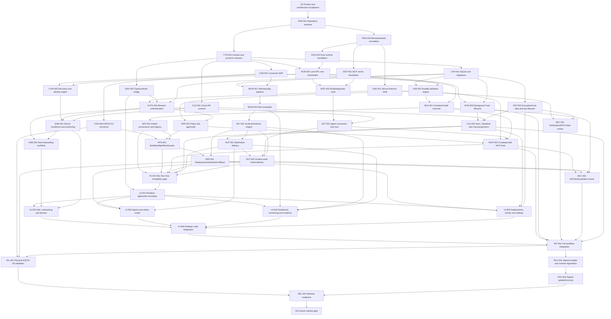

# LokiAI Main v1.2 Execution Graph

Status: **G0/FND-001/FND-002 accepted. Wave accepted and integrated on `origin/LokiAI-v1.2`: CTR-001, DSK-001, RUN-001, CON-001, DSK-002, RUN-002, DAT-001, MCP-001 — full cross-package `pnpm run verify` (4 TS/JS packages + 4 Rust crates together) passes. Continuing to dispatch/complete the remaining OQ-free Part One nodes per human authorization.**  
Graph owner: **Orchestrator**  
Updated: **2026-08-17**

## 1. Baseline

- `UI-BASE` exists: accepted visual/onboarding/dashboard renderer under
  `LokiAI Desktop UI/`.
- It is not evidence of working auth, hardware, monitoring, incidents,
  deployments, or agent integration.
- The repository has no Git baseline and no desktop/runtime/service structure.
- Tasks below are production implementation nodes. Device-changing verification
  waits for the user's confirmed physical board; independent software work does
  not stop.

## 1a. Program structure — Part One and Part Two

Recorded 2026-08-15 by explicit human instruction. This is a durable split of the
whole program, not a single-session convenience:

- **Part One — core platform (waves W0–W6):** repository/workspace foundation,
  shared contracts, the secure Electron shell and typed preload boundary, the Rust
  runtime and local IPC, persistence and protected local data, authentication and
  onboarding _services_ (not their UI wiring), the connector platform and device
  enrollment, the MCP server and agent-run services, monitoring/incidents/
  notifications, durable jobs/policy/approvals, the contained build executor,
  artifact management, device operations and deployment services, and cloud
  synchronization/agent work-intent delivery. Part One explicitly does **not**
  include wiring any of this into the renderer routes — `UI-001` (renderer
  application/contract boundary) is the first Part Two node.
- **Part One completion gate — `P1-INT-001`:** a dedicated milestone node (Section
  4, "Part One completion gate") that must pass before Part Two may begin. Individual
  accepted nodes are not sufficient; `P1-INT-001` exists specifically to prove the
  core services integrate and function together on one baseline. See its node
  definition for the exact required checks, including which security checks are in
  scope for this gate versus reserved for `SEC-001`/`SEC-002`.
- **Part Two — production wiring and release (waves W7–W10):** wiring the complete
  production UI (`UI-001`–`UI-006`), full-route integration (`INT-001`), the
  independent security and test gates (`SEC-001`, `SEC-002`), packaging and updates
  (`PKG-001`, `PKG-002`), physical hardware-in-the-loop validation (`HIL-001`), and
  release readiness plus the final human release gate (`REL-001`, `G6`).
- **Dispatch rule:** the orchestrator may plan, dispatch, and integrate any
  dependency-ready Part One node continuously, without pausing for confirmation
  after each node, and must stop and request a human decision only where a node is
  genuinely blocked on an open decision (`OQ-001`–`OQ-007`), a missing credential,
  a physical device, or an approval this file or `AGENTS.md` requires. The
  orchestrator must not dispatch any Part Two node (`UI-001` onward) until `P1-INT-001`
  is accepted **and** the human owner separately approves starting Part Two — the
  graph edge from `P1-INT-001` into `UI-001` enforces the technical half of that
  gate; the human approval is the other half and is not implied by graph readiness
  alone.

## 2. High-level DAG



## 3. Work waves

Waves are readiness groups, not permission to ignore graph edges. `Part` marks
which half of the program (Section 1a) a wave belongs to.

| Wave | Part | Purpose                             | Candidate parallel work                                                                                                            |
| ---- | ---- | ----------------------------------- | ---------------------------------------------------------------------------------------------------------------------------------- |
| W0   | One  | Accept intent and bootstrap control | G0, FND-001                                                                                                                        |
| W1   | One  | Establish build and contracts       | FND-002, CTR-001 after baseline                                                                                                    |
| W2   | One  | Establish process foundations       | DSK-001, RUN-001, MCP-001; DAT-001/CON-001 after contract readiness                                                                |
| W3   | One  | Establish trust and connectivity    | DSK-002, RUN-002, CLD-001, AUTH-001, CON-002                                                                                       |
| W4   | One  | Establish domain engines            | RUN-003, DAT-002, MON-001, JOB-001, MCP-002, CON-003 after board decision                                                          |
| W5   | One  | Establish workflows                 | ENR-001, ONB-001, AGT-001, MON-002, APR-001, INC-001, BLD-001                                                                      |
| W6   | One  | Establish operations and delivery   | ART-001, OPS-001, MCP-003, DEP-001, CLD-002, NOT-001, AGT-002                                                                      |
| —    | One  | **Part One completion gate**        | `P1-INT-001` — dispatched only once every W6 node above is accepted; see Section 4                                                 |
| W7   | Two  | Wire accepted UI                    | UI-001 foundation (depends on `P1-INT-001`), then UI-002/UI-003/UI-004/UI-005 in parallel by disjoint route ownership, then UI-006 |
| W8   | Two  | Independent review and integration  | SEC-001, SEC-002, INT-001                                                                                                          |
| W9   | Two  | Package and physical validation     | PKG-001, HIL-001, then PKG-002                                                                                                     |
| W10  | Two  | Release                             | REL-001, G6                                                                                                                        |

## 4. Node register

### Governance and foundation

| ID      | Type           | Outcome                                                                                                                                                                                        | Depends on      | Exit evidence                                                                                            | Status   |
| ------- | -------------- | ---------------------------------------------------------------------------------------------------------------------------------------------------------------------------------------------- | --------------- | -------------------------------------------------------------------------------------------------------- | -------- |
| G0      | DECISION       | Human accepts PRD, spec, Electron/Rust/MCP boundaries, scope, and open-decision routing                                                                                                        | —               | Accepted docs or recorded changes                                                                        | accepted |
| FND-001 | MIGRATION      | Git repository initialized with protected baseline, ignore rules, ownership, and current UI snapshot                                                                                           | G0              | clean reproducible baseline; no secret/generated content                                                 | accepted |
| FND-002 | IMPLEMENTATION | Accept and pin the `TECH_STACK.md` matrix; establish TypeScript/pnpm and Cargo workspaces, root commands, CI, formatting/lint/test config, dependency policy, and prototype dependency cleanup | FND-001 | clean reproducible install/check/build and packaged smoke on supported Windows; component/license record | accepted (packaged smoke deferred — no Electron shell exists yet; that's DSK-001) |
| CTR-001 | CONTRACT       | Versioned shared IDs, envelopes, errors, state enums, IPC DTOs, MCP schemas, connector capability schemas                                                                                      | FND-001, G0     | TypeScript/Rust contract validation and compatibility fixtures                                           | accepted (TS side only; Rust codegen deferred per packet; JSON-Schema-vs-zod deviation flagged for human review — see handoff) |
| CLD-001 | CONTRACT       | Accepted cloud identity/workspace/runtime/enrollment/policy/audit/artifact/notification contracts and signed fixtures                                                                          | CTR-001, OQ-002 | contract schemas plus success/error/revocation/version fixtures accepted by cloud owner                  | blocked  |

### Desktop, authentication, and persistence

| ID       | Type           | Outcome                                                                                                                         | Depends on                 | Exit evidence                                                    | Status   |
| -------- | -------------- | ------------------------------------------------------------------------------------------------------------------------------- | -------------------------- | ---------------------------------------------------------------- | -------- |
| DSK-001  | IMPLEMENTATION | Existing UI runs in a packaged secure Electron shell with single-instance and truthful app lifecycle                            | FND-002                    | Electron config/security tests and packaged smoke run            | accepted (packaged smoke run real and verified; `pnpm run electron:package` itself not yet reproducible — app proven via `npx` path instead, see handoff §7a) |
| DSK-002  | CONTRACT       | Minimal typed preload API and event subscription bridge with validation/sender checks                                           | CTR-001, DSK-001           | IPC contract tests; forbidden generic access tests               | accepted |
| DAT-001  | IMPLEMENTATION | Runtime-owned SQLite schema, migrations, repositories, outbox/inbox, integrity/backup primitives                                | FND-002, CTR-001           | migration/restart/corruption/transaction tests                   | accepted |
| DAT-002  | IMPLEMENTATION | Full-database encryption, OS-protected key lifecycle, encrypted backup/WAL, rotation/recovery, and attribution/support decision | DAT-001, OQ-007            | wrong-key/key-loss/rotation/backup/service-user boundary tests   | blocked  |
| AUTH-001 | IMPLEMENTATION | External-browser PKCE sign-in, session refresh, credential-store integration, and real logout                                   | DSK-002, DAT-001, OQ-002   | AS-001/AS-002 including replay/expiry/cleanup tests              | blocked  |
| ONB-001  | IMPLEMENTATION | Durable account/workspace/agent/device-or-project onboarding state machine                                                      | AUTH-001, ENR-001, MCP-002 | resume/back/failure/enrolled-device and project branch scenarios | proposed |

### Runtime and connector platform

| ID      | Type           | Outcome                                                                                                                  | Depends on                 | Exit evidence                                                       | Status   |
| ------- | -------------- | ------------------------------------------------------------------------------------------------------------------------ | -------------------------- | ------------------------------------------------------------------- | -------- |
| RUN-001 | IMPLEMENTATION | Rust runtime executable with health, structured diagnostics, graceful shutdown, and module boundaries                    | FND-002                    | startup/shutdown/crash/error tests                                  | accepted |
| RUN-002 | IMPLEMENTATION | Authenticated local named-pipe RPC, version/capability handshake, deadlines, cancellation, streams                       | RUN-001, CTR-001           | malformed/auth/replay/version/backpressure contract tests           | accepted |
| RUN-003 | IMPLEMENTATION | User background host and gateway-service lifecycle with restart/recovery and desktop discovery                           | RUN-002, DAT-001           | window-close/relaunch/service recovery scenarios                    | proposed |
| CON-001 | CONTRACT       | Device-neutral connector trait, manifest, capability, health, operation, verification, recovery contracts                | CTR-001                    | connector conformance harness                                       | accepted |
| CON-002 | IMPLEMENTATION | Connector registry plus discovery, identity, support, capability, and health orchestration                               | CON-001, RUN-002           | AS-003/AS-004 through conformance connector inputs                  | proposed |
| CON-003 | IMPLEMENTATION | Confirmed ESP32-S3 connector and pinned toolchain integration                                                            | CON-001, OQ-001            | connector conformance plus physical identity/recovery prerequisites | blocked  |
| ENR-001 | IMPLEMENTATION | Challenge-bound device enrollment, ownership, replay protection, revoke/move policy, and consequential-capability gating | CON-002, AUTH-001, CLD-001 | AS-011 including wrong-workspace/runtime and replay tests           | proposed |

### Agent access and observability

| ID      | Type           | Outcome                                                                                                                                                                                                                                        | Depends on                | Exit evidence                                                                                               | Status   |
| ------- | -------------- | ---------------------------------------------------------------------------------------------------------------------------------------------------------------------------------------------------------------------------------------------- | ------------------------- | ----------------------------------------------------------------------------------------------------------- | -------- |
| MCP-001 | IMPLEMENTATION | Provider-neutral stdio MCP server with `2026-07-28` per-request metadata/optional discovery plus one bounded previous-version edge adapter required by the certified clients; schemas, errors, diagnostics, and no transport-session authority | FND-002, CTR-001          | current/previous MCP protocol, transport/discovery/initialize-edge, malformed/version/client-metadata tests | accepted |
| MCP-002 | IMPLEMENTATION | Scoped device/workspace/incident read and diagnostic resources/tools                                                                                                                                                                           | MCP-001, RUN-002, CON-002 | AS-005; auth/scope/pagination/size tests                                                                    | proposed |
| AGT-001 | IMPLEMENTATION | Revocable agent connections plus run/parent-child/tool/change event registry                                                                                                                                                                   | MCP-002, AUTH-001         | Codex/Claude configuration contract and run lifecycle tests                                                 | proposed |
| AGT-002 | IMPLEMENTATION | Provider-neutral incident work intents, provider adapter delivery/acknowledgement, run linking, expiry, and user-action fallback                                                                                                               | AGT-001, INC-001, NOT-001 | AS-015 with supported-client acknowledgement and unavailable-client fallback                                | proposed |
| MON-001 | IMPLEMENTATION | Bounded telemetry/log ingestion, quality/freshness, buffering, storage, and subscriptions                                                                                                                                                      | CON-001, DAT-001          | loss/gap/backpressure/restart/retention tests                                                               | proposed |
| MON-002 | IMPLEMENTATION | Versioned monitoring rules, windows, debounce/cooldown, missing-data semantics                                                                                                                                                                 | MON-001                   | deterministic rule evaluation and restart tests                                                             | proposed |
| INC-001 | IMPLEMENTATION | Incident correlation, bounded evidence, assignment, timeline, verification, reopen/close, and work-intent emission                                                                                                                             | MON-002                   | AS-008 and state-transition tests                                                                           | proposed |
| CLD-002 | IMPLEMENTATION | Durable cloud outbox/inbox sync, conflicts, runtime heartbeat/freshness, control-plane projections, reconnect and backpressure                                                                                                                 | CLD-001, RUN-003, DAT-002 | AS-014 and cloud contract/revocation/deduplication tests                                                    | proposed |
| NOT-001 | IMPLEMENTATION | Deduplicated action-center and Windows notification intents, preferences, delivery/read state, secure deep links, and offline alerts                                                                                                           | CLD-002, INC-001, DSK-001 | notification privacy/dedup/deep-link/runtime-offline tests                                                  | proposed |

### Jobs, approvals, and deployment

| ID      | Type           | Outcome                                                                                                                                                                                                    | Depends on                                  | Exit evidence                                                                                  | Status   |
| ------- | -------------- | ---------------------------------------------------------------------------------------------------------------------------------------------------------------------------------------------------------- | ------------------------------------------- | ---------------------------------------------------------------------------------------------- | -------- |
| JOB-001 | IMPLEMENTATION | Durable job stages, idempotency, per-device lease, cancel/restart/reconcile/quarantine                                                                                                                     | DAT-001, RUN-002                            | crash/race/retry/unknown-outcome tests                                                         | proposed |
| APR-001 | IMPLEMENTATION | RBAC/policy decision and immutable, expiring, single-use approvals                                                                                                                                         | JOB-001, AUTH-001                           | AS-007 plus authorization/race/binding tests                                                   | proposed |
| BLD-001 | IMPLEMENTATION | Separate AppContainer/Job Object build executor, typed recipes, immutable snapshots, resource limits, no-network/secret/device authority, quarantine, and teardown                                         | JOB-001, CON-001, RUN-002                   | AS-012/AS-013 containment, escape, exhaustion, crash, and process-tree tests                   | proposed |
| ART-001 | IMPLEMENTATION | Content-addressed firmware/model/config/bundle registry, external output validation, target/resource compatibility, member ordering/atomicity, build provenance, signature status, and immutable retrieval | BLD-001, DAT-002                            | substitution/mislabel/type/bundle/resource/size/format/provenance and cache-invalidation tests | proposed |
| OPS-001 | IMPLEMENTATION | Artifact preflight, approved flash, restart, test, recovery, and real verification stages for reference connector                                                                                          | JOB-001, APR-001, ART-001, CON-003          | AS-006 stage evidence and safe-failure cases                                                   | proposed |
| MCP-003 | IMPLEMENTATION | Agent-facing contained-build and consequential operation tools mapped to approval/job pipeline with Tasks-extension support and explicit polling fallback                                                  | MCP-002, AGT-001, APR-001, JOB-001, BLD-001 | side-effect, recipe, Tasks/fallback, approval, idempotency, cancellation tests                 | proposed |
| DEP-001 | IMPLEMENTATION | Immutable artifact deployment, target snapshot, single target rollout, observation, verify, rollback                                                                                                       | OPS-001, INC-001                            | AS-006/AS-008/AS-009 deployment evidence                                                       | proposed |

### Part One completion gate

| ID         | Type        | Outcome                                                                                                                                                                                                                                                                                                                                                                                                                                                                                                                                                                                                                                                                                                                                                                                                                                                                                                                                                                                                                                                                                                                                                                                                                                                                                                                                                                                                                                                                                                                                                                                                                                                                                                                                                                                                                                                                                                                                                                                                                                                                                                                   | Depends on                                                    | Exit evidence                                                                                                                                                                                                                                                                              | Status                                                                                                                                                                                                                                                                                                                                                                                                                                                                                                                                                                                                                                                                                                                                                                                                                                                                                                                                                                                                                                                                                                                                |
| ---------- | ----------- | ------------------------------------------------------------------------------------------------------------------------------------------------------------------------------------------------------------------------------------------------------------------------------------------------------------------------------------------------------------------------------------------------------------------------------------------------------------------------------------------------------------------------------------------------------------------------------------------------------------------------------------------------------------------------------------------------------------------------------------------------------------------------------------------------------------------------------------------------------------------------------------------------------------------------------------------------------------------------------------------------------------------------------------------------------------------------------------------------------------------------------------------------------------------------------------------------------------------------------------------------------------------------------------------------------------------------------------------------------------------------------------------------------------------------------------------------------------------------------------------------------------------------------------------------------------------------------------------------------------------------------------------------------------------------------------------------------------------------------------------------------------------------------------------------------------------------------------------------------------------------------------------------------------------------------------------------------------------------------------------------------------------------------------------------------------------------------------------------------------------------- | ------------------------------------------------------------- | ------------------------------------------------------------------------------------------------------------------------------------------------------------------------------------------------------------------------------------------------------------------------------------------ | ------------------------------------------------------------------------------------------------------------------------------------------------------------------------------------------------------------------------------------------------------------------------------------------------------------------------------------------------------------------------------------------------------------------------------------------------------------------------------------------------------------------------------------------------------------------------------------------------------------------------------------------------------------------------------------------------------------------------------------------------------------------------------------------------------------------------------------------------------------------------------------------------------------------------------------------------------------------------------------------------------------------------------------------------------------------------------------------------------------------------------------- |
| P1-INT-001 | INTEGRATION | All accepted Part One (W0–W6) nodes run together on one integrated non-UI baseline: contracts, Electron shell/preload, Rust runtime/local IPC, encrypted persistence, auth/onboarding services, connector platform/enrollment, MCP server/agent runs, monitoring/incidents/notifications, durable jobs/policy/approvals, contained build executor, artifact registry, device-operation/deployment services, and cloud sync/work-intent delivery all pass integration together — not evaluated as isolated nodes. Required checks: (1) **implementation** — every non-blocked W0–W6 node in the register below is `accepted`, with `blocked`/deferred nodes explicitly listed with their blocking `OQ-*`; (2) **integration** — one integrator wave gate (`Docs/graph/INTEGRATION.md`) merges all accepted nodes on one baseline in dependency order with no unresolved conflict; (3) **testing** — each node's own required unit/contract/integration verification (`Docs/TESTING.md`) still passes post-integration, plus cross-service scenarios that only exist once services are combined (e.g., MCP tool call → job → contained build → artifact → connector → device-op pipeline on the conformance connector; runtime crash/restart under an open IPC session; auth session revoked mid-job; cloud outbox/inbox reconnect under DAT-002 encryption); (4) **contract** — every consumed/produced contract in `packages/contracts` has a passing compatibility fixture across every consumer accepted so far; (5) **security-relevant checks scoped to this gate** — secret/credential scan of the integrated baseline, dependency/license audit per `AGENTS.md` rule 11, and a regression pass of each node's own security-relevant acceptance criteria (IPC auth, preload allowlist, build-executor containment, approval binding). **This is not a substitute for `SEC-001`/`SEC-002`** — the full independent Electron/auth/IPC/data review and the full independent MCP/build/policy/connector/artifact review remain Part Two nodes per their existing dependencies and run after this gate, before `INT-001`. | ART-001, OPS-001, MCP-003, DEP-001, CLD-002, NOT-001, AGT-002 | integrator wave-gate record; cross-service scenario results; contract fixture matrix; security-relevant regression/scan results; explicit list of any `OQ-*`-blocked node with its blocker, since a blocked node does not by itself fail this gate but must be named, not silently omitted | **blocked — structurally, not just "not yet reached".** Traced through the node register's actual `Depends on` columns (not the simplified diagram): all seven direct dependencies terminate in at least one open decision — `OPS-001` and `DEP-001` need `CON-003` (`OQ-001`); `CLD-002`, `NOT-001`, and `AGT-002` need `CLD-001` and/or `DAT-002` (`OQ-002`, `OQ-007`); `MCP-003` and `AGT-002` need `AGT-001`, which needs `AUTH-001` (`OQ-002`); `ART-001` needs `DAT-002` (`OQ-007`); `OPS-001` also needs `APR-001`, which needs `AUTH-001` (`OQ-002`). **`P1-INT-001` cannot be reached at all until `OQ-001`, `OQ-002`, and `OQ-007` are resolved**, regardless of how much other Part One work completes. 17 of Part One's 32 non-gate nodes have no `OQ-*` in their dependency closure and can proceed now; the other 15 (`CLD-001`, `DAT-002`, `AUTH-001`, `ONB-001`, `CON-003`, `ENR-001`, `AGT-001`, `AGT-002`, `CLD-002`, `NOT-001`, `APR-001`, `ART-001`, `OPS-001`, `MCP-003`, `DEP-001`) cannot. This is reported now, not discovered after building the other 17, per `AGENTS.md`'s truth/anti-hallucination rules. |

### UI, review, packaging, and release

| ID      | Type               | Outcome                                                                                                                                                                                            | Depends on                                                          | Exit evidence                                                    | Status   |
| ------- | ------------------ | -------------------------------------------------------------------------------------------------------------------------------------------------------------------------------------------------- | ------------------------------------------------------------------- | ---------------------------------------------------------------- | -------- |
| UI-001  | CONTRACT/MIGRATION | Establish renderer application services, query/subscription contracts, common truthful states, error/freshness model, and removal boundary for browser-global authority without redesigning routes | DSK-002, CTR-001, P1-INT-001 (Part One completion gate, Section 1a) | shared renderer contract tests; no generic IPC/storage authority | proposed |
| UI-002  | MIGRATION          | Wire signed-out/auth, workspace, onboarding, discovery, enrollment, device health/detail, and project branch to real services                                                                      | UI-001, ONB-001, ENR-001, CON-002                                   | AS-001–AS-004/AS-011 desktop E2E and route states                | proposed |
| UI-003  | MIGRATION          | Wire Agents, run graph, approvals/action center, notifications, and real incident work-intent delivery states                                                                                      | UI-001, AGT-002, NOT-001                                            | AS-005/AS-015 and agent/notification route E2E                   | proposed |
| UI-004  | MIGRATION          | Wire Dashboard, Monitoring, Incidents, charts/logs, freshness/gaps, evidence, and verification timeline                                                                                            | UI-001, MON-002, INC-001, NOT-001                                   | AS-008/AS-014 and bounded stream/freshness route E2E             | proposed |
| UI-005  | MIGRATION          | Wire Deployments, build/provenance state, Activity, Settings, cloud/runtime/data controls, approval and rollback surfaces                                                                          | UI-001, DEP-001, CLD-002, DAT-002, APR-001                          | AS-006/AS-007/AS-009/AS-012/AS-016 route E2E                     | proposed |
| UI-006  | INTEGRATION        | Integrate all eight routes, shared navigation/search/deep links, relaunch, accessibility, design regression, and remove every successful-looking presentation-only operation                       | UI-002, UI-003, UI-004, UI-005                                      | complete packaged desktop E2E and UI acceptance matrix           | proposed |
| SEC-001 | VERIFICATION       | Independent Electron, auth, credential, local IPC, encrypted-data/key, dependency, and notification review                                                                                         | DSK-001, DSK-002, AUTH-001, RUN-002, DAT-002, NOT-001               | security report; release blockers resolved                       | proposed |
| SEC-002 | VERIFICATION       | Independent MCP, contained build, policy, approvals, connector, artifact, deployment, dispatch, and evidence review                                                                                | MCP-003, BLD-001, DEP-001, AGT-002                                  | security report; release blockers resolved                       | proposed |
| INT-001 | INTEGRATION        | Full desktop → runtime → build/connector/cloud/MCP/notification workflows pass on integrated baseline                                                                                              | UI-006, MCP-003, RUN-003, CLD-002, SEC-001, SEC-002                 | software integration suite and traceability update               | proposed |
| PKG-001 | IMPLEMENTATION     | Signed Windows installer installs desktop/runtime/MCP, registers lifecycle, and uninstalls safely                                                                                                  | INT-001, OQ-004                                                     | clean install/repair/uninstall evidence                          | blocked  |
| PKG-002 | IMPLEMENTATION     | Signed atomic update with compatibility, failed-update recovery, and channel policy                                                                                                                | PKG-001                                                             | update/rollback/signature/tamper evidence                        | proposed |
| HIL-001 | HARDWARE           | Required end-to-end and interruption/recovery scenarios pass on the confirmed physical ESP32-S3                                                                                                    | INT-001, DEP-001, CON-003                                           | signed operator test record, captured job/device evidence        | blocked  |
| REL-001 | RELEASE            | Full release candidate evidence, SBOM, signing, diagnostics, traceability, known risks, and rollback reviewed                                                                                      | HIL-001, PKG-002                                                    | release checklist complete                                       | proposed |
| G6      | RELEASE            | Human release owner approves merge/publish/deploy                                                                                                                                                  | REL-001                                                             | attributed release decision                                      | proposed |

## 5. Decision blockers

`OQ-*` values are defined in `Docs/CONTEXT.md` and are represented as external
decision nodes:

- `OQ-001` blocks only connector-specific flash/recovery and physical validation.
- `OQ-002` blocks cloud auth/client implementation, not Electron/runtime/contract
  foundations.
- `OQ-003` blocks only the Gravity adapter; provider-neutral MCP proceeds.
- `OQ-004` blocks final installer implementation, not packaging research.
- `OQ-005` blocks final retention defaults; persistence schemas should support
  configurable policy meanwhile.
- `OQ-006` blocks only an embedded operations-chat scope. External coding clients,
  the eight accepted tabs, runtime, and MCP proceed.
- `OQ-007` blocks the encrypted-SQLite implementation/package decision and final
  data-at-rest/release gates; schema, repository, and key-interface design may
  proceed without pretending an edition was accepted.

## 6. Ownership map

| Area                                 | Single writer during active node                                                   |
| ------------------------------------ | ---------------------------------------------------------------------------------- |
| Root workspace/lockfiles/CI          | Foundation or integrator                                                           |
| `packages/contracts`                 | CTR contract owner                                                                 |
| Electron main/preload                | Desktop owner                                                                      |
| React route/components               | UI owner, subdivided by route only after shared state contract is accepted         |
| Rust domain/runtime/IPC/storage      | Respective runtime package owner                                                   |
| Contained build executor and recipes | Build-executor owner; connector owner owns only connector-declared recipe contract |
| Cloud client/contracts and sync      | Cloud-contract/runtime-sync owner                                                  |
| Notifications and provider delivery  | Notification/agent-adapter owner after incident contract acceptance                |
| Connector SDK                        | Connector contract owner                                                           |
| ESP32 connector                      | ESP32 connector owner                                                              |
| MCP server                           | MCP owner                                                                          |
| Security documents/findings          | Security reviewer                                                                  |
| Task graph/status                    | Orchestrator                                                                       |
| Release manifest/signing             | Release owner                                                                      |

## 7. Critical path

The likely critical path is:

```text
G0 → FND-001 → FND-002/CTR-001 → RUN-001/RUN-002 → DAT-001/JOB-001
→ CON-001/BLD-001/ART-001 → CON-003/APR-001/OPS-001 → DEP-001
→ P1-INT-001 [Part One completion gate — human approval to proceed required]
→ UI-001 → UI-002/UI-003/UI-004/UI-005 → UI-006/INT-001
→ HIL-001/PKG-001/PKG-002 → REL-001 → G6
```

Cloud contract/sync, auth, enrollment, MCP, telemetry, incident, notification, and
agent-delivery work should run beside this path when their dependencies and write
ownership permit. Everything up to and including `P1-INT-001` is Part One; nothing
at or after `UI-001` (Part Two) is dispatched until `P1-INT-001` is accepted and the
human owner separately approves starting Part Two (Section 1a).

## 8. Status-update record

For every status change, the orchestrator records:

```text
node_id:
from:
to:
timestamp:
actor:
starting_revision:
result_revision:
evidence:
reason:
unblocked_nodes:
new_or_changed_risks:
```

Do not place verbose worker logs in this always-loaded graph. Link their handoff
and evidence records.

```text
node_id: G0
from: proposed
to: accepted
timestamp: 2026-08-15T00:00:00Z
actor: human product/release owner (shrustixrajput@gmail.com), recorded by orchestrator (Claude Code)
starting_revision: n/a (repository not yet under Git; see FND-001)
result_revision: n/a
evidence: explicit chat acceptance — "I accept G0 for LokiAI Main v1.2: the PRD, system
  specification, locked Electron/React/Rust/MCP architecture, and routing of unresolved
  decisions are accepted as the implementation baseline. OQ-001 through OQ-007 remain
  blockers only for their affected branches."
reason: Human product/release owner exercised the G0 human gate defined in
  Docs/graph/PLANNER.md section 10 and AGENTS.md human-approval boundaries, accepting
  Docs/PRD.md, Docs/SPEC.md, and the locked architecture in Docs/ARCHITECTURE.md
  (Electron shell / untrusted React renderer / narrow preload / separate Rust runtime /
  contained build executor / provider-neutral MCP server) as the implementation
  baseline for LokiAI Main v1.2.
unblocked_nodes: FND-001 (packet drafted this record; not yet dispatched — see
  Docs/graph/tasks/FND-001.md)
new_or_changed_risks: OQ-001 (ESP32-S3 SKU), OQ-002 (cloud/auth contracts), OQ-003
  (Gravity adapter), OQ-004 (Windows distribution channel), OQ-005 (retention
  defaults), OQ-006 (embedded ops chat scope), OQ-007 (encrypted-SQLite edition)
  remain open per Docs/CONTEXT.md and continue to block only their named descendant
  nodes/branches per TASK_GRAPH.md section 5; no new risk introduced by this
  acceptance alone.
```

```text
node_id: FND-001
from: ready
to: accepted
timestamp: 2026-08-15T11:01:01Z (commit); force-push correction below at a later
  timestamp on the same date (real wall-clock time not re-queried for the
  correction step)
actor: orchestrator (Claude Code), executing under explicit human approval recorded
  in Docs/graph/tasks/FND-001.md Section 10
starting_revision: pre-Git filesystem snapshot, 2026-08-15 (no .git existed)
result_revision: e5a75c3a06dc1f73c486eb7e4bac4c20b71b5b47 (branch LokiAI-v1.2, tree
  69ba2b2d8c989161a31c25706ee428223bed1229), pushed to
  https://github.com/The-Shriks/LokiAI-v1.2
evidence: Docs/graph/handoffs/FND-001-1.md (worker handoff); git log/status/
  ls-remote output quoted in that handoff; branch name, remote, PromptForYou.md
  exclusion, and one-time push all per explicit human instruction.
reason: FND-001 packet accepted, dispatched, and executed to completion this turn
  per human approval. All Section 7/8 acceptance and verification criteria in
  Docs/graph/tasks/FND-001.md passed. Correction: the first pushed commit
  (0ad5a7f0c1d5e71acbffb2b1b6d984bede7229fd) included a "Co-Authored-By: Claude"
  trailer that GitHub rendered as a second co-author on the commit; the human
  flagged this as looking like an unauthorized second account and asked for a
  single-author commit. The commit message (not its file content — tree hash
  unchanged: 69ba2b2d8c989161a31c25706ee428223bed1229) was amended to remove the
  trailer, producing e5a75c3, and force-pushed with `--force-with-lease` guarded
  against the exact prior known remote SHA, with explicit human approval for that
  specific force-push. No new GitHub account or repository was created at any
  point; only the pre-existing empty remote the human named was used.
unblocked_nodes: FND-002 (Monorepo/build foundation) is now dependency-ready but
  remains undispatched — human instruction scoped this turn to FND-001 only
  ("Part One"); no further node was started.
new_or_changed_risks: none beyond those already tracked under G0's status-update
  record above.
```

```text
node_id: CTR-001, DSK-001, RUN-001
from: proposed
to: accepted
timestamp: real command timestamps embedded in each node's
  Docs/graph/handoffs/<NODE-ID>-1.md; commits e5a... through 4eca56e
actor: three loki-implementer background subagents (initial work), each
  interrupted by an unrelated session restart before writing a handoff or
  committing; orchestrator (Claude Code) inspected each worktree directly,
  completed verification, wrote each handoff, committed each on its own
  branch, then integrated all three into LokiAI-v1.2 in dependency order
  (RUN-001, then CTR-001, then DSK-001), resolving one real mechanical
  conflict (pnpm-lock.yaml, via `pnpm install`'s own conflict resolution)
  and one non-conflicting shared-file merge (eslint.config.js, both
  branches' additions coexist correctly).
starting_revision: 519892a
result_revision: 4eca56e (LokiAI-v1.2, local; not yet pushed as of this record)
evidence: Docs/graph/handoffs/{CTR-001,DSK-001,RUN-001}-1.md; full integrated
  `pnpm run verify` exit 0 after all three merged, including the Rust
  build/test steps running for real for the first time (RUN-001 added the
  first non-empty workspace member) — 303 TS contract tests, 17 Electron
  security tests, 21 Rust tests, all passing together on one baseline.
reason: All three nodes' packet acceptance criteria pass with real,
  independently-verified evidence (not narrated). Two items explicitly NOT
  treated as fully resolved despite `accepted` status — recorded here so
  they aren't lost: (1) CTR-001 uses zod-schema-first contracts, not
  TECH_STACK.md's stated "canonical JSON Schema 2020-12 plus generated
  types" — needs an explicit human decision (accept as the real
  implementation and update TECH_STACK.md, or require a JSON-Schema layer);
  (2) DSK-001's packaged app is proven working, but the packet-intended
  `pnpm run electron:package` command itself is not yet reproducible on
  this pnpm version (node-linker friction) — tracked for a `DSK-001-R1` or
  `PKG-001`.
unblocked_nodes: DSK-002, DAT-001, CON-001, MCP-001, RUN-002 are all now
  dependency-ready.
new_or_changed_risks: none beyond the two items named above.
```

```text
node_id: FND-002
from: proposed
to: accepted
timestamp: real command timestamps embedded in Docs/graph/handoffs/FND-002-1.md;
  no single wall-clock "done" time captured separately
actor: orchestrator (Claude Code), under the continuous Part One authorization
  recorded in Section 1a and Docs/graph/PLANNER.md section 12
starting_revision: e5a75c3 / 4a28235 (FND-001 baseline)
result_revision: local commit pending push at time of this record; see next
  status-update entry for the pushed SHA once available
evidence: Docs/graph/handoffs/FND-002-1.md; `pnpm run verify` exit 0 (format,
  lint, typecheck, build, guarded cargo steps); `pnpm licenses list` all
  permissive; real Node 24.19.0/Rust 1.97.1 toolchain installed via winget with
  explicit human approval.
reason: FND-002 packet executed to completion. All Docs/graph/tasks/FND-002.md
  Section 7 criteria that are reachable at this point in the graph pass with real
  evidence; criteria requiring not-yet-built components (packaged smoke, MCP
  protocol test, etc.) are explicitly carried forward, not claimed.
unblocked_nodes: DSK-001, RUN-001, MCP-001 (all depend on FND-002 and CTR-001
  where applicable) are now dependency-ready pending CTR-001 for the ones that
  need it; CTR-001 was already ready independently of FND-002.
new_or_changed_risks: two AccountMenuModal/product-behavior and metadata.json-
  deletion findings recorded in the handoff Section 7/8 for reviewer attention;
  neither blocks acceptance.
```

```text
node_id: CON-001, DSK-002, RUN-002, DAT-001, MCP-001 (batch record — five nodes,
  same wave, same integration pass)
from: proposed
to: accepted
timestamp: 2026-08-17 (session continued after an interruption; individual
  command timestamps are in each node's own handoff)
actor: orchestrator (Claude Code). Each node's implementation was started by a
  background loki-implementer subagent; all five were interrupted before
  finishing (one API session-limit failure mid-work for MCP-001, four API
  session-limit failures right at/near their own final verification for the
  other four — CTR-001/DSK-001/RUN-001 from the prior wave hit the same
  session limit but were resumed successfully before it recurred). The
  orchestrator inspected each worktree directly rather than trust any
  self-report, ran real verification, found and fixed real bugs in three of
  the five (RUN-002: 6 distinct bugs including a hanging test traced to a
  split-pipe half never being dropped; MCP-001: a broken config placeholder
  plus 10 real lint/type findings; CON-001 and DAT-001 needed no fixes,
  DSK-002 needed none), wrote each handoff, and committed each on its own
  branch.
starting_revision: 4f57452 (five task packets, dispatched from there)
result_revision: 8ab36dc (LokiAI-v1.2, after all five merged + two Cargo.lock
  regenerations + one stray-artifact cleanup)
evidence: Docs/graph/handoffs/{CON-001,DSK-002,RUN-002,DAT-001,MCP-001}-1.md;
  full `pnpm run verify` exit 0 on the final integrated state — 4 TS/JS
  workspace packages (LokiAI Desktop UI, @lokiai/contracts, @lokiai/mcp-server,
  root) and 4 Rust crates (loki-runtime, loki-connectors-sdk, loki-ipc,
  loki-storage) all build/format/lint/typecheck/test together, including a
  fresh `cargo build/fmt/clippy/test --workspace` run across all four crates
  after each merge, not just the final one.
reason: each node's packet acceptance criteria pass with real, independently
  re-verified evidence — not accepted on the implementer's self-report alone,
  consistent with `Docs/graph/PLANNER.md`'s "never reports pass based on
  worker narrative alone."
unblocked_nodes: RUN-003 (RUN-002+DAT-001), CON-002 (CON-001+RUN-002),
  MCP-002 (MCP-001+RUN-002+CON-002), MON-001 (CON-001+DAT-001), JOB-001
  (DAT-001+RUN-002), BLD-001 (JOB-001+CON-001+RUN-002, once JOB-001 lands) are
  now dependency-ready or closer to it.
new_or_changed_risks: CTR-001's zod-vs-JSON-Schema `TECH_STACK.md` deviation
  (flagged in its own handoff) remains open for human decision, not resolved
  by this record. DSK-001's pnpm-vs-npx Electron Forge packaging gap (its own
  handoff, section 7a) likewise remains open. Both are pre-existing findings
  from the prior wave, restated here only because later nodes build on top of
  the same packages/crates and a reviewer should not lose track of them.
```
