# LokiAI Main v1.2 Execution Graph

Status: **`P1-INT-001` is reopened as `NEEDS_REPLAN`. Its recorded test evidence remains valid only for separately tested packages; it did not prove that the production runtime, Electron, MCP, connector, monitoring, jobs, approvals, agents, incidents, and local-delivery services run together. Production Electron/MCP paths still return `runtime_unavailable`, `CON-002` is mock-backed, and mandatory connector/build/artifact/operation/deployment nodes remain unaccepted. ADR-0003 restores every non-cloud W0-W6 capability to Part One. Independent `DAT-002-REV-001` found two critical and seven high findings, so DAT remains blocked while `DAT-002-CORR-001` is ready. `P1-RPC-CONTRACT-001` is also ready. Cloud remains deferred; Part Two has not started.**
Graph owner: **Orchestrator**  
Updated: **2026-08-24**

## 1. Baseline

- `UI-BASE` exists: accepted visual/onboarding/dashboard renderer under
  `LokiAI Desktop UI/`.
- It is not evidence of working auth, hardware, monitoring, incidents,
  deployments, or agent integration.
- The repository has a Git baseline plus Electron, runtime, IPC, contracts, and
  local domain-service packages. These packages are not yet composed into one
  production Part One system.
- Tasks below are production implementation nodes. Device-changing verification
  waits for the user's confirmed physical board; independent software work does
  not stop.

## 1a. Program structure — Part One and Part Two

Recorded 2026-08-15 by explicit human instruction. This is a durable split of the
whole program, not a single-session convenience:

- **Part One — local core platform (waves W0–W6):** repository/workspace foundation,
  shared contracts, the secure Electron shell and typed preload boundary, the Rust
  runtime and local IPC, persistence and protected local data, local installation
  authority and setup _services_ (not their UI wiring), the connector platform and
  local device binding, the MCP server and agent-run services, monitoring/incidents/
  local notification intents, durable jobs/policy/approvals, the contained build
  executor, artifact registry, and verified device-operation/deployment services.
  Per accepted
  `ADR-0002`, cloud contracts/login/workspaces/enrollment/sync/remote delivery are
  deferred. The human owner's 2026-08-24 production-completion instruction
  supersedes the earlier temporary deferral of `BLD-001` and its descendants;
  those nodes are required again and remain blocked/proposed until proven. Part
  One explicitly does **not**
  include wiring any of this into the renderer routes — `UI-001` (renderer
  application/contract boundary) is the first Part Two node.
- **Part One completion gate — `P1-INT-001`:** a dedicated milestone node (Section
  4, "Part One completion gate") that must pass before Part Two may begin. Individual
  accepted nodes are not sufficient; `P1-INT-001` exists specifically to prove the
  non-deferred local core services integrate and function together on one baseline. See its node
  definition for the exact required checks, including which security checks are in
  scope for this gate versus reserved for `SEC-001`/`SEC-002`.
- **Part Two — production wiring and release (waves W7–W10):** wiring the complete
  production UI (`UI-001`–`UI-006`), full-route integration (`INT-001`), the
  independent security and test gates (`SEC-001`, `SEC-002`), packaging and updates
  (`PKG-001`, `PKG-002`), physical hardware-in-the-loop validation (`HIL-001`), and
  release readiness plus the final human release gate (`REL-001`, `G6`).
- **Dispatch rule:** the orchestrator may plan, dispatch, and integrate any
  dependency-ready Part One node continuously, without pausing for confirmation
  after each node, and must stop and request a human decision only where a node is
  genuinely blocked on an open decision (`OQ-001`–`OQ-007`), a missing credential,
  a physical device, or an approval this file or `AGENTS.md` requires. The
  orchestrator must not dispatch any Part Two node (`UI-001` onward) until `P1-INT-001`
  is accepted **and** the human owner separately approves starting Part Two. A
  blocked/deferred node is never relabeled accepted; the revised gate must list it
  and exclude its capabilities from the certified baseline — the
  graph edge from `P1-INT-001` into `UI-001` enforces the technical half of that
  gate; the human approval is the other half and is not implied by graph readiness
  alone.

## 2. High-level DAG

```mermaid
flowchart TD
  G0["G0 Product and architecture acceptance"] --> FND001["FND-001 Repository baseline"]
  FND001 --> FND002["FND-002 Monorepo/build foundation"]
  FND001 --> CTR001["CTR-001 Domain and protocol contracts"]
  CTR001 --> CLD001["CLD-001 Cloud API contract"]

  FND002 --> DSK001["DSK-001 Secure Electron shell"]
  FND002 --> RUN001["RUN-001 Rust runtime foundation"]
  FND002 --> MCP001["MCP-001 MCP server foundation"]
  CTR001 --> DSK002["DSK-002 Typed preload bridge"]
  CTR001 --> RUN002["RUN-002 Local IPC and handshake"]
  CTR001 --> CON001["CON-001 Connector SDK"]
  CTR001 --> DAT001["DAT-001 SQLite and migrations"]
  DAT001 --> DAT002["DAT-002 Encrypted local data and key lifecycle"]

  DSK001 --> AUTH001["AUTH-001 Browser authentication"]
  DSK002 --> AUTH001
  DAT001 --> AUTH001
  DSK002 --> LOC001["LOC-001 Local installation authority"]
  DAT001 --> LOC001
  RUN001 --> RUN002
  RUN002 --> RUN003["RUN-003 Background host lifecycle"]
  DAT001 --> RUN003

  CON001 --> CON002["CON-002 Discovery and identity engine"]
  CON001 --> CON003["CON-003 ESP32-S3 connector"]
  RUN002 --> CON002
  RUN002 --> MCP002["MCP-002 Read/diagnostic tools"]
  MCP001 --> MCP002

  AUTH001 --> ONB001["ONB-001 Real onboarding workflow"]
  CON002 --> ENR001["ENR-001 Device enrollment and ownership"]
  AUTH001 --> ENR001
  CLD001 --> ENR001
  ENR001 --> ONB001
  MCP002 --> AGT001["AGT-001 Agent connection and runs"]
  LOC001 --> AGT001
  CON002 --> LDEV001["LDEV-001 Local device binding"]
  LOC001 --> LDEV001
  LOC001 --> LONB001["LONB-001 Local setup workflow"]
  LDEV001 --> LONB001
  MCP002 --> LONB001

  DAT001 --> MON001["MON-001 Telemetry/log pipeline"]
  CON001 --> MON001
  MON001 --> MON002["MON-002 Rule evaluation"]
  MON002 --> INC001["INC-001 Incident/evidence engine"]

  DAT001 --> JOB001["JOB-001 Durable job/lease engine"]
  RUN002 --> JOB001
  JOB001 --> APR001["APR-001 Policy and approvals"]
  LOC001 --> APR001
  JOB001 --> BLD001["BLD-001 Contained build executor"]
  CON001 --> BLD001
  BLD001 --> ART001["ART-001 Artifact provenance and registry"]
  CON003 --> OPS001["OPS-001 Build/preflight/flash/restart"]
  APR001 --> OPS001
  ART001 --> OPS001
  OPS001 --> DEP001["DEP-001 Deployment/verification/rollback"]
  INC001 --> DEP001

  APR001 --> MCP003["MCP-003 Consequential MCP tools"]
  JOB001 --> MCP003
  AGT001 --> MCP003
  BLD001 --> MCP003

  RUN003 --> CLD002["CLD-002 Sync, heartbeat and cloud projections"]
  CLD001 --> CLD002
  DAT002 --> CLD002
  CLD002 --> NOT001["NOT-001 Notification delivery"]
  INC001 --> NOT001
  INC001 --> LNOT001["LNOT-001 Local notification intents"]
  DSK001 --> LNOT001
  NOT001 --> AGT002["AGT-002 Incident work-intent delivery"]
  LNOT001 --> AGT002
  AGT001 --> AGT002
  INC001 --> AGT002

  DAT002 --> P1INT001["P1-INT-001 Local-only Part One completion gate"]
  LONB001 --> P1INT001
  LDEV001 --> P1INT001
  APR001 --> P1INT001
  AGT002 --> P1INT001

  DSK002 --> UI001["UI-001 Renderer application boundary"]
  P1INT001 --> UI001
  UI001 --> UI002["UI-002 Auth, onboarding and devices"]
  ONB001 --> UI002
  ENR001 --> UI002
  UI001 --> UI003["UI-003 Agents and action center"]
  AGT002 --> UI003
  NOT001 --> UI003
  UI001 --> UI004["UI-004 Dashboard, monitoring and incidents"]
  MON002 --> UI004
  INC001 --> UI004
  NOT001 --> UI004
  UI001 --> UI005["UI-005 Deployments, activity and settings"]
  DEP001 --> UI005
  CLD002 --> UI005
  DAT002 --> UI005
  UI002 --> UI006["UI-006 Desktop route integration"]
  UI003 --> UI006
  UI004 --> UI006
  UI005 --> UI006

  DSK001 --> SEC001["SEC-001 Desktop/auth/IPC/data review"]
  DAT002 --> SEC001
  MCP003 --> SEC002["SEC-002 MCP/policy/artifact review"]
  DEP001 --> SEC002
  BLD001 --> SEC002
  AGT002 --> SEC002

  UI006 --> INT001["INT-001 Full workflow integration"]
  MCP003 --> INT001
  RUN003 --> INT001
  SEC001 --> INT001
  SEC002 --> INT001
  CLD002 --> INT001

  CON003 --> HIL001["HIL-001 Physical ESP32-S3 validation"]
  DEP001 --> HIL001
  INT001 --> HIL001

  INT001 --> PKG001["PKG-001 Signed installer and runtime registration"]
  PKG001 --> PKG002["PKG-002 Signed update/recovery"]
  HIL001 --> REL001["REL-001 Release readiness"]
  PKG002 --> REL001
  REL001 --> G6["G6 Human release gate"]
```



## 3. Work waves

Waves are readiness groups, not permission to ignore graph edges. `Part` marks
which half of the program (Section 1a) a wave belongs to.

| Wave | Part | Purpose                             | Candidate parallel work                                                                                                            |
| ---- | ---- | ----------------------------------- | ---------------------------------------------------------------------------------------------------------------------------------- |
| W0   | One  | Accept intent and bootstrap control | G0, FND-001                                                                                                                        |
| W1   | One  | Establish build and contracts       | FND-002, CTR-001 after baseline                                                                                                    |
| W2   | One  | Establish process foundations       | DSK-001, RUN-001, MCP-001; DAT-001/CON-001 after contract readiness                                                                |
| W3   | One  | Establish trust and connectivity    | DSK-002, RUN-002, CON-002, LOC-001; CLD-001/AUTH-001 deferred by ADR-0002                                                          |
| W4   | One  | Establish domain engines            | RUN-003, DAT-002, MON-001, JOB-001, MCP-002; CON-003 deferred pending OQ-001                                                       |
| W5   | One  | Establish local workflows           | LDEV-001, LONB-001, AGT-001, MON-002, APR-001, INC-001; ENR-001/ONB-001/BLD-001 deferred                                           |
| W6   | One  | Establish local delivery            | LNOT-001, AGT-002; ART-001/OPS-001/MCP-003/DEP-001/CLD-002/NOT-001 deferred                                                        |
| —    | One  | **Part One completion gate**        | `P1-INT-001` — revised local-only baseline per ADR-0002; deferred nodes must be named and must not be represented as accepted       |
| W7   | Two  | Wire accepted UI                    | UI-001 foundation (depends on `P1-INT-001`), then UI-002/UI-003/UI-004/UI-005 in parallel by disjoint route ownership, then UI-006 |
| W8   | Two  | Independent review and integration  | SEC-001, SEC-002, INT-001                                                                                                          |
| W9   | Two  | Package and physical validation     | PKG-001, HIL-001, then PKG-002                                                                                                     |
| W10  | Two  | Release                             | REL-001, G6                                                                                                                        |

## 4. Node register

### Governance and foundation

| ID      | Type           | Outcome                                                                                                                                                                                        | Depends on      | Exit evidence                                                                                            | Status   |
| ------- | -------------- | ---------------------------------------------------------------------------------------------------------------------------------------------------------------------------------------------- | --------------- | -------------------------------------------------------------------------------------------------------- | -------- |
| G0      | DECISION       | Human accepts PRD, spec, Electron/Rust/MCP boundaries, scope, and open-decision routing                                                                                                        | —               | Accepted docs or recorded changes                                                                        | accepted |
| FND-001 | MIGRATION      | Git repository initialized with protected baseline, ignore rules, ownership, and current UI snapshot                                                                                           | G0              | clean reproducible baseline; no secret/generated content                                                 | accepted |
| FND-002 | IMPLEMENTATION | Accept and pin the `TECH_STACK.md` matrix; establish TypeScript/pnpm and Cargo workspaces, root commands, CI, formatting/lint/test config, dependency policy, and prototype dependency cleanup | FND-001 | clean reproducible install/check/build and packaged smoke on supported Windows; component/license record | accepted (packaged smoke deferred — no Electron shell exists yet; that's DSK-001) |
| CTR-001 | CONTRACT       | Versioned shared IDs, envelopes, errors, state enums, IPC DTOs, MCP schemas, connector capability schemas                                                                                      | FND-001, G0     | TypeScript/Rust contract validation and compatibility fixtures                                           | accepted (TS side only; Rust codegen deferred per packet; JSON-Schema-vs-zod deviation flagged for human review — see handoff) |
| CLD-001 | CONTRACT       | Accepted cloud identity/workspace/runtime/enrollment/policy/audit/artifact/notification contracts and signed fixtures                                                                          | CTR-001, OQ-002 | contract schemas plus success/error/revocation/version fixtures accepted by cloud owner                  | deferred — excluded from local-only Part One by ADR-0002; requirement retained |

### Desktop, authentication, and persistence

| ID       | Type           | Outcome                                                                                                                         | Depends on                 | Exit evidence                                                    | Status   |
| -------- | -------------- | ------------------------------------------------------------------------------------------------------------------------------- | -------------------------- | ---------------------------------------------------------------- | -------- |
| DSK-001  | IMPLEMENTATION | Existing UI runs in a packaged secure Electron shell with single-instance and truthful app lifecycle                            | FND-002                    | Electron config/security tests and packaged smoke run            | accepted (packaged smoke run real and verified; `pnpm run electron:package` itself not yet reproducible — app proven via `npx` path instead, see handoff §7a) |
| DSK-002  | CONTRACT       | Minimal typed preload API and event subscription bridge with validation/sender checks                                           | CTR-001, DSK-001           | IPC contract tests; forbidden generic access tests               | accepted |
| DAT-001  | IMPLEMENTATION | Runtime-owned SQLite schema, migrations, repositories, outbox/inbox, integrity/backup primitives                                | FND-002, CTR-001           | migration/restart/corruption/transaction tests                   | accepted |
| DAT-002  | IMPLEMENTATION | Full-database encryption, OS-protected key lifecycle, encrypted backup/WAL, rotation/recovery, and SQLCipher Community attribution. **Accepted scope:** preserve bounded-context files rather than merge stores; every persisted local Part One database and its WAL/backup must be encrypted. | DAT-001, OQ-007            | wrong-key/key-loss/rotation/backup/service-user boundary tests   | blocked — production checkpoint integrated at `073af82`; local Part One store integration at `41d510f`. All runnable gates pass (`Docs/graph/evidence/W4/DAT-002/verification.md` and `local-part-one-integration.md`), but the mandatory second-identity DPAPI test environment and independent data-security review remain unavailable. Integrated does not mean accepted. |
| LOC-001  | IMPLEMENTATION | Windows-bound local installation-owner/session authority, explicit local capability projection, revocation, and fail-closed cloud separation | DSK-002, DAT-001, ADR-0002 | wrong-principal/session, revocation, expiry, restart, and cloud-unavailable tests | accepted — integrated at `ce789a6`; full verification in `Docs/graph/evidence/W3/LOC-001/verification.md` |
| LONB-001 | IMPLEMENTATION | Durable local setup state machine for installation owner, agent registration, and existing-device-or-project choice without inventing cloud account/workspace state | LOC-001, LDEV-001, MCP-002 | resume/back/failure/device and project branch scenarios | accepted — integrated at `c9e82e7`; full verification in `Docs/graph/evidence/W5/LONB-001/verification.md` |
| AUTH-001 | IMPLEMENTATION | External-browser PKCE sign-in, session refresh, credential-store integration, and real logout                                   | DSK-002, DAT-001, OQ-002   | AS-001/AS-002 including replay/expiry/cleanup tests              | deferred — excluded from local-only Part One by ADR-0002 |
| ONB-001  | IMPLEMENTATION | Durable cloud account/workspace/agent/device-or-project onboarding state machine                                                | AUTH-001, ENR-001, MCP-002 | resume/back/failure/enrolled-device and project branch scenarios | deferred — excluded from local-only Part One by ADR-0002 |

### Runtime and connector platform

| ID      | Type           | Outcome                                                                                                                  | Depends on                 | Exit evidence                                                       | Status   |
| ------- | -------------- | ------------------------------------------------------------------------------------------------------------------------ | -------------------------- | ------------------------------------------------------------------- | -------- |
| RUN-001 | IMPLEMENTATION | Rust runtime executable with health, structured diagnostics, graceful shutdown, and module boundaries                    | FND-002                    | startup/shutdown/crash/error tests                                  | accepted |
| RUN-001-CORR-001 | CORRECTION | Restore RUN-001's structured-stdout diagnostics contract and deterministic default-logging process tests          | RUN-001, RUN-003           | runtime and IPC real-process/named-pipe regression suites           | accepted |
| RUN-002 | IMPLEMENTATION | Authenticated local named-pipe RPC, version/capability handshake, deadlines, cancellation, streams                       | RUN-001, CTR-001           | malformed/auth/replay/version/backpressure contract tests           | accepted |
| RUN-003 | IMPLEMENTATION | User background host and gateway-service lifecycle with restart/recovery and desktop discovery                           | RUN-002, DAT-001           | window-close/relaunch/service recovery scenarios                    | accepted |
| CON-001 | CONTRACT       | Device-neutral connector trait, manifest, capability, health, operation, verification, recovery contracts                | CTR-001                    | connector conformance harness                                       | accepted |
| CON-002 | IMPLEMENTATION | Connector registry plus discovery, identity, support, capability, and health orchestration                               | CON-001, RUN-002           | AS-003/AS-004 through conformance connector inputs                  | accepted |
| CON-003 | IMPLEMENTATION | Confirmed ESP32-S3 connector and pinned toolchain integration                                                            | CON-001, OQ-001            | connector conformance plus physical identity/recovery prerequisites | blocked  |
| LDEV-001 | IMPLEMENTATION | Installation-scoped local device binding with stable identity evidence, explicit rebind/revoke, replay protection, and consequential-capability gating; never represented as cloud ownership | CON-002, LOC-001, ADR-0002 | wrong-installation/runtime, replay, rebind, revoke, and identity-change tests | accepted — integrated at `7c0a2da`; full verification in `Docs/graph/evidence/W5/LDEV-001/verification.md` |
| ENR-001 | IMPLEMENTATION | Challenge-bound cloud device enrollment, ownership, replay protection, revoke/move policy, and consequential-capability gating | CON-002, AUTH-001, CLD-001 | AS-011 including wrong-workspace/runtime and replay tests           | deferred — excluded from local-only Part One by ADR-0002 |

### Agent access and observability

| ID      | Type           | Outcome                                                                                                                                                                                                                                        | Depends on                | Exit evidence                                                                                               | Status   |
| ------- | -------------- | ---------------------------------------------------------------------------------------------------------------------------------------------------------------------------------------------------------------------------------------------- | ------------------------- | ----------------------------------------------------------------------------------------------------------- | -------- |
| MCP-001 | IMPLEMENTATION | Provider-neutral stdio MCP server with `2026-07-28` per-request metadata/optional discovery plus one bounded previous-version edge adapter required by the certified clients; schemas, errors, diagnostics, and no transport-session authority | FND-002, CTR-001          | current/previous MCP protocol, transport/discovery/initialize-edge, malformed/version/client-metadata tests | accepted |
| MCP-002 | IMPLEMENTATION | Scoped device/workspace/incident read and diagnostic resources/tools                                                                                                                                                                           | MCP-001, RUN-002, CON-002 | AS-005; auth/scope/pagination/size tests                                                                    | accepted |
| AGT-001 | IMPLEMENTATION | Locally authorized, scoped, revocable agent connections plus run/parent-child/tool/change event registry                                                                                                                                       | MCP-002, LOC-001          | Codex/Claude configuration contract, unknown-principal denial, and run lifecycle tests                       | accepted — integrated at `c4f0c44`; full verification in `Docs/graph/evidence/W5/AGT-001/verification.md` |
| AGT-002 | IMPLEMENTATION | Provider-neutral local incident work intents, supported local adapter delivery/acknowledgement, run linking, expiry, and user-action fallback; remote wake/resume remains deferred                                                             | AGT-001, INC-001, LNOT-001 | AS-015 local supported-client acknowledgement and unavailable-client fallback                               | accepted — integrated at `49e86c7`; full verification in `Docs/graph/evidence/W6/AGT-002/verification.md` |
| MON-001 | IMPLEMENTATION | Bounded telemetry/log ingestion, quality/freshness, buffering, storage, and subscriptions                                                                                                                                                      | CON-001, DAT-001          | loss/gap/backpressure/restart/retention tests                                                               | accepted |
| MON-002 | IMPLEMENTATION | Versioned monitoring rules, windows, debounce/cooldown, missing-data semantics                                                                                                                                                                 | MON-001                   | deterministic rule evaluation and restart tests                                                             | accepted |
| INC-001 | IMPLEMENTATION | Incident correlation, bounded evidence, assignment, timeline, verification, reopen/close, and work-intent emission                                                                                                                             | MON-002                   | AS-008 and state-transition tests                                                                           | accepted |
| LNOT-001 | IMPLEMENTATION | Deduplicated durable local notification intents, preferences, delivery/read state, safe local action references, and runtime-offline alerts; no remote delivery claim                                                                          | INC-001, DSK-001, DAT-002 | notification privacy/dedup/action-reference/runtime-offline tests                                           | accepted — integrated at `185edd8`; full verification in `Docs/graph/evidence/W6/LNOT-001/verification.md` |
| CLD-002 | IMPLEMENTATION | Durable cloud outbox/inbox sync, conflicts, runtime heartbeat/freshness, control-plane projections, reconnect and backpressure                                                                                                                 | CLD-001, RUN-003, DAT-002 | AS-014 and cloud contract/revocation/deduplication tests                                                    | deferred — excluded from local-only Part One by ADR-0002 |
| NOT-001 | IMPLEMENTATION | Cloud-coordinated action-center and Windows notification delivery, preferences, delivery/read state, secure deep links, and offline alerts                                                                                                      | CLD-002, INC-001, DSK-001 | notification privacy/dedup/deep-link/runtime-offline tests                                                  | deferred — remote delivery excluded from local-only Part One by ADR-0002 |

### Jobs, approvals, and deployment

| ID      | Type           | Outcome                                                                                                                                                                                                    | Depends on                                  | Exit evidence                                                                                  | Status   |
| ------- | -------------- | ---------------------------------------------------------------------------------------------------------------------------------------------------------------------------------------------------------- | ------------------------------------------- | ---------------------------------------------------------------------------------------------- | -------- |
| JOB-001 | IMPLEMENTATION | Durable job stages, idempotency, per-device lease, cancel/restart/reconcile/quarantine                                                                                                                     | DAT-001, RUN-002                            | crash/race/retry/unknown-outcome tests                                                         | accepted |
| APR-001 | IMPLEMENTATION | Local installation policy decision and immutable, expiring, single-use, canonical-request-bound human approvals; cloud RBAC remains deferred                                                               | JOB-001, LOC-001                            | AS-007 plus principal/target/artifact binding, expiry, reuse, authorization, and race tests    | accepted — integrated at `95c4e0f`; full verification in `Docs/graph/evidence/W5/APR-001/verification.md` |
| BLD-001 | IMPLEMENTATION | Separate AppContainer/Job Object build executor, typed recipes, immutable snapshots, resource limits, no-network/secret/device authority, quarantine, and teardown                                         | JOB-001, CON-001, RUN-002                   | AS-012/AS-013 containment, escape, exhaustion, crash, and process-tree tests                   | blocked — explicitly deferred by human 2026-08-24. `BLD-001-CORR-001-R1` found that the current per-job AppContainer ancestor-traverse design mutates an existing volume root, conflicting with the accepted no-host-ACL boundary; it requires a new accepted architecture/task packet and full real hostile-fixture evidence before it can be reconsidered. |
| ART-001 | IMPLEMENTATION | Content-addressed firmware/model/config/bundle registry, external output validation, target/resource compatibility, member ordering/atomicity, build provenance, signature status, and immutable retrieval | BLD-001, DAT-002                            | substitution/mislabel/type/bundle/resource/size/format/provenance and cache-invalidation tests | proposed |
| OPS-001 | IMPLEMENTATION | Artifact preflight, approved flash, restart, test, recovery, and real verification stages for reference connector                                                                                          | JOB-001, APR-001, ART-001, CON-003          | AS-006 stage evidence and safe-failure cases                                                   | proposed |
| MCP-003 | IMPLEMENTATION | Agent-facing contained-build and consequential operation tools mapped to approval/job pipeline with Tasks-extension support and explicit polling fallback                                                  | MCP-002, AGT-001, APR-001, JOB-001, BLD-001 | side-effect, recipe, Tasks/fallback, approval, idempotency, cancellation tests                 | proposed |
| DEP-001 | IMPLEMENTATION | Immutable artifact deployment, target snapshot, single target rollout, observation, verify, rollback                                                                                                       | OPS-001, INC-001                            | AS-006/AS-008/AS-009 deployment evidence                                                       | proposed |

### Part One completion gate

| ID         | Type        | Outcome | Depends on | Exit evidence | Status |
| ---------- | ----------- | ------- | ---------- | ------------- | ------ |
| P1-INT-001 | INTEGRATION | Prove the cloud-deferred Part One services run together through their real production process boundaries on one non-UI baseline: authenticated desktop/runtime and MCP/runtime communication; encrypted persistence; real connector discovery/identity/health; monitoring/incidents; durable jobs/policy/approvals; contained builds; artifact provenance; consequential operations; verification/recovery/deployment; agent delivery; and fail-closed unavailable behavior. Package/unit tests are necessary but cannot substitute for cross-process, containment, or physical evidence. | DAT-002, LOC-001, LDEV-001, LONB-001, AGT-001, APR-001, LNOT-001, AGT-002, BLD-001, ART-001, OPS-001, MCP-003, DEP-001, CON-003, production composition correction nodes | real process integration record; contract matrix; containment and physical evidence; security reviews; explicit cloud deferral | `NEEDS_REPLAN` — prior acceptance at `38fd260` is invalid as a production integration claim; its package-test evidence is retained but insufficient |
| P1-GRAPH-AUD-001 | VERIFICATION | Reconstruct the authoritative cloud-deferred production Part One DAG and correction frontier. | reopened P1 audit | complete W0-W6 coverage and executable dependency order | `NEEDS_REPLAN` — correction DAG recorded |
| P1-RUNTIME-AUD-001 | VERIFICATION | Define production runtime composition and authenticated Electron/MCP business-IPC correction nodes. | accepted local packages | source-traced node decomposition and real-process tests | complete — no locked-boundary change required |
| DAT-002-REV-001 | VERIFICATION | Independently review DAT-002 and define the real second-identity evidence procedure. | DAT-002 checkpoint | independent security verdict and environment procedure | `FAILED_VERIFICATION` — two critical and seven high findings |
| P1-SCOPE-ADR-001 | DECISION | Accept corrected cloud-only deferral, named local scenarios, physical evidence boundary and required W0-W6 nodes. | P1-GRAPH-AUD-001 | accepted ADR-0003 | accepted |
| DAT-002-CORR-001 | IMPLEMENTATION | Correct critical/high encrypted-data lifecycle findings before a new independent review and second-identity matrix. | DAT-002-REV-001 | fault-injection, concurrency, recovery, ACL and cipher evidence | ready |
| P1-RPC-CONTRACT-001 | CONTRACT | Canonical authenticated, versioned, bounded business RPC methods/streams and server-created principal context. | CTR-001, RUN-002, ADR-0003 | TS/Rust fixtures plus real named-pipe compatibility/security matrix | ready |
| P1-SERVICE-READINESS-001 | IMPLEMENTATION | Move migrations under runtime ownership and expose authorized service projections without raw database handles. | DAT-002-CORR-001, P1-RPC-CONTRACT-001 | migration-owner, open-existing, scope and projection tests | proposed |
| P1-NODE-IPC-CLIENT-001 | IMPLEMENTATION | Reusable production Node named-pipe client with OS-protected distinct installation/agent credentials. | P1-RPC-CONTRACT-001 | real pipe handshake, method, reconnect, deadline and stream tests | proposed |
| P1-RUNTIME-COMP-001 | INTEGRATION | Compose every accepted local service in one runtime and serve authorized business RPC. | P1-SERVICE-READINESS-001, P1-RPC-CONTRACT-001 | real process startup/restart/reconcile/failure tests | proposed |
| P1-ELECTRON-RUNTIME-001 | IMPLEMENTATION | Replace Electron hardcoded unavailable providers with the authenticated production runtime client. | P1-NODE-IPC-CLIENT-001, P1-RUNTIME-COMP-001 | real Electron-main/runtime status, list, subscription and reconnect evidence | proposed |
| P1-MCP-RUNTIME-001 | IMPLEMENTATION | Replace MCP unavailable/deny-all production defaults with per-request runtime authorization using a revocable agent credential. | P1-NODE-IPC-CLIENT-001, P1-RUNTIME-COMP-001 | real MCP stdio-to-runtime positive and denial matrix | proposed |
| P1-RUNTIME-E2E-001 | INTEGRATION | Prove compiled runtime, production Node client, Electron main and MCP traverse real process boundaries. | P1-ELECTRON-RUNTIME-001, P1-MCP-RUNTIME-001 | kill/restart, reconnect, revoke, empty/unavailable and credential-leak evidence | proposed |

### UI, review, packaging, and release

| ID      | Type               | Outcome                                                                                                                                                                                            | Depends on                                                          | Exit evidence                                                    | Status   |
| ------- | ------------------ | -------------------------------------------------------------------------------------------------------------------------------------------------------------------------------------------------- | ------------------------------------------------------------------- | ---------------------------------------------------------------- | -------- |
| UI-001  | CONTRACT/MIGRATION | Establish renderer application services, query/subscription contracts, common truthful states, error/freshness model, and removal boundary for browser-global authority without redesigning routes | DSK-002, CTR-001, P1-INT-001 (Part One completion gate, Section 1a) | shared renderer contract tests; no generic IPC/storage authority | proposed |
| UI-002  | MIGRATION          | Wire signed-out/auth, workspace, onboarding, discovery, enrollment, device health/detail, and project branch to real services                                                                      | UI-001, ONB-001, ENR-001, CON-002                                   | AS-001–AS-004/AS-011 desktop E2E and route states                | proposed |
| UI-003  | MIGRATION          | Wire Agents, run graph, approvals/action center, notifications, and real incident work-intent delivery states                                                                                      | UI-001, AGT-002, NOT-001                                            | AS-005/AS-015 and agent/notification route E2E                   | proposed |
| UI-004  | MIGRATION          | Wire Dashboard, Monitoring, Incidents, charts/logs, freshness/gaps, evidence, and verification timeline                                                                                            | UI-001, MON-002, INC-001, NOT-001                                   | AS-008/AS-014 and bounded stream/freshness route E2E             | proposed |
| UI-005  | MIGRATION          | Wire Deployments, build/provenance state, Activity, Settings, cloud/runtime/data controls, approval and rollback surfaces                                                                          | UI-001, DEP-001, CLD-002, DAT-002, APR-001                          | AS-006/AS-007/AS-009/AS-012/AS-016 route E2E                     | proposed |
| UI-006  | INTEGRATION        | Integrate all eight routes, shared navigation/search/deep links, relaunch, accessibility, design regression, and remove every successful-looking presentation-only operation                       | UI-002, UI-003, UI-004, UI-005                                      | complete packaged desktop E2E and UI acceptance matrix           | proposed |
| SEC-001 | VERIFICATION       | Independent Electron, auth, credential, local IPC, encrypted-data/key, dependency, and notification review                                                                                         | DSK-001, DSK-002, AUTH-001, RUN-002, DAT-002, NOT-001               | security report; release blockers resolved                       | proposed |
| SEC-002 | VERIFICATION       | Independent MCP, contained build, policy, approvals, connector, artifact, deployment, dispatch, and evidence review                                                                                | MCP-003, BLD-001, DEP-001, AGT-002                                  | security report; release blockers resolved                       | proposed |
| INT-001 | INTEGRATION        | Full desktop → runtime → build/connector/cloud/MCP/notification workflows pass on integrated baseline                                                                                              | UI-006, MCP-003, RUN-003, CLD-002, SEC-001, SEC-002                 | software integration suite and traceability update               | proposed |
| PKG-001 | IMPLEMENTATION     | Signed Windows installer installs desktop/runtime/MCP, registers lifecycle, and uninstalls safely                                                                                                  | INT-001, OQ-004                                                     | clean install/repair/uninstall evidence                          | blocked  |
| PKG-002 | IMPLEMENTATION     | Signed atomic update with compatibility, failed-update recovery, and channel policy                                                                                                                | PKG-001                                                             | update/rollback/signature/tamper evidence                        | proposed |
| HIL-001 | HARDWARE           | Required end-to-end and interruption/recovery scenarios pass on the confirmed physical ESP32-S3                                                                                                    | INT-001, DEP-001, CON-003                                           | signed operator test record, captured job/device evidence        | blocked  |
| REL-001 | RELEASE            | Full release candidate evidence, SBOM, signing, diagnostics, traceability, known risks, and rollback reviewed                                                                                      | HIL-001, PKG-002                                                    | release checklist complete                                       | proposed |
| G6      | RELEASE            | Human release owner approves merge/publish/deploy                                                                                                                                                  | REL-001                                                             | attributed release decision                                      | proposed |

## 5. Decision blockers

`OQ-*` values are defined in `Docs/CONTEXT.md` and are represented as external
decision nodes:

- `OQ-001` blocks only connector-specific flash/recovery and physical validation.
- `OQ-002` blocks cloud auth/client implementation, not Electron/runtime/contract
  foundations.
- `OQ-003` blocks only the Gravity adapter; provider-neutral MCP proceeds.
- `OQ-004` blocks final installer implementation, not packaging research.
- `OQ-005` blocks final retention defaults; persistence schemas should support
  configurable policy meanwhile.
- `OQ-006` blocks only an embedded operations-chat scope. External coding clients,
  the eight accepted tabs, runtime, and MCP proceed.
- `OQ-007` was accepted on 2026-08-24 as SQLCipher Community Edition with
  required attribution; `DAT-002` is now ready and remains a release blocker
  until its encryption, migration, and recovery evidence passes.

## 6. Ownership map

| Area                                 | Single writer during active node                                                   |
| ------------------------------------ | ---------------------------------------------------------------------------------- |
| Root workspace/lockfiles/CI          | Foundation or integrator                                                           |
| `packages/contracts`                 | CTR contract owner                                                                 |
| Electron main/preload                | Desktop owner                                                                      |
| React route/components               | UI owner, subdivided by route only after shared state contract is accepted         |
| Rust domain/runtime/IPC/storage      | Respective runtime package owner                                                   |
| Contained build executor and recipes | Build-executor owner; connector owner owns only connector-declared recipe contract |
| Cloud client/contracts and sync      | Cloud-contract/runtime-sync owner                                                  |
| Notifications and provider delivery  | Notification/agent-adapter owner after incident contract acceptance                |
| Connector SDK                        | Connector contract owner                                                           |
| ESP32 connector                      | ESP32 connector owner                                                              |
| MCP server                           | MCP owner                                                                          |
| Security documents/findings          | Security reviewer                                                                  |
| Task graph/status                    | Orchestrator                                                                       |
| Release manifest/signing             | Release owner                                                                      |

## 7. Critical path

The likely critical path is:

```text
G0 → FND-001 → FND-002/CTR-001 → RUN-001/RUN-002 → DAT-001/JOB-001
→ CON-001/BLD-001/ART-001 → CON-003/APR-001/OPS-001 → DEP-001
→ P1-INT-001 [Part One completion gate — human approval to proceed required]
→ UI-001 → UI-002/UI-003/UI-004/UI-005 → UI-006/INT-001
→ HIL-001/PKG-001/PKG-002 → REL-001 → G6
```

Cloud contract/sync, auth, enrollment, MCP, telemetry, incident, notification, and
agent-delivery work should run beside this path when their dependencies and write
ownership permit. Everything up to and including `P1-INT-001` is Part One; nothing
at or after `UI-001` (Part Two) is dispatched until `P1-INT-001` is accepted and the
human owner separately approves starting Part Two (Section 1a).

## 8. Status-update record

For every status change, the orchestrator records:

```text
node_id:
from:
to:
timestamp:
actor:
starting_revision:
result_revision:
evidence:
reason:
unblocked_nodes:
new_or_changed_risks:
```

Do not place verbose worker logs in this always-loaded graph. Link their handoff
and evidence records.

```text
node_id: G0
from: proposed
to: accepted
timestamp: 2026-08-15T00:00:00Z
actor: human product/release owner (shrustixrajput@gmail.com), recorded by orchestrator (Claude Code)
starting_revision: n/a (repository not yet under Git; see FND-001)
result_revision: n/a
evidence: explicit chat acceptance — "I accept G0 for LokiAI Main v1.2: the PRD, system
  specification, locked Electron/React/Rust/MCP architecture, and routing of unresolved
  decisions are accepted as the implementation baseline. OQ-001 through OQ-007 remain
  blockers only for their affected branches."
reason: Human product/release owner exercised the G0 human gate defined in
  Docs/graph/PLANNER.md section 10 and AGENTS.md human-approval boundaries, accepting
  Docs/PRD.md, Docs/SPEC.md, and the locked architecture in Docs/ARCHITECTURE.md
  (Electron shell / untrusted React renderer / narrow preload / separate Rust runtime /
  contained build executor / provider-neutral MCP server) as the implementation
  baseline for LokiAI Main v1.2.
unblocked_nodes: FND-001 (packet drafted this record; not yet dispatched — see
  Docs/graph/tasks/FND-001.md)
new_or_changed_risks: OQ-001 (ESP32-S3 SKU), OQ-002 (cloud/auth contracts), OQ-003
  (Gravity adapter), OQ-004 (Windows distribution channel), OQ-005 (retention
  defaults), OQ-006 (embedded ops chat scope), OQ-007 (encrypted-SQLite edition)
  remain open per Docs/CONTEXT.md and continue to block only their named descendant
  nodes/branches per TASK_GRAPH.md section 5; no new risk introduced by this
  acceptance alone.
```

```text
node_id: FND-001
from: ready
to: accepted
timestamp: 2026-08-15T11:01:01Z (commit); force-push correction below at a later
  timestamp on the same date (real wall-clock time not re-queried for the
  correction step)
actor: orchestrator (Claude Code), executing under explicit human approval recorded
  in Docs/graph/tasks/FND-001.md Section 10
starting_revision: pre-Git filesystem snapshot, 2026-08-15 (no .git existed)
result_revision: e5a75c3a06dc1f73c486eb7e4bac4c20b71b5b47 (branch LokiAI-v1.2, tree
  69ba2b2d8c989161a31c25706ee428223bed1229), pushed to
  https://github.com/The-Shriks/LokiAI-v1.2
evidence: Docs/graph/handoffs/FND-001-1.md (worker handoff); git log/status/
  ls-remote output quoted in that handoff; branch name, remote, PromptForYou.md
  exclusion, and one-time push all per explicit human instruction.
reason: FND-001 packet accepted, dispatched, and executed to completion this turn
  per human approval. All Section 7/8 acceptance and verification criteria in
  Docs/graph/tasks/FND-001.md passed. Correction: the first pushed commit
  (0ad5a7f0c1d5e71acbffb2b1b6d984bede7229fd) included a "Co-Authored-By: Claude"
  trailer that GitHub rendered as a second co-author on the commit; the human
  flagged this as looking like an unauthorized second account and asked for a
  single-author commit. The commit message (not its file content — tree hash
  unchanged: 69ba2b2d8c989161a31c25706ee428223bed1229) was amended to remove the
  trailer, producing e5a75c3, and force-pushed with `--force-with-lease` guarded
  against the exact prior known remote SHA, with explicit human approval for that
  specific force-push. No new GitHub account or repository was created at any
  point; only the pre-existing empty remote the human named was used.
unblocked_nodes: FND-002 (Monorepo/build foundation) is now dependency-ready but
  remains undispatched — human instruction scoped this turn to FND-001 only
  ("Part One"); no further node was started.
new_or_changed_risks: none beyond those already tracked under G0's status-update
  record above.
```

```text
node_id: CTR-001, DSK-001, RUN-001
from: proposed
to: accepted
timestamp: real command timestamps embedded in each node's
  Docs/graph/handoffs/<NODE-ID>-1.md; commits e5a... through 4eca56e
actor: three loki-implementer background subagents (initial work), each
  interrupted by an unrelated session restart before writing a handoff or
  committing; orchestrator (Claude Code) inspected each worktree directly,
  completed verification, wrote each handoff, committed each on its own
  branch, then integrated all three into LokiAI-v1.2 in dependency order
  (RUN-001, then CTR-001, then DSK-001), resolving one real mechanical
  conflict (pnpm-lock.yaml, via `pnpm install`'s own conflict resolution)
  and one non-conflicting shared-file merge (eslint.config.js, both
  branches' additions coexist correctly).
starting_revision: 519892a
result_revision: 4eca56e (LokiAI-v1.2, local; not yet pushed as of this record)
evidence: Docs/graph/handoffs/{CTR-001,DSK-001,RUN-001}-1.md; full integrated
  `pnpm run verify` exit 0 after all three merged, including the Rust
  build/test steps running for real for the first time (RUN-001 added the
  first non-empty workspace member) — 303 TS contract tests, 17 Electron
  security tests, 21 Rust tests, all passing together on one baseline.
reason: All three nodes' packet acceptance criteria pass with real,
  independently-verified evidence (not narrated). Two items explicitly NOT
  treated as fully resolved despite `accepted` status — recorded here so
  they aren't lost: (1) CTR-001 uses zod-schema-first contracts, not
  TECH_STACK.md's stated "canonical JSON Schema 2020-12 plus generated
  types" — needs an explicit human decision (accept as the real
  implementation and update TECH_STACK.md, or require a JSON-Schema layer);
  (2) DSK-001's packaged app is proven working, but the packet-intended
  `pnpm run electron:package` command itself is not yet reproducible on
  this pnpm version (node-linker friction) — tracked for a `DSK-001-R1` or
  `PKG-001`.
unblocked_nodes: DSK-002, DAT-001, CON-001, MCP-001, RUN-002 are all now
  dependency-ready.
new_or_changed_risks: none beyond the two items named above.
```

```text
node_id: BLD-001
from: proposed / in-progress correction state
to: blocked (explicit human deferral)
timestamp: 2026-08-24
actor: human product owner, recorded by orchestrator (Codex)
starting_revision: isolated BLD-001 worktree; no merge or acceptance performed
result_revision: n/a
evidence: Docs/graph/handoffs/BLD-001-CORR-001-R1-1.md in the isolated BLD-001
worktree; current human instruction to skip this part and return later
reason: R1 implemented the approved pre-create Win32k mitigation but established
that the current per-job AppContainer ancestor-traverse model writes an ACL entry
on the existing volume root. The real hostile fixture could not produce evidence
within the accepted no-host-ACL-change boundary. The human directed this branch to
be explicitly deferred rather than weaken acceptance or claim a pass.
unblocked_nodes: none; ART-001 and MCP-003 remain blocked by BLD-001, and the
other Part One delivery branches remain blocked by OQ-001, OQ-002, or OQ-007.
new_or_changed_risks: Part One completion gate P1-INT-001 cannot be proposed while
BLD-001 remains deferred. No Part Two node is authorized.
```

```text
node_id: FND-002
from: proposed
to: accepted
timestamp: real command timestamps embedded in Docs/graph/handoffs/FND-002-1.md;
  no single wall-clock "done" time captured separately
actor: orchestrator (Claude Code), under the continuous Part One authorization
  recorded in Section 1a and Docs/graph/PLANNER.md section 12
starting_revision: e5a75c3 / 4a28235 (FND-001 baseline)
result_revision: local commit pending push at time of this record; see next
  status-update entry for the pushed SHA once available
evidence: Docs/graph/handoffs/FND-002-1.md; `pnpm run verify` exit 0 (format,
  lint, typecheck, build, guarded cargo steps); `pnpm licenses list` all
  permissive; real Node 24.19.0/Rust 1.97.1 toolchain installed via winget with
  explicit human approval.
reason: FND-002 packet executed to completion. All Docs/graph/tasks/FND-002.md
  Section 7 criteria that are reachable at this point in the graph pass with real
  evidence; criteria requiring not-yet-built components (packaged smoke, MCP
  protocol test, etc.) are explicitly carried forward, not claimed.
unblocked_nodes: DSK-001, RUN-001, MCP-001 (all depend on FND-002 and CTR-001
  where applicable) are now dependency-ready pending CTR-001 for the ones that
  need it; CTR-001 was already ready independently of FND-002.
new_or_changed_risks: two AccountMenuModal/product-behavior and metadata.json-
  deletion findings recorded in the handoff Section 7/8 for reviewer attention;
  neither blocks acceptance.
```

```text
node_id: CON-001, DSK-002, RUN-002, DAT-001, MCP-001 (batch record — five nodes,
  same wave, same integration pass)
from: proposed
to: accepted
timestamp: 2026-08-17 (session continued after an interruption; individual
  command timestamps are in each node's own handoff)
actor: orchestrator (Claude Code). Each node's implementation was started by a
  background loki-implementer subagent; all five were interrupted before
  finishing (one API session-limit failure mid-work for MCP-001, four API
  session-limit failures right at/near their own final verification for the
  other four — CTR-001/DSK-001/RUN-001 from the prior wave hit the same
  session limit but were resumed successfully before it recurred). The
  orchestrator inspected each worktree directly rather than trust any
  self-report, ran real verification, found and fixed real bugs in three of
  the five (RUN-002: 6 distinct bugs including a hanging test traced to a
  split-pipe half never being dropped; MCP-001: a broken config placeholder
  plus 10 real lint/type findings; CON-001 and DAT-001 needed no fixes,
  DSK-002 needed none), wrote each handoff, and committed each on its own
  branch.
starting_revision: 4f57452 (five task packets, dispatched from there)
result_revision: 8ab36dc (LokiAI-v1.2, after all five merged + two Cargo.lock
  regenerations + one stray-artifact cleanup)
evidence: Docs/graph/handoffs/{CON-001,DSK-002,RUN-002,DAT-001,MCP-001}-1.md;
  full `pnpm run verify` exit 0 on the final integrated state — 4 TS/JS
  workspace packages (LokiAI Desktop UI, @lokiai/contracts, @lokiai/mcp-server,
  root) and 4 Rust crates (loki-runtime, loki-connectors-sdk, loki-ipc,
  loki-storage) all build/format/lint/typecheck/test together, including a
  fresh `cargo build/fmt/clippy/test --workspace` run across all four crates
  after each merge, not just the final one.
reason: each node's packet acceptance criteria pass with real, independently
  re-verified evidence — not accepted on the implementer's self-report alone,
  consistent with `Docs/graph/PLANNER.md`'s "never reports pass based on
  worker narrative alone."
unblocked_nodes: RUN-003 (RUN-002+DAT-001), CON-002 (CON-001+RUN-002),
  MCP-002 (MCP-001+RUN-002+CON-002), MON-001 (CON-001+DAT-001), JOB-001
  (DAT-001+RUN-002), BLD-001 (JOB-001+CON-001+RUN-002, once JOB-001 lands) are
  now dependency-ready or closer to it.
new_or_changed_risks: CTR-001's zod-vs-JSON-Schema `TECH_STACK.md` deviation
  (flagged in its own handoff) remains open for human decision, not resolved
  by this record. DSK-001's pnpm-vs-npx Electron Forge packaging gap (its own
  handoff, section 7a) likewise remains open. Both are pre-existing findings
  from the prior wave, restated here only because later nodes build on top of
  the same packages/crates and a reviewer should not lose track of them.
```

```text
node_id: JOB-001, CON-002 (batch record — two nodes, sequential integration,
  same session)
from: proposed
to: accepted
timestamp: 2026-08-18 (session continued after an interruption)
actor: orchestrator (Claude Code). Both nodes' implementations were completed
  by background loki-implementer subagents that self-reported COMPLETE. Per
  standing discipline, the orchestrator did not trust either self-report:
  independently re-ran `cargo build/fmt/clippy/test --workspace` in each
  worktree from a clean shell, read each full handoff, and spot-checked the
  specific code each handoff flagged as its highest-risk design decision
  (JOB-001's `lease.rs` mutex-guarded atomicity and `engine.rs::reconcile`;
  CON-002's substitution of its own `TestConnector` for CON-001's
  crate-private `MockConnector`) against the actual source, not just the
  narrative. No bugs found in either; both accepted as submitted.
starting_revision: b3d5caf (both dispatched from there)
result_revision: 530ef0f (LokiAI-v1.2, after both merged — one Cargo.toml
  members-array conflict between them, resolved by combining both entries and
  regenerating Cargo.lock via a real `cargo build`, never hand-edited)
evidence: Docs/graph/handoffs/{JOB-001,CON-002}-1.md; JOB-001 contributes
  44 tests (25 unit + 19 integration, incl. a real 8-thread lease-race test
  and a crash-mid-job quarantine test that inserts a pre-crash row directly
  via loki-storage); CON-002 contributes 35 tests (26 unit + 9 integration,
  incl. a 50-connector/8-thread concurrency test re-run 5x with no flakiness);
  full `pnpm run verify` exit 0 on the final integrated state — 4 TS/JS
  workspace packages and now 6 Rust crates (loki-runtime, loki-connectors-sdk,
  loki-ipc, loki-storage, loki-jobs, loki-connector-registry) all build/
  format/lint/typecheck/test together; pushed to `origin/LokiAI-v1.2`.
reason: each node's packet acceptance criteria pass with real, independently
  re-verified evidence — not accepted on the implementer's self-report alone.
unblocked_nodes: MCP-002 (MCP-001+RUN-002+CON-002, now fully dependency-ready)
  and BLD-001 (JOB-001+CON-001+RUN-002, now fully dependency-ready) move from
  "closer to ready" to dependency-ready. RUN-003 and MON-001 remain in
  progress (resumed after their own session-limit interruptions with a fresh
  worker each, since the interrupted sessions were unreachable).
new_or_changed_risks: JOB-001's device lease is in-memory/per-process, not a
  durable SQLite-backed table (flagged in its own handoff §7 as a deliberate,
  in-scope reading of its writable boundary, not a workaround) —
  `JobEngine::reconcile()` is the tested compensating control; a future
  consumer node (RUN-002's real process / MCP-003 / OPS-001) must call it
  once at startup before accepting work, and that call site is explicitly
  out of JOB-001's own scope. CON-002 proposes a non-blocking follow-up to
  expose CON-001's `MockConnector` behind a `test-util` feature so future
  connector-consuming crates share one mock instead of each maintaining its
  own equivalent test double. Neither blocks acceptance; both carried forward
  for reviewer awareness.
```

```text
node_id: MON-001
from: proposed
to: accepted
timestamp: 2026-08-18
actor: orchestrator (Claude Code). Original worker session was interrupted by
  an API session-limit error; the original worktree's uncommitted, in-progress
  work was not discarded — a fresh worker session was pointed at the same
  worktree, read every existing file, verified it against the packet rather
  than trusting it, ran the required verification to completion, and
  committed. The orchestrator then independently re-ran `cargo build/fmt/
  clippy/test --workspace` from a clean shell and, because the handoff's
  central technical claim was the single highest-stakes judgment call in it,
  read `crates/loki-storage/src/{storage,migrations}.rs` directly to confirm
  it before accepting (see new_or_changed_risks below) rather than trusting
  the handoff's own re-verification of it.
starting_revision: b3d5caf (dispatched from there)
result_revision: bd8a711 (LokiAI-v1.2, after merge — one Cargo.toml
  members-array conflict against CON-002/JOB-001's own prior additions,
  resolved by combining all four entries and regenerating Cargo.lock via a
  real `cargo build`)
evidence: Docs/graph/handoffs/MON-001-1.md; 58 tests for `loki-monitoring`
  (42 unit + 16 integration across `backpressure`/`buffer_overflow`/
  `gap_detection`/`restart`); full `pnpm run verify` exit 0 on the final
  integrated state — 4 TS/JS workspace packages and now 7 Rust crates
  (loki-runtime, loki-connectors-sdk, loki-ipc, loki-storage, loki-jobs,
  loki-connector-registry, loki-monitoring) all build/format/lint/typecheck/
  test together; pushed to `origin/LokiAI-v1.2`.
reason: packet acceptance criteria pass with real, independently re-verified
  evidence, including a direct-source-read verification of the one flagged
  architectural deviation rather than accepting its stated justification on
  narrative alone.
unblocked_nodes: MON-002 (needs MON-001, now dependency-ready).
new_or_changed_risks: **flagged for human/ADR-level attention, not resolved
  by this record.** MON-001's telemetry/log/gap data lives in a second,
  self-contained SQLite database (`crates/loki-monitoring/migrations/
  0001_telemetry.sql`, its own connection and migration runner) rather than
  inside `loki-storage`'s shared database, because the task packet's literal
  instruction ("new migration file in `crates/loki-storage/migrations/`")
  and its own forbidden-scope boundary (no edits to `crates/loki-storage/
  src/**`) are mutually exclusive as written: `loki-storage`'s `MIGRATIONS`
  array is a `pub(crate)` compile-time-embedded constant in `src/
  migrations.rs`, and its SQLite connection is reachable only via a
  `pub(crate)` method — both confirmed by the orchestrator reading that
  source directly, not assumed. This is functionally sound and fully tested
  (restart-durability included), but it is a real architecture fork —
  "one database per bounded context" vs. "one shared `loki-storage`-owned
  database with a repository seam for other crates" — that nobody has
  explicitly decided yet, and it changes `DAT-002`'s (encryption) scope: that
  node must now cover two plaintext database files, not one, or explicitly
  decide not to. Recommend either a short ADR or a small follow-up node
  before `DAT-002` is dispatched.
```

```text
node_id: RUN-003
from: proposed
to: accepted
timestamp: 2026-08-18
actor: orchestrator (Claude Code). Original worker session was interrupted by
  an API session-limit error mid-implementation (files written, uncommitted,
  no tests, not wired into the crate's module tree). Original session was
  unreachable (no captured agent ID), so a fresh worker was pointed at the
  same worktree; it read every existing file, found the implementation logic
  itself complete with no placeholders, wired it into the crate, added real
  test coverage, and fixed a pre-existing timing race in an unrelated
  RUN-001 test exposed by the new synchronous host-startup step. The
  orchestrator independently re-ran `cargo build/fmt/clippy/test --workspace`
  from a clean shell, repeated the full `cargo test --workspace` three times
  and the `loki-runtime` suite specifically an additional three times (this
  node includes real-process-spawn and real-pipe-bind tests, the highest
  flakiness risk of any node so far) — zero failures, zero flakiness — and
  read `discovery.rs`'s actual `locate()`/`try_ping` logic directly to
  confirm `HostStatus::Healthy` is genuinely gated on a real handshake+ping
  round trip, not a file claim, before accepting.
starting_revision: f0bb792 (worktree's actual start point; dispatched
  alongside the b3d5caf batch)
result_revision: 6a5eccb (LokiAI-v1.2, after merge — clean auto-merge, no
  Cargo.toml conflict since this node only touched `loki-runtime`'s own
  manifest, not the root workspace members array)
evidence: Docs/graph/handoffs/RUN-003-1.md; `loki-runtime` grew from 21 to 53
  unit tests plus 4 new `tests/host_lifecycle.rs` integration tests and one
  new `tests/process_behavior.rs` real-binary end-to-end test; full
  `pnpm run verify` exit 0 on the final integrated state — 4 TS/JS workspace
  packages and 7 Rust crates all build/format/lint/typecheck/test together;
  pushed to `origin/LokiAI-v1.2`.
reason: packet acceptance criteria pass with real, independently
  re-verified evidence, including direct source inspection of the one
  property (`Healthy` never defaults) `AGENTS.md` rule 1 is strictest about.
unblocked_nodes: none newly unblocked by this node alone (its consumers —
  desktop discovery integration, `CLD-002`, packaging — are later/blocked
  nodes); it does retire the "RUN-003 in progress" caveat on the wave status
  line above.
new_or_changed_risks: the interim IPC shared-secret token
  (`src/host/token.rs`) is stored as a plain file under
  `%LOCALAPPDATA%\LokiAI\runtime\ipc.token`, relying on default NTFS
  per-user-profile ownership, not yet DPAPI-wrapped — explicitly recorded as
  deferred to `DAT-002` (blocked on OQ-007) rather than an ad hoc fix here;
  this is a restatement of an already-known gap category (plaintext-at-rest
  pending DAT-002), not a new one. `--supervised` relies on default Windows
  console-process-group signal propagation rather than explicit process-group
  creation for the spawned child — documented as a recorded userland-scope
  design choice, not a silent gap. Neither blocks acceptance.
```

```text
node_id: MCP-002
from: proposed
to: accepted
timestamp: 2026-08-18
actor: orchestrator (Claude Code). Worker self-reported COMPLETE with a full
  `pnpm run verify` claim; the orchestrator independently re-ran typecheck,
  the crate's own test suite, root lint, and root format:check from a clean
  shell (not the full multi-minute `pnpm run verify` a second time, since
  its constituent steps were re-run individually and a `git diff --stat`
  confirmed the commit touched only `services/mcp-server/**`, making a
  second full run redundant), and read the commit message's own scope claim
  against the actual diff before accepting.
starting_revision: 776c946 (dispatched from there)
result_revision: cde152d (LokiAI-v1.2, after merge — clean, no conflicts)
evidence: Docs/graph/handoffs/MCP-002-1.md; 85/85 `services/mcp-server`
  tests (26 new unit + 14 new pure-handler + 9 new full-protocol integration
  + 2 pre-existing updated); root lint 0 errors (4 pre-existing unrelated
  warnings); root format:check clean; pushed to `origin/LokiAI-v1.2`.
reason: packet acceptance criteria pass with real, independently
  re-verified evidence.
unblocked_nodes: none newly unblocked (this node's own consumers — real
  device data wiring, AGT-001 — are later/blocked nodes).
new_or_changed_risks: `loki_list_devices`/`loki_get_device_health` cannot
  reach real device data at this milestone and honestly report
  `runtime_unavailable` via a pluggable `DeviceDataSource` — RUN-003 (now
  accepted) still has no MCP-facing device/health RPC of its own, and
  `loki-connector-registry` (CON-002) deliberately has no IPC dependency
  (its own accepted handoff already documents this). This is the same
  honest-gap pattern `DSK-002` established, not a new one; a future node
  wiring a real IPC-backed `DeviceDataSource` implementation is the
  documented follow-up. Not blocking.
```

```text
node_id: MON-002
from: proposed
to: accepted
timestamp: 2026-08-18
actor: orchestrator (Claude Code). Worker session was interrupted mid-task by
  an API session-limit error (mid-way through a full workspace test run
  following a clean format pass) and resumed via SendMessage once the limit
  reset; it also self-corrected a mistake mid-task (briefly wrote the
  handoff into the main repo checkout instead of the MON-002 worktree,
  caught it, moved it, confirmed the main checkout was left clean) which the
  orchestrator independently re-verified with `git status --porcelain` on
  the main checkout before trusting it. The orchestrator then independently
  re-ran `cargo build/fmt/clippy/test --workspace` from a clean shell,
  confirmed via `git diff --stat` that all six of MON-001's protected files
  (`buffer.rs`/`freshness.rs`/`gap.rs`/`pipeline.rs`/`store.rs`/
  `subscription.rs`) are byte-for-byte unmodified, and read the handoff's
  central design decision (`ScopeSelector`'s mechanical device-ID matching)
  in full before accepting it as a legitimate resolution of the packet's
  stop condition rather than an evasion.
starting_revision: 66296d4 (dispatched from there)
result_revision: e6d1dcf (LokiAI-v1.2, after merge — clean, no conflicts,
  since this node's only root-level touch was inside
  `crates/loki-monitoring/**`)
evidence: Docs/graph/handoffs/MON-002-1.md; `loki-monitoring` grew from 58 to
  75 unit tests plus 5 new integration-test files (20 new black-box tests:
  debounce/cooldown, deterministic evaluation, all three missing-data
  behaviors, version attribution, restart); full `pnpm run verify` exit 0 on
  the final integrated state; pushed to `origin/LokiAI-v1.2`.
reason: packet acceptance criteria pass with real, independently
  re-verified evidence, including direct confirmation that the main
  checkout was not left in an inconsistent state by the worker's mid-task
  self-correction.
unblocked_nodes: none newly unblocked (this node's own consumer, `INC-001`,
  still needs `MON-002` — now satisfied — but `INC-001`'s own packet has not
  been written yet; dispatching it next).
new_or_changed_risks: `RuleStore` opens a second plaintext SQLite connection
  into the same physical database file `MON-001`'s `SqliteTelemetryStore`
  already uses — extends, not introduces, the two-plaintext-database gap
  already flagged in MON-001's own record above; `DAT-002`'s eventual scope
  must account for this. The condition grammar (single-signal threshold
  comparison only) and the debounce-gates-first-fire/cooldown-gates-every-
  fire interaction rule are both this node's own necessary design decisions
  where `Docs/SPEC.md` §3.6 is silent — flagged for reviewer awareness
  before `INC-001` builds on them, not blocking this node's own acceptance.
```

```text
node_id: RUN-001-CORR-001
from: running
to: accepted
timestamp: 2026-08-19T09:20:50Z
actor: Codex orchestrator. The Part One workspace gate exposed an accepted
  RUN-001 contract regression: structured health/lifecycle diagnostics were
  using tracing-subscriber's stderr default, while LokiAI's process contract
  requires stdout. The correction was isolated, tested, committed, and merged
  without changing event shape, redaction, filtering, IPC, persistence, or
  shutdown behavior.
starting_revision: 76c73a14e5cc9abb2efe01b4d9e087fb175d40fb
result_revision: 025442805f3197343faaa756f5799884e93e1707
evidence: Docs/graph/handoffs/RUN-001-CORR-001-1.md; runtime Clippy exit 0;
  63/63 runtime tests; the six-case real child-process/named-pipe suite passed
  independently; 69/69 IPC tests passed. PID 11648 was verified as the exact
  stale test-built runtime before termination, then the affected suite and the
  complete suites passed from a clean process state.
reason: every correction-packet acceptance criterion and mandatory verification
  row passed with real Windows process and named-pipe evidence.
unblocked_nodes: INC-001 workspace verification can proceed without waiving the
  runtime gate.
new_or_changed_risks: none. Production RUST_LOG behavior remains unchanged;
  only black-box tests remove an inherited parent override when asserting the
  documented default.
```

```text
node_id: INC-001
from: ready
to: accepted
timestamp: 2026-08-19T09:42:40Z
actor: Codex orchestrator. Implementation was rebased onto the accepted runtime
  diagnostics correction, audited against SPEC §3.7/§4.6 and the task packet,
  hardened after review, then integrated in dependency order.
starting_revision: 6d20b5c3af51f8d2411edf1b88c973d99953df1e
worker_result_revision: 632b67e08f36a90222add1e07b650aa1b969901e
integrated_revision: 33ad99671ddacf978f6c47c37fb6110416dffd78
evidence: Docs/graph/handoffs/INC-001-1.md; 61/61 focused incident tests;
  exact eleven-edge state-machine matrix; eight-thread correlation race;
  real SQLite forced-failure rollback across incident/timeline/evidence/intent;
  evidence scope-isolation and bounds; expiry-overflow no-panic/no-partial-write;
  post-merge `pnpm run verify` exit 0; post-merge workspace Clippy exit 0.
reason: every packet deliverable and mandatory gate passed on the merged
  baseline. Review-found false-success and privacy risks were fixed before
  acceptance rather than documented away.
unblocked_nodes: AGT-002, NOT-001, DEP-001, and UI-004 satisfy their INC-001
  edge, but remain blocked/proposed on their other dependencies.
new_or_changed_risks: this crate adds the third accepted self-contained
  plaintext SQLite database; DAT-002 must include it once OQ-007 is resolved.
  No device, provider delivery, approval, shell, network, USB, or serial
  authority was added.
```

```text
node_id: P1-DAT-INTEGRATION
from: ready
to: accepted
timestamp: 2026-08-24T18:42:00+05:30
actor: Codex orchestrator under the accepted local-only Part One scope
starting_revision: 073af82
worker_result_revision: 8e12aa0
integrated_revision: 41d510f
evidence: Docs/graph/evidence/W4/DAT-002/local-part-one-integration.md;
  focused encrypted restart tests pass for authority, device bindings,
  approvals, agents, and setup; warnings-denied workspace Clippy passes; all
  repository non-Rust stages pass; an initial Windows Application Control
  pre-execution block was followed by successful exact-package and complete
  workspace Rust test reruns.
reason: every newly persisted local Part One store now routes through the
  SQLCipher/DPAPI managed open path and has raw-file ciphertext evidence. No
  plaintext local metadata exception was accepted.
unblocked_nodes: LNOT-001 can use the integrated encrypted storage foundation.
new_or_changed_risks: DAT-002 remains blocked, not accepted, because its
  second-Windows-identity DPAPI test and independent data-security review are
  still unavailable. Cloud remains deferred and fail-closed.
```

```text
node_id: LNOT-001
from: ready
to: accepted
timestamp: 2026-08-24T18:57:39+05:30
actor: Codex orchestrator under the accepted local-only Part One scope
starting_revision: 974dfbe
worker_result_revision: 7da0088
integrated_revision: 185edd8
evidence: Docs/graph/evidence/W6/LNOT-001/verification.md;
  Docs/graph/handoffs/LNOT-001-1.md; seven focused notification tests;
  warnings-denied focused and workspace Clippy; complete repository verify.
reason: the encrypted local action-center projection passed restart,
  privacy, deduplication, safe-action-reference, preference, state, and expiry
  gates without claiming cloud delivery or OS notification presentation.
unblocked_nodes: AGT-002 now has every implementation dependency available.
new_or_changed_risks: none. The node adds no URL/path actions, network path,
  renderer authority, device authority, or remote-delivery claim. DAT-002's
  named second-identity and independent-review blocker remains unchanged.
```

```text
node_id: AGT-002
from: ready
to: accepted
timestamp: 2026-08-24T19:08:48+05:30
actor: Codex orchestrator under the accepted local-only Part One scope
starting_revision: 12bc249
worker_result_revision: 6c90d72
integrated_revision: 49e86c7
evidence: Docs/graph/evidence/W6/AGT-002/verification.md;
  Docs/graph/handoffs/AGT-002-1.md; seven focused work-intent tests; focused
  and workspace warnings-denied Clippy; complete repository verify.
reason: the authenticated local pull/acknowledgement path and deduplicated human
  fallback pass AS-015's local slice without adding approval, device, shell,
  provider, network, or remote-wake authority.
unblocked_nodes: P1-INT-001 has all revised local implementation dependencies.
new_or_changed_risks: none. Remote/cloud delivery remains deferred. DAT-002's
  second-identity and independent-review blocker remains named and unchanged.
```

```text
node_id: P1-INT-001
from: ready
to: accepted
timestamp: 2026-08-24T19:14:22+05:30
actor: Codex orchestrator under ADR-0002's accepted revised local-only scope
starting_revision: 333209ea7d674d1cd397164ebafd66ef5c63ef36
integrated_evidence_revision: 38fd260802881ebec46c1e6a3ed1a74c37ad1a3a
evidence: Docs/graph/evidence/P1/P1-INT-001/verification.md;
  Docs/graph/handoffs/P1-INT-001-1.md; final complete repository verify exit 0;
  workspace warnings-denied Clippy exit 0; 303 contract, 85 MCP, and 77 Electron
  tests pass; complete Cargo workspace passes; tracked-source secret scan clean;
  dependency/licence inventories contain no missing metadata.
reason: every runnable revised local Part One integration row passed and every
  excluded capability is named and remains fail-closed. DAT-002's missing
  second-identity/reviewer evidence is retained as a blocker, not relabelled.
unblocked_nodes: the graph prerequisite for UI-001 is satisfied, but the separate
  human approval required to begin Part Two has not been given.
new_or_changed_risks: none. This is not SEC-001/SEC-002, packaging, release,
  cloud, contained-build, exact-board, flash, device-operation, or deployment
  certification. Part Two was not started.
```
